Hive9

Functional Analysis for the Replacement Build

Plan · Finance & Purchasing · GSAP integration · Measure · Administration — and how every module depends on the Plan

| Item | Detail |
|---|---|
| Application | Hive9 Plan (an Uptempo product), version 10.9.0 |
| Environment | Shell Sandbox — https://plan.hive9.com/ |
| Purpose | Single functional reference for building the in-house replacement of Hive9 |
| Sources | (1) Live sandbox, driven with Playwright, including two plans built for this analysis; (2) Hive9 User & Admin Guide (EN, 2025); (3) GSAP–Hive9 Integrations workshop with Shell, 10 Sep 2026 |
| Supersedes | Hive9_Measure_Module_Analysis.docx, Hive9_Plan_Module_Guide.docx, Hive9_Apple_Worked_Example.docx |
| Prepared by | Anup Kesarwani, Zensar |
| Date | 24 September 2026 |

> Naming: This tenant renames two hierarchy levels. Shell's Initiative is the product's Program, and Shell's Activity is the product's Tactic. The document uses Shell's labels, adding the product term where the guide, the API or the Measure screens use it.

## How to read this document

| Part | What it covers | Read it if you are… |
|---|---|---|
| A. Foundations | Every term in plain English, the hierarchy, the two money rules, the end-to-end journey | Anyone new to Hive9 — start here |
| B. Plan module | Every screen, form and field at each level, with real values from the sandbox | Building the planning screens |
| C. Finance, purchasing, accruals & approvals | The Plan-adjacent modules that hang off the line item | Building budgets, PRs, accruals or workflow |
| D. GSAP integration | How a PR really moves between Hive9 and GSAP — actors, steps, files, keys, rules | Designing the integration or the freeze-period workaround |
| E. Measure module | The exhaustive screen-by-screen reference for reporting | Building reporting |
| F. Administration & configuration | The configuration layer, and what each of the 20 roles may do | Designing admin, setup and permissions |
| G. Cross-module dependencies | What each module needs from the Plan, what it writes back, and what breaks | Architects and anyone sequencing the build |
| H. Gaps & open questions | What is not verified, and what we still need from Shell | Everyone |

| Evidence label | Meaning |
|---|---|
| Live | Observed in the sandbox — screens, fields and values read from the running application |
| Guide | Taken from the Hive9 User & Admin Guide; not exercised in the sandbox |
| Workshop | Stated by Shell subject-matter experts in the 10 Sep 2026 integration workshop |
| Inferred | Our conclusion from the evidence; stated as such and not yet confirmed |

# A. Foundations

## A1. Hive9 in one page

Hive9 is where Shell's marketers plan their work and track what it costs. It does not move money. Money moves in GSAP, Shell's SAP finance system. The two systems exchange a small number of facts — accounting codes out of GSAP, purchase and invoice data back into Hive9 — and the Measure module reports on the result.

| System / module | What it is for, in one line |
|---|---|
| Plan | Build the marketing plan: Plan → Campaign → Initiative → Activity → Line Item, with dates, cost, goals and owners |
| Finance | Budgets, imported transactions, purchase requests and accruals — the money side of the plan |
| Measure | Read-only dashboards: are we on track, what did it cost, what did it return |
| Audit Log | The budget change history (Finance Log) |
| Settings | My Account for everyone; Users, Roles, Teams, Currency, Theme and Approval Workflows for roles allowed to administer them; and the approver's sign-off grid |
| GSAP (external) | Shell's finance system of record: creates SWBS codes, PRs, POs, invoices and payments |
| CRM / marketing automation / web analytics (external) | Supply performance data — responses, leads, revenue — matched back to Activities |

The main navigation, as captured live:

| Section | Item | URL |
|---|---|---|
| Plan | Plan | /Home/Index |
| Finance | Finance Budget | /MarketingBudget/Index |
|  | Transactions | /Finance/Transactions |
|  | Purchase Request Grid | /Finance/PurchaseRequestGrid |
|  | Accrual Request Grid | /Accruals/Index |
| Measure | Summary · Revenue · Waterfall · Plan Budget · Finance Budget · Approvals Dashboard · PR Dashboard | /NewReport/… |
|  | AR Invoice Details | /ARInvoiceDetail/Index |
|  | Plan Details (+ User Details, Custom Attributes – Tactic / Program, User Detail Report) | /Measure/Home?DashboardID=4… |
|  | China Budget Reports (+ Activity Summary, PO Report) | /Measure/Home?DashboardID=11… |
| Audit Log | Finance Log | /Finance/AuditLog |
| Settings | Settings — My Account, Users, Roles, Teams, Currency, Theme, Approval Workflows | /User/Edit |
|  | Approval (sign-off grid) | /Finance/Approval |

> Live: The sandbox account's role is Business Champion. Organizational Setup, Integrations, Models and custom attributes are not in its Settings menu, and neither is the Plan Log the guide describes.

## A2. Glossary — every term in plain English

Grouped by where the term lives. Where Shell and the product use different words, both are given.

### Planning terms (Hive9)

| Term | What it really is | Example from the sandbox |
|---|---|---|
| Plan | One fiscal year of marketing for one business. The container for everything else. Its name must be unique across the whole system. | Apple FY2026 Global Marketing (ID 9180) |
| Campaign | A theme pushed for most of the year (usually 9+ months). | iPhone 18 launch (ID 131344) |
| Initiative (Program) | A bucket of similar work inside a campaign — e.g. Reputation, Demand Creation. | Digital & Social (ID 342813) |
| Activity (Tactic) | One actual piece of work — a webinar, a film, an e-mail. The object marketers spend most time on, and the one Measure joins performance data to. | iPhone 18 launch film (ID 1065831) |
| Line Item | One cost within an Activity — a media buy, an agency fee. The only object that talks to GSAP. | iPhone 18 launch film_Line Item |
| Model | Attached to a Plan. Defines the funnel stages, conversion rates, average deal size, the allowed Activity Types and the integrations. Every projected number comes from it. | Lubricants 1.0 |
| Activity Type (Tactic Type) | What kind of work an Activity is. The Model decides the list. | Agency Fees - Creative |
| Tactic Category | A grouping of Activity Types used by the Measure dashboards (e.g. Asset, Promotion). | SMP Plan on a Page |
| Waterfall / funnel | The stages a lead moves through. In this tenant: INQ → MQL → Closed Won. | — |
| Goal | A target volume at one funnel stage. You type one number; the Model calculates the rest. | INQ 250,000 → MQL 5,000 → Revenue $2,500,000 |
| Custom Goal | An extra, non-funnel target with a 4-character code. Must be added to the Plan before an Activity can use it. | — |
| Custom attribute | A tenant-defined field on any level — Brand, Country, Cost Centre. These become the filters and groupings in Measure. | Cost Centre CA48001559 |
| Dependent attribute | A custom attribute whose options depend on another field's value. If the parent is empty, the child can have no options at all. | Business Unit (see B10) |
| User Category | A classification of users that every record inherits from its owner, silently, and that can drive attribute dependencies. Not enabled in this tenant. | — |
| Owner / Team / Role | Owner is the person responsible for one record. A Team grants access to a Plan (a user can be in many). A Role says what the user may do (a user has exactly one). | Kanishk Punekar; 2020 China CH Team |
| Status | Where a record is in its approval life cycle. Each object type has its own list (B9). | Plan: Draft / Published · Activity: Created / Submitted … |
| AOP / Strategic plan | A flag marking a plan as strategic rather than operational; it renders light grey. | Set plan as Strategic/AOP |
| SMP | Strategic Marketing Plan — a Shell term. The Plan form shows a checkbox labelled “Strategic Marketing Plan?” beside Business Unit = Mobility. | SMP For Test 1.0 (a Model) |
| Evergreen (ongoing) Activity | An Activity with no end date. Cannot be undone once saved. | — |
| Multi-year Activity | An Activity whose dates cross fiscal years. It needs a parent Initiative in each year. | — |
| Media Code | A code attached to an Activity and placed in campaign URLs (like a UTM) so web data can be matched back to it. | ?mediacode=9000036 |
| External Name | The name used to match an Activity with third-party systems. Generated when the Activity is approved. | — |
| Inspection Window | The detail panel that opens when you click a record. All editing happens here. | — |
| Honeycomb | Multi-select mode for bulk actions on many records at once. | — |
| HUD (heads-up display) | The strip of total cards above a grid or dashboard. | Planned Cost: Annual |

### Money terms

| Term | What it really is |
|---|---|
| Planned Cost | What you intend to spend. Typed on the Activity and Line Item; read-only on every level above. |
| Allocated Cost | The same planned money spread across months or quarters by the Line Item's allocation mechanism (Custom, Even, First, Last). |
| Actual Cost | What was really spent — imported transactions from finance, linked to Line Items. |
| Plan Budget | Marketing's own budget, typed top-down on Plan, Campaign and Initiative. |
| Finance Budget | Finance's budget, organised by budget levels, cost centres and accounts. Line Items link to its rows. |
| Sys_Gen_Balance | System-generated balance: the part of an Activity's Planned Cost not yet broken into named Line Items. Target: zero. |
| Accrual | Month-end recognition of money owed for work received but not yet invoiced. |
| Currency / FX | Every Line Item has a local currency; actuals can be converted at a standard or monthly rate. |

### Finance and GSAP terms

| Term | What it really is |
|---|---|
| GSAP | Shell's SAP finance system — the system of record for money. |
| Nucleus | Shell's migration of its SAP estate to SAP S/4HANA. Cut-over January 2027, with a change freeze on GSAP integrations until about March 2027. |
| SWBS code (WBS) | An accounting tag GSAP creates for each Line Item that asks for one. Every PO needs it. Only GSAP can create it; it is tied to one company code. |
| GL code | The general-ledger account the spend posts to. This tenant has 13 marketing GL codes. |
| Cost Centre / Company Code | SAP organisational keys. Company Code is the legal entity; GSAP refuses to use one company's SWBS code for another country's company code. |
| Hive9 PR (PR form) | A request form raised from a Line Item in Hive9. Despite the name, it is not the real purchase requisition — it is sent to a requisitioner by e-mail. |
| GSAP PR | The real purchase requisition, typed into GSAP by the requisitioner from the Hive9 PR form. |
| PO (purchase order) | Created in GSAP from the approved GSAP PR. From this point Shell is contractually committed to the vendor. |
| Outline agreement | A standing contract with a vendor. If one exists, GSAP creates the PO automatically. |
| Invoice | The vendor's bill, processed by Accounts Payable in GSAP and synced back to Hive9. |
| Service Entry (SES) | The GSAP confirmation that the service was received. The requisitioner releases it after the marketer approves the invoice; it clears the block and allows payment. |
| MOA | Manual of Authority — who may approve what, for which legal entity, up to which amount. |
| Requisitioner | The procurement person who turns the Hive9 PR form into a GSAP PR and later releases the Service Entry. |
| SC analyst / CP buyer | Supply-chain analyst who builds the PO manually when there is no outline agreement. |
| CP lead / PO approver | Releases POs of $50,000 or more. Separate from the MOA approver. |
| AP | Accounts Payable — processes vendor invoices and payment. |
| HX tracking number | “HX” + the Hive9 line-item ID (e.g. HX64307). Typed into the GSAP PR's tracking-number field. It is the only link from GSAP's PR, PO and invoice back to the Hive9 line item. |
| FSSI 1523 | The interface that carries SWBS requests from Hive9 to GSAP (daily CSV file). |
| PGSI 941 | The interface that carries PR, PO and invoice data from GSAP back to Hive9 (daily CSV file). |
| SFTP / CPI | File drop locations on each side, and SAP's middleware that moves files between them. |

## A3. The hierarchy and the two money rules

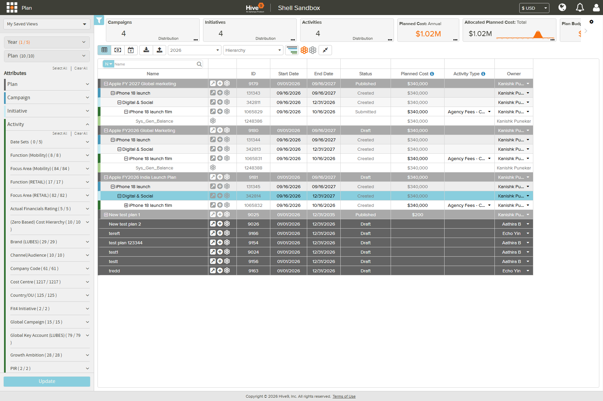

Figure 1 — The Plan grid with the three Apple plans expanded to line-item level (Live).

Each level is a folder for the level below. Only the bottom two hold real cost, and only the bottom one reaches GSAP.

### Rule 1 — budget flows down

Budget is typed at each level, and each child shows how much of its parent's budget remains. Real values from plan 9180 (Live):

| Level | Budget field | Value | Shown to the child | Arithmetic |
|---|---|---|---|---|
| Plan | Plan Budget | $4,800,000 | — | — |
| Campaign | Campaign Budget | $2,200,000 | Remaining Plan Budget $2,600,000 | 4.8M − 2.2M |
| Initiative | Initiative Budget | $900,000 | Remaining Campaign Budget $1,300,000 | 2.2M − 0.9M |

### Rule 2 — cost flows up

Planned Cost is typed on the Activity (and split into Line Items). It is read-only and greyed out on the Initiative, Campaign and Plan, which simply add up what is beneath them — all three showed $340,000, the single Activity's cost (Live).

> Key point: Budget is permission, poured down. Planned Cost is intention, summed up. Actual Cost is reality, imported from finance. The Sys_Gen_Balance and the Finance Budget link are where the three are reconciled.

## A4. The whole journey on one page

| # | Step | Where | Who | Details |
|---|---|---|---|---|
| 1 | Configure models, attributes, teams, workflows | Hive9 admin | Admin (vendor today) | F |
| 2 | Build Plan → Campaign → Initiative → Activity, set budgets and goals | Plan | Marketer | B3–B6 |
| 3 | Add Line Items, link each to a Finance Budget row, tick Create SWBS Code | Plan | Marketer | B7 |
| 4 | Submit and approve the Activity | Plan / Approvals | Marketer, approver | B9, C6 |
| 5 | SWBS request goes to GSAP; code comes back (24–48 h) | FSSI 1523 | System | D3–D4 |
| 6 | Raise the Hive9 PR form from the Line Item; approve it | Plan / Purchase Support | Marketer, MOA | C4, D3 |
| 7 | PR form e-mailed to the requisitioner; GSAP PR typed in with HX key | E-mail → GSAP | Requisitioner | D3 |
| 8 | GSAP PR approved; PO created and released | GSAP | MOA, SC analyst, CP lead | D3 |
| 9 | PR number, PO number and PO copy return to the Line Item | PGSI 941 | System | D4 |
| 10 | Vendor invoices; AP processes; invoice returns to Hive9 | GSAP → PGSI 941 | Vendor, AP | D3 |
| 11 | Marketer approves invoice; requisitioner releases Service Entry; payment runs | Hive9 → GSAP | Marketer, requisitioner, AP | D3 |
| 12 | Actuals roll up the hierarchy; Measure reports them | Plan → Measure | System | E, G |

# B. Plan module

Everything in this part was observed live unless marked otherwise. Two plans were built for the purpose (Appendix 2), so every Inspection Window below shows a real, saved record.

## B1. The Plan workspace

One screen, three interchangeable views over the same data, plus a shared filter panel and control strip.

| View | Best for | Evidence |
|---|---|---|
| Grid | Reading and editing the hierarchy as an expandable table | Live |
| Calendar | Seeing Activities on a timeline; drag bars to reschedule; colours by level (Plan black, Campaign dark blue, Initiative light blue, Activity by type colour); quick-view popup of Name, Start, End, Planned Cost, Description plus admin-chosen attributes; ICS calendar feed from a saved filter, republished nightly | Guide |
| Plan Budget & Cost | Typing budget allocations; also an Inspection Window entry point and snapshot target | Guide |

> Clarification: The Honeycomb is not a fourth view. It is a multi-select mode that can be switched on in any view (B8).

### B1.1 Control strip

| Control | What it does |
|---|---|
| View icons | Switch Grid / Plan Budget & Cost / Calendar |
| Import / Export | Import Activities from the system template; export the grid (spreadsheet) or calendar (PDF) |
| Year selector | Which fiscal year the grid shows |
| View By | How rows are grouped — Hierarchy by default, or by Plan / Campaign / Initiative / Activity attributes |
| Search + criteria | Search box with seven selectable criteria: Name, External Name, Id, Media Code, Integration Id, Description, SWBS Code. The default criterion is an admin setting. |
| Honeycomb toggle | Turn bulk multi-select on or off |
| Line-item display | Show all line items · Show line items with details · Hide Sys_Gen_Balance |
| Collapse / expand | Fold or unfold the whole tree |
| Column Management | Choose columns from five groups (Standard, Campaign, Initiative, Activity, Line Item attributes); drag to reorder; saved between sessions and in saved views |

### B1.2 Heads-up display and grid

The HUD carries eight cards: Campaigns, Initiatives and Activities (each a count with a Distribution link), Planned Cost: Annual, Allocated Planned Cost: Total, Plan Budget: Annual, Plan Budget: Total, and Actual @ Monthly FX Cost: Total. The cards are per-user configurable and hidden when a snapshot is open.

| Grid column | Example | Notes |
|---|---|---|
| Name | Apple FY2026 Global Marketing | Expandable tree |
| (row icons) | open · add · honeycomb | Open the Inspection Window, open the create menu, select for bulk |
| ID | 9180 | The system ID — the planIds value Measure posts |
| Start Date / End Date | 01/01/2026 – 09/16/2027 | Plan dates derive from its children |
| Status | Draft | Per-object vocabulary (B9) |
| Planned Cost | $340,000 | Rolled up |
| Activity Type | Agency Fees - Creative | Activity rows only |
| Owner | Kanishk Punekar | Inline dropdown |

Cells in dark grey font can be edited directly in the grid; light grey cannot. Multi-select attributes and some dependencies cannot be edited in the grid (Guide).

The left filter panel is the same component the Measure standard reports use, and its state is shared with them. It is documented in full in section E3.0.

## B2. Creating records

Records are created top-down — an Activity needs an existing Initiative. Every create starts from the circular plus icon on a grid row, the Add button inside an Inspection Window, or (for children) the Calendar.

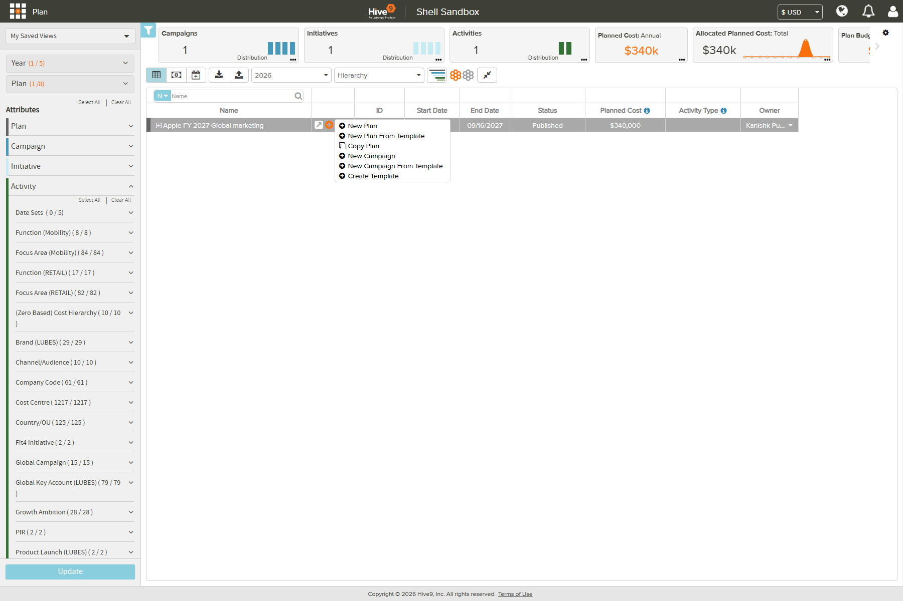

Figure 2 — The create menu opened from a Plan row (Live).

| Row the + is clicked on | Options offered |
|---|---|
| Plan (Live) | New Plan · New Plan From Template · Copy Plan · New Campaign · New Campaign From Template · Create Template |
| Campaign, Initiative, Activity (Guide) | The same pattern one level down: new sibling, new child, from template, copy, create template. An Activity row also offers New Line Item. |

### B2.1 The Inspection Window

| Element | Behaviour |
|---|---|
| Header | ID, Status, Created date |
| Toolbar | Reset · Save (turns orange when there are unsaved changes) · Submit / Re-Submit / Publish · Add child · Copy · Delete · More. The toolbar differs between a new and a saved record. |
| Left jump bar | Icons that jump to Attributes, Goals, Integrations, Performance, Line Items, Approvals, Related records |
| Sections | Collapsible; the guide says users can reorder them, so field order is per-user |
| Setup / Review | The guide describes a Review area with Comments, Submit, Share (send a link) and Sync (manual push to an integrated system) |
| Required fields | Red asterisk. The guide says they are required to submit, not to create; in practice the Plan form refused to save without them, one field per attempt. |

## B3. Plan

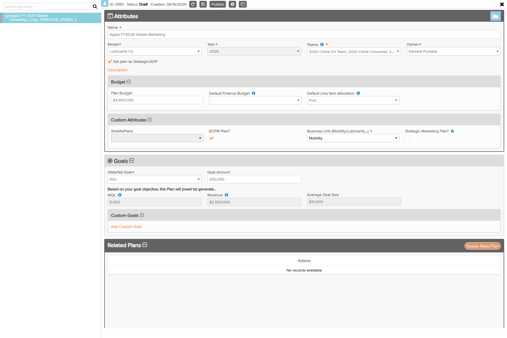

Figure 3 — Plan 9180 after saving (Live).

| Field | Req. | Control | Source / behaviour | Value on plan 9180 |
|---|---|---|---|---|
| Name | Yes | Text | Unique across the whole system | Apple FY2026 Global Marketing |
| Model | Yes | Searchable list (15) | Admin-defined; drives types, stages, integrations | Lubricants 1.0 |
| Year | Yes | List 2026–2036 | Read-only once saved | 2026 |
| Teams | Yes | Checkbox list (85) | Grants access | 2020 China CH Team + 3 |
| Owner | Yes | Searchable list | Only members of the selected Teams are offered | Kanishk Punekar |
| Set plan as Strategic/AOP | No | Checkbox | Appears only if AOP is enabled | Ticked |
| Description | No | Rich text | Typed | — |
| Plan Budget | No | Currency | Typed | $4,800,000 |
| Default Finance Budget | No | List (4) | Finance budgets for the year | (not set) |
| Default Line Item Allocation | No | List | Custom / Even / First / Last — inherited by line items | First |
| ShellAllPlans | No | Multi-select | Disabled for this account | (empty) |
| BCPIR Plan? | No | Checkbox | Typed | Ticked |
| Business Unit (Mobility/Lubricants…) | Yes | Multi-select | Dependent attribute — see B10 | Mobility |
| Strategic Marketing Plan? | No | Checkbox | Appears when Business Unit = Mobility | Unticked |
| Waterfall Goal | Yes | List | INQ / MQL / revenue — the stage the goal is set at | INQ |
| Goal Amount | No | Number | Typed | 250,000 |
| MQL | — | Read-only | Calculated by the Model | 5,000 |
| Revenue | — | Read-only | Calculated by the Model | $2,500,000 |
| Average Deal Size | — | Read-only | From the Model | $10,000 |
| Custom Goals | No | Add Custom Goal | Admin-defined list | (none) |
| Related Plans | No | Relate New Plan | Appears if Relate Plans is enabled | (none) |

> What the Model does: The Goals block shows what a Model is for. Typing 250,000 at INQ produced MQL 5,000 (2%) and Revenue $2,500,000 (250 closed deals at $10,000) — rates held centrally in the Model, not on the plan.

## B4. Campaign

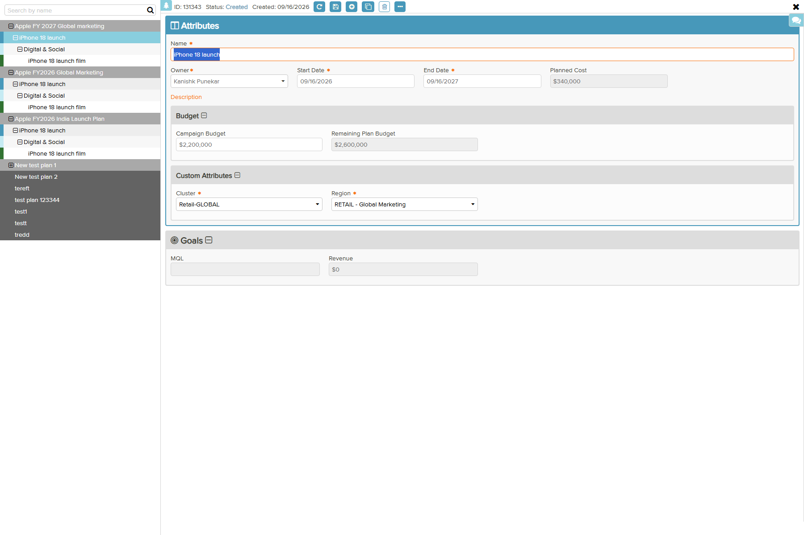

Figure 4 — Campaign Inspection Window. Planned Cost is greyed out (Live).

| Field | Req. | Behaviour | Value |
|---|---|---|---|
| Name | Yes | Unique under its plan | iPhone 18 launch |
| Owner | Yes | List | Kanishk Punekar |
| Start Date / End Date | Yes | Editable in this tenant (manual dates). If the admin option 'shrink date range to fit child activities' is on, they follow the children instead (Guide). | 09/16/2026 – 09/16/2027 |
| Planned Cost | — | Read-only roll-up | $340,000 |
| Description | No | Rich text | — |
| Campaign Budget | No | Currency | $2,200,000 |
| Remaining Plan Budget | — | Calculated | $2,600,000 |
| Cluster | Yes | Custom attribute | Retail-GLOBAL |
| Region | Yes | Custom attribute | RETAIL - Global Marketing |
| MQL / Revenue | — | Read-only roll-up | — / $0 |

The tenant also defines a Campaign-level attribute group, Statuses & Approvals, with its own approval workflow (captured from the approvals API; CustomFieldGroupId 213).

## B5. Initiative

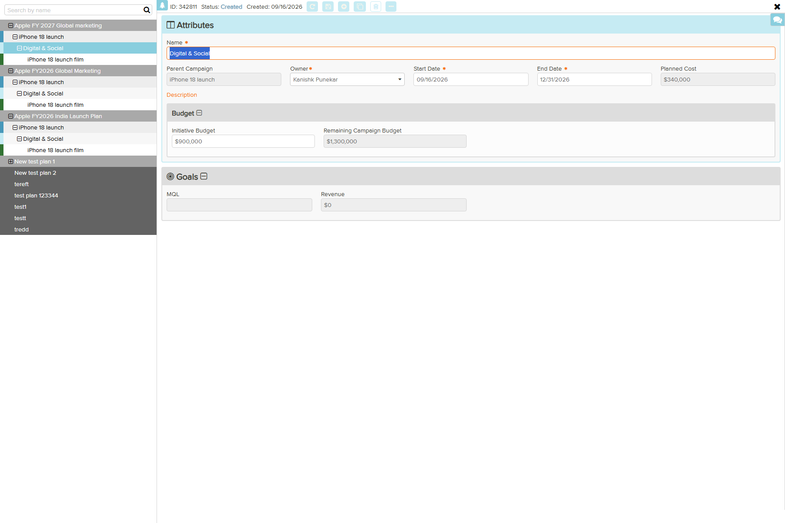

Figure 5 — Initiative Inspection Window (Live).

| Field | Req. | Behaviour | Value |
|---|---|---|---|
| Name | Yes | Unique under its campaign | Digital & Social |
| Parent Campaign | — | Read-only | iPhone 18 launch |
| Owner | Yes | List | Kanishk Punekar |
| Start Date / End Date | Yes | Must sit inside the campaign's dates (Guide) | 09/16/2026 – 12/31/2026 |
| Planned Cost | — | Read-only roll-up | $340,000 |
| Initiative Budget | No | Currency | $900,000 |
| Remaining Campaign Budget | — | Calculated | $1,300,000 |
| MQL / Revenue | — | Read-only roll-up | — / $0 |

> Guide contradiction: The guide says an Initiative budget cannot exceed its campaign budget, and elsewhere that a child budget may exceed its parent. Over-allocation was not tested live. Confirm the intended rule with Shell.

> Observed: The tenant defines Initiative-level attributes (Growth Ambition, Function, Focus Area, FIT4 Initiative? and the SMP Initiative - Footer group), but none rendered on this Initiative. Several attribute sets are hidden on this Mobility plan in the same way — see B10.

## B6. Activity — the most important object

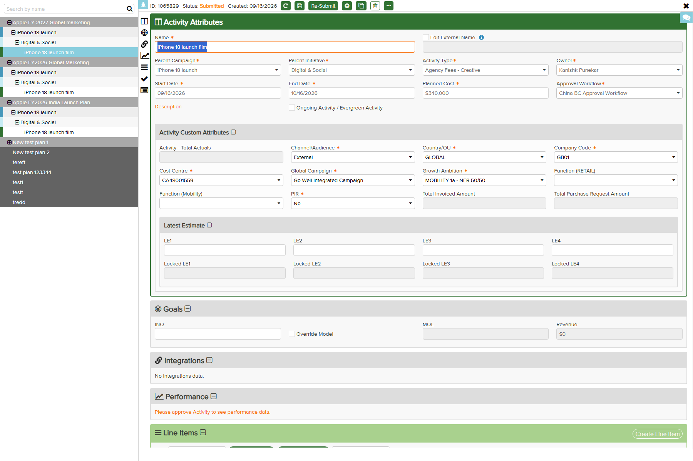

Figure 6 — The Activity Inspection Window (Live).

### B6.1 Attributes

| Field | Req. | Behaviour | Value |
|---|---|---|---|
| Name | Yes | Unique under its initiative | iPhone 18 launch film |
| Edit External Name | No | Checkbox + text; changing it may update the integrated system on sync | Unticked |
| Parent Campaign / Parent Initiative | Yes | Chosen from the plan | iPhone 18 launch / Digital & Social |
| Activity Type | Yes | Limited by the Model. Changing it resets Planned Cost to the Model default (Guide) | Agency Fees - Creative |
| Owner | Yes | List | Kanishk Punekar |
| Start Date / End Date | Yes | Start before end; end within 10 years of the plan year; may cross fiscal years | 09/16/2026 – 10/16/2026 |
| Planned Cost | Yes | Model supplies a default | $340,000 |
| Approval Workflow | Yes | Which workflow approves this Activity | China BC Approval Workflow |
| Description | No | Rich text | — |
| Ongoing / Evergreen Activity | No | Irreversible once saved | Unticked |
| Point of View | — | Appears only on multi-year Activities linked in 2+ years (Guide) | — |
| Build / Completion date, Start / End time | No | Optional extra dates if enabled (Guide) | — |

### B6.2 Custom attributes on this Activity

| Attribute | Req. | Options in tenant | Value |
|---|---|---|---|
| Channel/Audience | Yes | 10 | External |
| Country/OU | Yes | 125 | GLOBAL |
| Company Code | Yes | 61 | GB01 |
| Cost Centre | Yes | 1,217 | CA48001559 |
| Global Campaign | Yes | 15 | Go Well Integrated Campaign |
| Growth Ambition | Yes | 28 | MOBILITY 1a - NFR 50/50 |
| PIR | Yes | 2 | No |
| Function (RETAIL) / Function (Mobility) | No | 17 / 8 | (empty) |
| Activity - Total Actuals | — | Read-only | (empty) |
| Total Invoiced Amount / Total Purchase Request Amount | — | Read-only roll-ups from the line items | (empty) |

Company Code and Cost Centre are the SAP keys that matter for GSAP (Part D). The tenant defines about twenty Activity-level attributes in total; only those above rendered here (see B10).

### B6.3 The other Activity sections

| Section | Contents |
|---|---|
| Latest Estimate | LE1–LE4 (typed) and Locked LE1–LE4 (read-only) |
| Goals | INQ (typed) · Override Model · MQL and Revenue (calculated). Goal horizon may extend past the in-market dates (Guide). |
| Integrations | Links to external systems. “No integrations data.” on this record. |
| Performance | “Please approve Activity to see performance data.” — performance is shown only for approved Activities. Transactions can be exported to Excel (Guide). |
| Line Items | Year selector · Add Past Year · Add Future Year · Monthly / Quarterly · the allocation grid (B7) · Create Line Item |
| Approval Tracking | Level · Approver · Action Date · Status · Comments (e.g. level A, approver Yi-Mun Poon, on the source Activity) |
| Related Primary Activities | Link Activities that affect each other's ROI (e.g. content reused from last year); dates must overlap |
| Media Code | Shown only when the Activity Type requires it; codes carry their own attributes (Guide) |

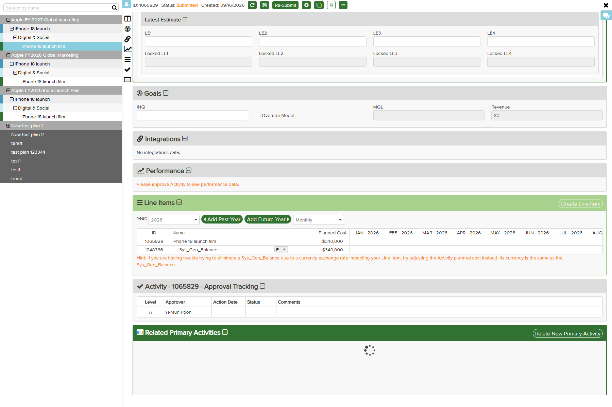

Figure 7 — Line Items, Approval Tracking and Related Primary Activities sections (Live).

### B6.4 Multi-year and evergreen Activities (Guide)

- Dates in different fiscal years, or the evergreen box ticked, make an Activity multi-year.
- It must be linked to a parent Initiative in every fiscal year it spans (row action Link to → year, plan, parent). Until then the grid shows a warning icon. The target plan must use a compatible Model.
- Attributes stay the same in every year; to change them, create a new Activity.
- Evergreen Activities cannot use attribute dependencies consistently, and the Last and Even allocation mechanisms do not apply to them.

## B7. Line Item — the only door to GSAP

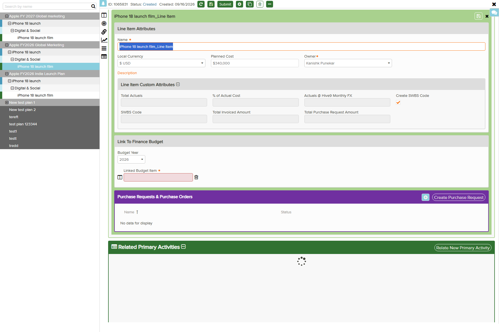

Figure 8 — The Create Line Item form on Activity 1065831 (Live, not saved).

| Field | Req. | Behaviour | Value |
|---|---|---|---|
| Name | Yes | Defaults to <Activity name>_Line Item | iPhone 18 launch film_Line Item |
| Local Currency | No | List | $ USD |
| Planned Cost | No | Pre-filled with the Activity's remaining cost | $340,000 |
| Owner | Yes | List (the guide calls it optional; this tenant requires it) | Kanishk Punekar |
| Description | No | Rich text | — |
| Create SWBS Code | No | Ticked by default. Asks GSAP for an SWBS code (Part D) | Ticked |
| SWBS Code | — | Read-only; filled by GSAP | (empty) |
| Total Actuals | — | Read-only; payments released | (empty) |
| % of Actual Cost | — | Read-only; calculated | (empty) |
| Actuals @ Hive9 Monthly FX | — | Read-only; actuals at the monthly rate | (empty) |
| Total Invoiced Amount | — | Read-only; from GSAP invoices | (empty) |
| Total Purchase Request Amount | — | Read-only; sum of PRs raised | (empty) |
| Budget Year | No | List | 2026 |
| Linked Budget Item | Yes | Finance Budget row picker — required in this tenant | (not set) |
| Purchase Requests & Purchase Orders | — | Grid of PRs with Create Purchase Request | No data |

> Hidden finance attributes: Contracted Spend (5 options), GL Code (13), Spend Category (19) and Spend Type (57) are defined in this tenant at Line Item level — the filter panel lists them — and the workshop demo showed them on the line item as the inputs to the SWBS request. They did not render on this Mobility plan's line item. The most likely cause is an attribute dependency on Business Unit (Inferred; User Category is not enabled). The 13 GL codes match the workshop's statement exactly: 6140900, 7250050, 7250060, 7250070, 7250080, 7250100, 7250150, 7250190, 7250200, 7250250, 7250300, 7250310 and 7250350.

### B7.1 Allocation

| Code | Mechanism | Behaviour |
|---|---|---|
| C | Custom | Allocate by hand. An admin option decides whether an unallocated remainder is allowed. |
| E | Even | Split equally across the Activity's months or quarters (all years if multi-year) |
| F | First | All in the first month or quarter |
| L | Last | All in the last month or quarter |

- Monthly or quarterly segments; Add Past Year and Add Future Year extend the grid. Adding a year may turn the Activity into a multi-year Activity, irreversibly (Guide).
- Line items may fall outside the Activity's dates — a deposit paid before the event, for example.
- The default mechanism comes from the Plan's Default Line Item Allocation.

### B7.2 Sys_Gen_Balance and the Finance Budget link

The copied Activity has one line-item row, Sys_Gen_Balance, for its full $340,000: none of the cost has been broken into named line items yet. The target is zero. If a line item is not linked to a budget row, its amount appears in the Sys_Gen / Unlinked rows of the Finance Budget, and the Plan Budget and Finance Budget views disagree. This tenant prevents that by requiring Linked Budget Item. Where a budget row has a hard stop limit, allocation is done in a popup (Guide).

Hive9's own hint on the grid: “If you are having trouble eliminating a Sys_Gen_Balance due to a currency exchange rate impacting your Line Item, try adjusting the Activity planned cost instead.”

## B8. Bulk actions, cloning and record life cycle

| Feature | What it does | Evidence |
|---|---|---|
| Honeycomb | Select many rows, then: Export All · Export Selected Columns · Copy · Copy/Move To · Create Purchase Req. · Create Template · Change Owner · Change Status · Link To · Bulk Edit · Package · Unpackage. The live menu has no Delete, although the guide lists one. | Live menu; Guide |
| Copy Plan | Dialog asks only for the number of copies and whether to include children. The copy is named <source>_Copy_<MMDDYYYY>_<HHMMSS>_<n>; the plan becomes Draft and children become Created. | Live |
| Templates | Save a Plan, Campaign, Initiative or Activity — with its children and attribute values — as a template in My Templates or Shared Templates (sharing needs permission); create new records from it. Created from the Grid view only. | Live menu; Guide |
| Snapshots | Point-in-time copy of a plan from the Grid, Budget & Cost grid or Calendar; gallery with rename, open, delete. Finance Budgets have separate snapshots. Both are permission-gated. | Guide |
| Import | Activities from the system template; owner column required when User Categories are on; end dates beyond 10 years are rejected. | Guide |
| Recycle Bin | The only undo for deleted records. Restores go to the same year, come back as Created and must be re-submitted; children of deleted parents must be restored parent-first. | Guide |
| Plan Log | Audit trail of plan-object changes (Date, User, Object Type, ID, Name, Year, Action…). Not in this account's menu. | Guide |

## B9. Statuses and approval behaviour

| Object | Statuses | Evidence |
|---|---|---|
| Plan | Draft · Published (Publish button on a Draft plan) | Live |
| Campaign | Created observed; full list not captured | Live |
| Initiative | Created · Submitted · GroupSubmitted · GroupApproved · In-Progress · Complete | Live |
| Activity | Created · Submitted · Declined · Approved · In-Progress · Complete. The client configuration also declares two custom statuses, Accepted and Committed, which did not appear in the Status filter. | Live |
| Purchase Request | Created · Submitted · In-Review · Declined · Approved · Closed | Live |
| Accrual Request / AR line | Created · Submitted · Approved & Sent · In-Progress · Closed · Declined / Created · Submitted · Approved & Sent · Processed · Declined | Live |

- Submitting a Campaign: the guide says all Initiatives and Activities under it will be approved if none has been submitted before. It does not say they are all submitted individually.
- An approved Activity is the gate for three things: the SWBS request to GSAP (Workshop), performance data (Live), and External Name generation (Guide). A PR can be created on an Activity in any status but submitted only when the Activity is approved (Guide).
- Approval workflows attach to Activities, PRs, modified PRs and accrual requests, and to custom attribute groups such as Statuses & Approvals (Campaign) and SMP Initiative - Footer (Initiative). See C6.

## B10. Rules and behaviours observed while building the plans

| # | Behaviour | Why it matters for the rebuild |
|---|---|---|
| 1 | The New Plan form must be filled in this order: Model → Year → Teams → Owner → Business Unit → Waterfall Goal → Goal Amount. Each later list depends on an earlier choice. | Field dependencies are sequential |
| 2 | Owner offers only members of the selected Teams. | Team membership constrains ownership |
| 3 | Year is read-only once a plan is saved. | Fiscal year is immutable |
| 4 | Validation reports one missing required field per save attempt. | Poor UX; validate everything at once |
| 5 | Business Unit is required, but for this account it renders with no options and no event handlers. Its likely parent, ShellAllPlans, is disabled. The account's role (Business Champion) may create plans and User Category is not enabled, so this is neither a permission nor a user-category issue. A plan therefore cannot be created from scratch with this account; Copy Plan was used instead, inheriting Business Unit = Mobility. | A dependency chain can make a required field unfillable |
| 6 | On this Mobility plan, the Lubricants-flavoured attributes do not render at Initiative, Activity or Line Item level — including the line-item finance attributes GSAP needs. | Dependencies hide whole field sets |
| 7 | A line item cannot be saved without Linked Budget Item. | Tenant enforces the Finance Budget link |
| 8 | Copying resets status: plan → Draft, children → Created. | Copies re-enter approval |

## B11. Entity relationships

| Relationship | Cardinality | Notes |
|---|---|---|
| Plan → Campaign → Initiative → Activity | 1 : many at each step | Plan fixed to one fiscal year |
| Initiative → Activity (multi-year) | many : many across years | One parent Initiative per fiscal year |
| Activity → Line Item | 1 : many | Line items may fall outside the Activity's dates |
| Line Item → Finance Budget row | many : 1 | Required in this tenant |
| Line Item → SWBS code | 1 : 1 | Created by GSAP |
| Line Item → Hive9 PR → PR lines | 1 : many | PR lines cannot exceed the line item's remaining amount |
| Hive9 PR → GSAP PR → PO | 1 : 1 : 1 | Linked only by the HX tracking number |
| PO → invoices / service entries | 1 : many | Returned by PGSI 941 |
| Activity → Media Code | 1 : many | Never on line items |
| Plan → Model | many : 1 | Model governs stages, types, integrations |
| Plan ↔ Team | many : many | Owner must belong to one of the teams |
| Plan ↔ Plan, Activity ↔ Activity | many : many | Related plans / related activities |

# C. Finance, purchasing, accruals and approvals

These modules all hang off the Line Item. Their grids were captured live; their behaviour comes from the guide unless stated.

## C1. Plan Budget versus Finance Budget

|  | Plan Budget | Finance Budget |
|---|---|---|
| Whose view | Marketing's | Finance's — levels, cost centres, accounts |
| Where | Budget fields on Plan, Campaign, Initiative | Finance → Finance Budget |
| Bridge | Line Item → Linked Budget Item | Same link, seen from the budget row |
| Can be switched off | Yes (Organizational Setup) | No |

## C2. Finance Budget

- Four 2026 budgets exist in the sandbox: 2026 Shell Lubricants Budget, 2026 Shell Lubricants Budget Test, 2026 Shell Mobility Budget, 2026 Shell Mobility Finance budget for test (Live).
- Budget settings, from the API: Year, Owner, Team, Default user permission, Cascade parent permission, Budget Lock, Forecast Lock, Is Hard Limit, Default Time Frame, Level, Accrual Method, Accrual Cut-Off Day, Accrual Threshold Amount (Live).
- Exactly one team per budget at a time; permission levels None, View, View/Edit (Guide).
- Budget levels are named in Organizational Setup and become the tabs of Measure's Finance Budget dashboard.
- Bulk tools: Budget Distribution (evenly by month or quarter, percentage by month or quarter, apply to selected rows) and Copy Planned Cost to Budget (chosen months or all). Copy Item duplicates a row with its sub-tree.
- Snapshots and a Snapshot Gallery separate from plan snapshots; they include the Unlinked and Sys_Gen rows.

## C3. Transactions — where Actual Cost comes from

Grid columns (Live): Transaction ID · Line Items · Transaction Date · Transaction Amount · Attributed · Remaining · Linked Elsewhere · SWBS Code · Cost Center · Document Type · Cost Element · Ref Document Number · Name · Purchasing Document · Document Number · Period and Fiscal Year · Document Header Text · Object Currency · Value in Obj. Crcy · Vendor Code - Vendor Name · Document Date · Value in Posted Currency · Posted Currency.

Attributed, Remaining and Linked Elsewhere show how a transaction is split across line items. SWBS Code, Cost Center and Cost Element are the SAP keys. Transactions can be imported, linked, unlinked and bulk-linked.

## C4. Purchase Support — the Hive9 side of the PR

A PR is raised from the line item (Create Purchase Request, Live) or in bulk from the Honeycomb.

| Rule | Evidence |
|---|---|
| Purchase Support must be enabled for the tenant (it is here) | Live |
| A PR can be created on an Activity in any status but submitted only once the Activity is approved | Guide |
| PR lines cannot exceed the line item's amount less other PR lines; one line is created for the balance | Guide |
| Budget is reserved as soon as the PR is created — before approval. Only cancelling or deleting it releases the money. | Workshop |
| Approved PRs cannot be deleted, only closed out (reduced to the invoiced amount) | Guide |
| Whether lines can be added to an approved PR is a setting; this tenant's value is 1 (mapping to the three options not confirmed) | Live config |

PR sections (Guide): header (vendor and PR attributes) · PR lines (amount and delivery date) · transactions (receipts, invoices, credits) · approval tracker.

Purchase Request Grid columns (Live): Name (Vendor › PR › PR line › line item) · Actions · ID · Level · Status · PR Cost · Owner/Created By · Created Date · Delivery Date · Sent Date · PO Number · POLine Number · POLine Status · Invoice Amount · GRSP Amount · Approval Workflow.

What the requisitioner receives from the PR form (Workshop): the Hive9 ID (HX key), short description, cost centre, WBS code, GL code, amount and MOA approver, as an Excel attachment to an e-mail titled “You have new purchase requests”. See D3.

## C5. Accruals

| Aspect | Detail |
|---|---|
| Purpose | Recognise money committed but not yet invoiced in the period |
| Raised against | Finance Budget or Plan Budget line items |
| Structure | Accrual Request header with one or more lines; each line approved or declined individually; the header is approved only when all lines are |
| Duration | Previous month · previous quarter · year to date |
| Re-submission | Changing an approved line re-submits the line and its header |
| Deletion | Irreversible; frees the line items to be accrued again |
| Grid columns (Live) | Name · Actions · Accrual Type · ID · Level · Status · Owner · AR Date · AR line Amount · Line Item Id · Budget Id · Planned Amount (in period) · Actual Amount (in period) · Planned − Actual Amount (in period) · Approval Workflow · Accrual Month |

## C6. Approvals

| Concept | Detail |
|---|---|
| Regimes | Basic (team-based sign-off) and Advanced workflows (multi-level, configurable) |
| Approver types | User · Role · Record Owner · Custom Attribute (resolved from a field on the record) · delegates |
| Objects | Activity · Purchase Request · Modified PR · Accrual Request · custom attribute groups · custom objects |
| Queues | My Approvals, with a View By selector including AR Line Approvals; /Finance/Approval sign-off grid (Item Type · Actions · Item ID · Item Name · Status · Approval Status · Comments · Start Date · End Date · Planned Cost) |
| Set-up caution (Guide) | Do not switch workflows on for an object until all workflows are built; nothing may be left in Submitted at cut-over; once on, it is on for the whole organisation |
| Double MOA (Workshop) | The Hive9 PR form is approved in Hive9 (self-approval allowed), then the GSAP PR is approved again in GSAP. The GSAP approval is the authoritative one; the Hive9-chosen MOA is sometimes not authorised in GSAP. |

# D. GSAP integration — how a PR really moves

Source: the GSAP–Hive9 Integrations workshop, 10 September 2026, with Alexandra Gatchalian (requisitioner), Sanjay Bhagat (Hive9), Ashish Kumar, Venkatakrishnan Raghavendran and Kapil Bahl (Shell), cross-checked against the fields seen live. No one from the GSAP technical team attended, and the sandbox cannot show the round trip because the GSAP test system (C94) is unavailable.

## D1. Why this matters now

- Nucleus moves Shell's SAP estate to S/4HANA. Cut-over is January 2027; GSAP integrations are frozen until about March 2027.
- A replacement for Hive9 must keep the same data flowing to and from GSAP. It may not connect to GSAP during the freeze.
- Options raised in the workshop: connect the new application through the same interfaces Hive9 uses today; or, for the freeze period, exchange data by file (for example GSAP extracts loaded into the new application). Post-Nucleus interface changes need a separate design once S/4HANA is live.

> Workshop consensus: GSAP cannot be replaced or mimicked. Only the Hive9 side can change, so the target is to reproduce Hive9's side of the same contracts.

## D2. Who is involved

| Actor | System | Role in the flow |
|---|---|---|
| Marketer | Hive9 | Creates the line item, raises and approves the PR form, shares the PO, approves the invoice |
| MOA approver | Hive9 and GSAP | Approves the PR form in Hive9 and the GSAP PR in GSAP |
| Requisitioner | E-mail, GSAP | Builds the GSAP PR from the PR form; releases the Service Entry. In Hive9 this is the TA role (6 users): it can view the plan and the Purchase Request Grid but create or edit nothing (Live, F4). |
| SC analyst / CP buyer | GSAP | Builds the PO when there is no outline agreement |
| CP lead / PO approver | GSAP | Releases POs of $50,000 or more |
| Vendor | — | Receives the PO number, submits the invoice to the scanning mailbox |
| Accounts Payable | GSAP | Processes invoices; receives rejected invoices; runs payment |
| Batch jobs and CPI middleware | Hive9, SFTP, GSAP | Move the daily files |
| Hive9 administrator (vendor) | Hive9 | Maintains system-level lists such as GL codes; Shell raises requests |

## D3. The four stages, step by step

This expands Shell's “End-to-end process” slide. The timing and ownership come from the workshop.

### Stage 1 — Intake and approval (Hive9)

| # | Step | Owner | What happens |
|---|---|---|---|
| 1.1 | Create line item | Marketer | On an approved Activity; amount, currency, finance attributes, Finance Budget link; Create SWBS Code ticked |
| 1.2 | Generate SWBS | System | Hive9 sends the request in the daily file (FSSI 1523); GSAP creates the code and returns it. 24–48 hours, usually 24. |
| 1.3 | Submit Hive9 PR | Marketer | The PR form, raised from the line item once the SWBS code is present |
| 1.4 | Approve PR | MOA, or the marketer (self-approval) | Approval in Hive9 |
| 1.5 | Route request | Hive9 | E-mails the requisitioner's functional or personal mailbox with the form as an Excel file |

Outcome: an approved request. Budget is reserved; nothing is committed to the vendor yet.

### Stage 2 — Requisition to PO (all in GSAP)

| # | Step | Owner | What happens |
|---|---|---|---|
| 2.1 | Build GSAP PR | Requisitioner | Re-types the form into GSAP; pastes the details into the header notes for the PO buyer, who has no Hive9 access; sets the purchasing group; enters HX + line-item ID as the tracking number |
| 2.2 | Approve GSAP PR | MOA | Releases the PR in GSAP; without it the flow stops at PR |
| 2.3 | Convert to PO | System or SC analyst | With an outline agreement: automatic, 1–2 hours after release. Without: the CP buyer builds it, checking contracts and risk (high / medium / low). |
| 2.4 | Release PO | GSAP or CP lead | Below $50,000 automatic; $50,000 or more needs the PO approver. The threshold is $50,000 for global marketing and $100,000 in other ERPs, and is set in GSAP, not Hive9. |

Outcome: a released PO; Shell is contractually committed. SLA: two days per step. Hive9 shows the GSAP PR number when the PR is created and the PO number and PO copy about 24 hours after the PO.

### Stage 3 — PO to invoice

| # | Step | Owner | What happens |
|---|---|---|---|
| 3.1 | Sync PO | System | End-of-day GSAP file (PGSI 941) adds PO number, date, amount and a PO-copy link to the line item, matched on the HX key |
| 3.2 | Share PO | Marketer | Sends the PO number to the vendor |
| 3.3 | Submit invoice | Vendor | To the scanning team / mailbox |
| 3.4 | Process invoice | Accounts Payable | In GSAP |
| 3.5 | Sync invoice | System | Invoice amount, details and link return to the line item by PGSI 941 |

### Stage 4 — Approve to pay

| # | Step | Owner | What happens |
|---|---|---|---|
| 4.1 | Approve invoice | Marketer | In Hive9 — they know whether the work was delivered. Rejected invoices go to AP; the vendor may reissue, which cancels the invoice in GSAP and clears it from Hive9. |
| 4.2 | Release invoice | Requisitioner | Creates / releases the Service Entry in GSAP, clearing the block |
| 4.3 | Process payment | AP / payments | Payment run; the vendor is paid |

Outcome: paid. The payment reaches Total Actuals on the line item and rolls up the hierarchy into Measure. SLA: ten working days for the invoice, longer if the PO or budget is insufficient.

> Sequence: The goods or service receipt (Service Entry) comes after the marketer approves the invoice — not between the PO and the invoice as in a textbook PR → PO → GR → invoice chain.

> Where it is fragile: Only Stages 1, 3 and 4 are automated. Stage 2 is an e-mail and a person re-typing a form. The single thread holding GSAP's data to the right Hive9 line item is the HX number the requisitioner types by hand.

## D4. The interfaces

|  | FSSI 1523 — Hive9 → GSAP | PGSI 941 — GSAP → Hive9 |
|---|---|---|
| Carries | SWBS requests for line items | PR numbers, POs, invoices and related amounts and links |
| Trigger | Approved Activity with a line item flagged Create SWBS Code | PO or invoice created in GSAP |
| Mechanism | Hive9 batch job writes one CSV of the day's requests to Hive9 SFTP; CPI moves it to GSAP SFTP; a GSAP job processes it and writes a response file back the same way; a Hive9 job consumes it | GSAP end-of-day batch writes a CSV to GSAP SFTP; middleware moves it to Hive9 SFTP; a Hive9 job consumes it |
| Frequency | Daily | Daily |
| Round trip | 24–48 hours (usually 24) | About 24 hours after the GSAP event |
| Match key | Line-item ID | HX + line-item ID |
| Returns | The SWBS code only | — |

> Mechanism: There is no REST API in either direction — both are file-based. The authoritative file layouts are in Shell's integration technical document with sample CSVs, which we have not yet received.

## D5. Keys that hold the chain together

| Key | Created by | Carried to | Purpose |
|---|---|---|---|
| Line-item ID | Hive9 | FSSI 1523 file | Matches the SWBS response to the line item |
| SWBS code | GSAP | Line item; PR form; GSAP PR | Accounting tag every PO needs; tied to one company code |
| HX + line-item ID | Hive9 (typed into GSAP by hand) | GSAP PR tracking number; PGSI 941 file | Brings PR, PO and invoice data back to the right line item |
| GSAP PR / PO number | GSAP | Line item (PR block, PR grid) | Visibility for the marketer |
| Company Code | Activity attribute | SWBS / PO | GSAP blocks cross-company charging |

## D6. What data moves

| Direction | Fields | Evidence |
|---|---|---|
| Out — SWBS request | Line-item ID, name, amount, currency, contracted amount, contract type (Contracted Spend), spend category, spend type, GL code; the Finance Budget link | Workshop (Sanjay's demo) |
| Out — SWBS request | Company Code / Cost Centre from the Activity | Inferred |
| Back — SWBS response | Line-item ID and SWBS code | Workshop |
| By e-mail — PR form | Hive9 ID (HX), short text, cost centre, WBS code, GL code, amount, MOA approver, supporting documents | Workshop (form shown) |
| Back — PGSI 941 | GSAP PR number, PO number, PO date, PO amount, PO-copy link, invoice amount and details, invoice link, service entry date | Workshop |
| Where it lands | Line item: SWBS Code, Total Purchase Request Amount, Total Invoiced Amount, Total Actuals, % of Actual Cost, Actuals @ Monthly FX; the PR block; PR grid PO Number, POLine Number, POLine Status, Invoice Amount, GRSP Amount | Live fields |

## D7. Business rules

- Only GSAP can create an SWBS code. Finance can create one manually; manual and automatic codes are sequential per company code and never duplicate.
- An SWBS code used against another country's company code is rejected — no cross-company charging.
- Budget is reserved when the PR is created, before approval; cancelling or deleting the PR releases it.
- The MOA is threshold-based and tied to legal entities.
- PO release: automatic below $50,000; the CP lead / PO approver at $50,000 or more (global marketing; $100,000 in other ERPs). Set in GSAP; Hive9 needs no function to change it.
- Outline agreement present → PO created automatically; absent → manual PO by the CP buyer.
- GSAP is the only procurement platform — there is no other PO integration.
- SLAs: two days per PR and PO step; ten working days for invoice processing without issues.
- Marketers often do not know which WBS code to use; without Hive9 they would need finance to tell them.

## D8. What breaks without the GSAP connection

| Step | Without GSAP | Implication for the freeze period |
|---|---|---|
| SWBS code (1.2) | No code; the PR form cannot carry one; no GSAP PR or PO is possible | Needs a way to load SWBS codes created by finance into the new application |
| PR form routing (1.5) | Unaffected — it is e-mail | Can be reproduced as is |
| GSAP PR, PO (2.x) | Unaffected — manual in GSAP | Requisitioners keep entering the HX key |
| PO and invoice sync (3.1, 3.5) | Marketers lose PR number, PO, PO copy and invoice visibility | Needs periodic GSAP extracts matched on the HX key |
| Invoice approval (4.1) | Marketers cannot see invoices to approve | Same extract, or a manual approval route |
| Actuals and Measure | Total Actuals and Actual Cost stay at zero | Transactions import from GSAP extracts |

## D9. Open integration questions

- Exact FSSI 1523 and PGSI 941 file layouts, field mapping, file naming and batch windows (technical document and sample files promised by Shell).
- Error handling: what happens to a rejected SWBS request or an HX key GSAP cannot match, and how records are reprocessed.
- Whether the line-item finance attributes differ by Business Unit (they did not render on our Mobility plan).
- Whether the $50,000 threshold varies by country or class of business (Alexandra to confirm).
- The SLA for the final payment step.
- Whether Nucleus / S/4HANA changes either interface.
- Whether GSAP test access or a recorded end-to-end walkthrough can be provided.
- What the tenant's SWBS Not Received, Pending PR and PR Track Invoices dashboards show — they look like the operational monitoring of this integration but are not visible to our role (F4).

# E. Measure module

Measure is the read-only reporting layer. This part is the complete screen-by-screen reference: every dashboard, control, field, enumeration and API, with the data model and permissions behind them. It was built from live captures of all sixteen Measure pages and their network traffic.

> How Measure relates to the rest: Every Measure number traces back to something in Part B, C or D. Part G maps those dependencies; section E5.6 lists what empties each screen.

## E1. Executive Summary

### E1.1 What the Measure module is

Measure is the analytics and performance-reporting layer of Hive9. Where the Plan module is the system of record for marketing plans, campaigns, initiatives, activities and line items, and the Finance module is the system of record for budgets, transactions, purchase requests and accruals, Measure is a read-mostly presentation layer that reads from both and joins them to externally-integrated performance data.

Hive9 runs on two distinct database architectures, and this split is the single most important architectural fact about the module:

- A traditional relational structure for plans and budgets — internally called the "Plan" database. This is where everything a user types into the Plan and Finance modules lives.
- A star schema for performance reporting — internally called the "Measure" database. This is a dimensional warehouse that collects facts from many different external systems and relates each of them back to a Tactic in the plan, which in turn connects the performance fact to all of the cost and segmentation attributes needed for full analysis.

Consequently almost nothing in Measure is directly editable. The module is a projection: every number is either (a) rolled up from Plan/Finance entities, (b) loaded from an integrated third-party system, or (c) derived by calculation from (a) and (b).

### E1.2 Key business objectives

| Objective | How Measure delivers it |
|---|---|
| Prove marketing ROI | Attribution models convert externally-sourced touchpoints into revenue credit per Tactic; ROI is then computed against Plan/Finance cost. |
| Predict, not just report | Every stage chart splits at 'Today': actuals to the left, model-driven projections to the right, both plotted against Goal. |
| Find the winners and losers fast | Stack-ranking dashboards (Revenue, Waterfall, Plan Budget) group and sort plan objects by any metric and drill two levels at a time. |
| Control spend | Plan Budget and Finance Budget dashboards compare Budget vs Planned vs Actual vs Forecast over time, including FX-converted actuals and burn rate. |
| Govern process | Approvals and PR dashboards expose approval cycle time, current approval status, vendor commitment and vendor delivery performance. |
| Prove data quality | The Plan Details dashboard reports segmentation completeness so compliance gaps in attribute population are visible. |
| Close the loop to finance | AR Invoice Details and the custom PO/Budget reports reconcile accruals, POs, goods receipts and invoices back to plan line items. |

### E1.3 Principal use cases

| # | Use case | Primary screen(s) |
|---|---|---|
| UC-01 | CMO / VP asks 'are we going to hit the number this year?' | Summary; Revenue |
| UC-02 | Identify the best and worst performing campaigns or initiatives and act on them | Revenue; Waterfall |
| UC-03 | Diagnose a funnel bottleneck (which stage conversion is below plan?) | Summary → Waterfall |
| UC-04 | Marketing controller reviews spend pacing against plan | Plan Budget |
| UC-05 | Finance controller reviews budget consumption by cost centre / GL | Finance Budget |
| UC-06 | Governance review of approval bottlenecks and cycle time | Approvals Dashboard |
| UC-07 | Procurement review of vendor commitment and delivery reliability | PR Dashboard |
| UC-08 | Accruals / invoice reconciliation at period end | AR Invoice Details |
| UC-09 | Data-quality audit of segmentation attribute completeness | Plan Details |
| UC-10 | Country-specific statutory / operational reporting (e.g. China PO tracking) | China Budget Reports (custom) |
| UC-11 | User access audit — who has which role and team, when did they last log in | User Detail Report |

### E1.4 Scope of this analysis and its limits

Every page reachable under the Measure section of the main navigation was opened, rendered, screenshotted, DOM-inventoried and network-traced. Where a screen was empty under the default filter, filters were widened (all years, all plans, 2015–2030 date windows) and the underlying APIs were replayed directly in the authenticated session so that real field names, column metadata and sample records could be observed.

> Limitation: The analysis was performed with a single sandbox account (kanishk.punekar, role Business Champion). Role-based variations in visibility were inferred from the product's documented permission model and from the API surface, not observed directly under multiple roles — that limitation is called out explicitly in section E6.3.

## E2. Module Breakdown

### E2.1 Where Measure sits in the product

The Hive9 main navigation flyout has five sections, each populated according to the signed-in user's role and permissions. Measure is the third:

| Nav section | Items | Purpose |
|---|---|---|
| Plan | Plan | The planning workspace — grid, calendar, honeycomb, hierarchy maintenance. |
| Finance | Finance Budget, Transactions, Purchase Request Grid, Accrual Request Grid | Financial system of record and operational grids. |
| Measure | Summary, Revenue, Waterfall, Plan Budget, Finance Budget, Approvals Dashboard, PR Dashboard, AR Invoice Details, Plan Details (+ sub-pages), China Budget Reports (+ sub-pages) | Analytics and reporting layer. Per the product guide this section appears only 'if enabled' — Measure is a separately-enabled capability, not a universal one. |
| Audit Log | Finance Log (/Finance/AuditLog) | The budget audit trail. The guide also describes a Plan Log; it is not in this account's menu. |
| Settings | Settings (/User/Edit), Approval (/Finance/Approval) | Settings opens My Account (profile, notifications, alerts, templates, report sharing, shared filters, password) and, for roles with the permission, Users, Roles, Teams, Currency, Theme and Approval Workflows. Approval is the approver's sign-off grid. |

> Access: Because the Measure section is conditionally enabled and each item within it is permission-gated, two users of the same tenant can legitimately see different Measure menus. Confirm the enabled item set per role before treating any menu listing as complete.

### E2.2 Complete Measure navigation map and URL inventory

Measure is served by three distinct back-end controllers, and which controller serves a page determines its entire look, behaviour and capability set. This is the key to understanding the module.

| # | Menu item | URL | Controller / engine | Type |
|---|---|---|---|---|
| 1 | Summary | /NewReport/ReportOverview | NewReport | Standard report |
| 2 | Revenue | /NewReport/ReportRevenue | NewReport | Standard report |
| 3 | Waterfall | /NewReport/ReportWaterfall | NewReport | Standard report |
| 4 | Plan Budget | /NewReport/ReportFinance | NewReport | Standard report |
| 5 | Finance Budget | /NewReport/ReportFinanceBudget | NewReport + Web API | Standard report |
| 6 | Approvals Dashboard | /NewReport/ReportApproval | NewReport + Web API | Standard report |
| 7 | PR Dashboard | /NewReport/ReportPurchaseRequest | NewReport + Web API | Standard report |
| 8 | AR Invoice Details | /ARInvoiceDetail/Index | ARInvoiceDetail Web API | Operational grid |
| 9 | Plan Details | /Measure/Home?DashboardID=4&DashboardPageID=0 | Measure/Home | Custom dashboard |
| 10 | › User Details | /Measure/Home?DashboardID=4&DashboardPageID=10 | Measure/Home | Custom page |
| 11 | › Custom Attributes – Tactic | /Measure/Home?DashboardID=4&DashboardPageID=11 | Measure/Home | Custom page |
| 12 | › Custom Attributes – Program | /Measure/Home?DashboardID=4&DashboardPageID=12 | Measure/Home | Custom page |
| 13 | › User Detail Report | /Measure/Home?DashboardID=4&DashboardPageID=13 | Measure/Home | Custom page |
| 14 | China Budget Reports | /Measure/Home?DashboardID=11&DashboardPageID=0 | Measure/Home | Custom dashboard |
| 15 | › Activity Summary | /Measure/Home?DashboardID=11&DashboardPageID=14 | Measure/Home | Custom page |
| 16 | › PO Report | /Measure/Home?DashboardID=11&DashboardPageID=15 | Measure/Home | Custom page |

> Tenant-specific: Items 9–16 are tenant-specific. DashboardID 4 ('Plan Details') ships as a standard Hive9 self-configuring dashboard; DashboardID 11 ('China Budget Reports') is bespoke, built and maintained for this tenant by the Hive9 / Uptempo Customer Success team. A different tenant will have a different set of custom dashboards, but the same engine, the same URL shape and the same filter chrome.

### E2.3 The Measure/Home URL contract

All custom dashboard pages are addressed through a single route with a fixed query-string contract. Omitting any parameter causes a redirect to /Measure/Error/Error, so the parameters are effectively mandatory:

| Parameter | Type | Meaning / behaviour |
|---|---|---|
| DashboardID | int | The dashboard container. 4 = Plan Details, 11 = China Budget Reports. |
| DashboardPageID | int | The page (tab) within the dashboard. 0 = the dashboard's default/landing page. |
| DashboardName | string (URL-encoded) | Display name rendered in the header breadcrumb. |
| DashboardPageName | string (URL-encoded) | Page name appended to the breadcrumb; empty for page 0. |
| IsHomepage | bool | Whether this dashboard is pinned as the user's landing page. |
| IsComparisonDisplay | bool | Enables side-by-side comparison rendering mode. |
| ComparisonFlag | bool | Companion flag to IsComparisonDisplay. |

### E2.4 Two distinct user interfaces

A new user's biggest source of confusion in this module is that Measure presents two completely different interfaces depending on which controller serves the page. They do not share filter state, date semantics, saved views, or export behaviour.

| Aspect | Standard reports (/NewReport/*, /ARInvoiceDetail) | Custom dashboards (/Measure/Home) |
|---|---|---|
| Time control | Varies by screen: Year checkboxes on Summary, Revenue, Waterfall, Plan Budget and Approvals; a Date Range picker on the PR Dashboard and AR Invoice Details; and NO time control at all on Finance Budget | A Date Range picker (from–to), default a rolling 6-month window ending today |
| Filter panel | Varies: the full hierarchy-tabbed panel on five screens; an object-grouped panel (Accrual Request / AR Line Item, or Purchase Request / PR Line Item) on AR and PR; none at all on Finance Budget | 'Filters' with a configuration hamburger; flat list of filter groups, each with Select All / Clear All, a Search box, a checkbox list and 'View all' |
| Filter scope | Global — the filter set persists across the standard reports for the user, and survives logout | Per-dashboard — the groups shown are defined per dashboard by Customer Success |
| Apply mechanism | 'Update' button at the bottom of the panel | 'Update' button at the bottom of the panel |
| Aggregation control | Monthly / Quarterly dropdown (absent on Approvals, PR and AR) | 'View by' dropdown — Years / Quarters / Months / Weeks |
| Select All / Clear All | Present, at three levels: global above Attributes, per hierarchy tab, and inside every group | Present, per filter group |
| Per-group search | Present — on the Plan list, Activity Type, all five Owner lists and 21 custom-attribute groups | Present, per filter group |
| Export | BOTH page-level and per-widget. 'Share Report' opens an e-mail modal; separately each stack-ranking screen carries #btnExportSegment on the chart and #btnExportCard on the ranked list. Approvals has its own grid export; AR Invoice Details has none | Per-widget Export on every chart and table. On tables it is a two-item menu: Export as CSV / Export as Excel |
| Chart engine | Highcharts 4.1.7 draws the main charts (SVG, data-highcharts-chart); Chart.js canvas is used ONLY for the small HUD sparklines | Highcharts-style JSON series returned by /Measure/Home/GetChart |
| Per-widget icon | An (i) tooltip carrying real help text (verified on Revenue) | An icon per widget; on Plan Details it behaves as a 'View Data' drill-through rather than help text |
| Currency selector | Present in the masthead | Present in the masthead |

> For replication: 'Standard report' is not one template: five screens share the full panel and three each differ. Select All / Clear All, per-group search and per-widget Export exist on both halves of the module, and Highcharts is the charting engine throughout — Chart.js draws only the small HUD sparklines.

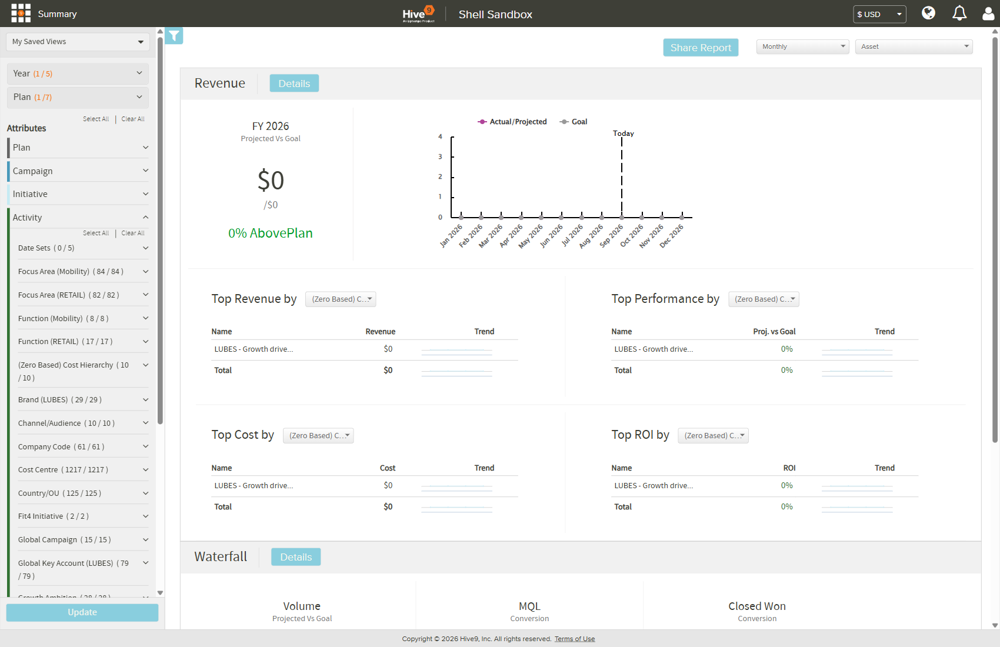

Figure 9 — Standard report chrome: the Summary dashboard. Left: the global filter panel with Year, Plan and hierarchy-tabbed Attributes. Right: Share Report, aggregation and Tactic Category selectors.

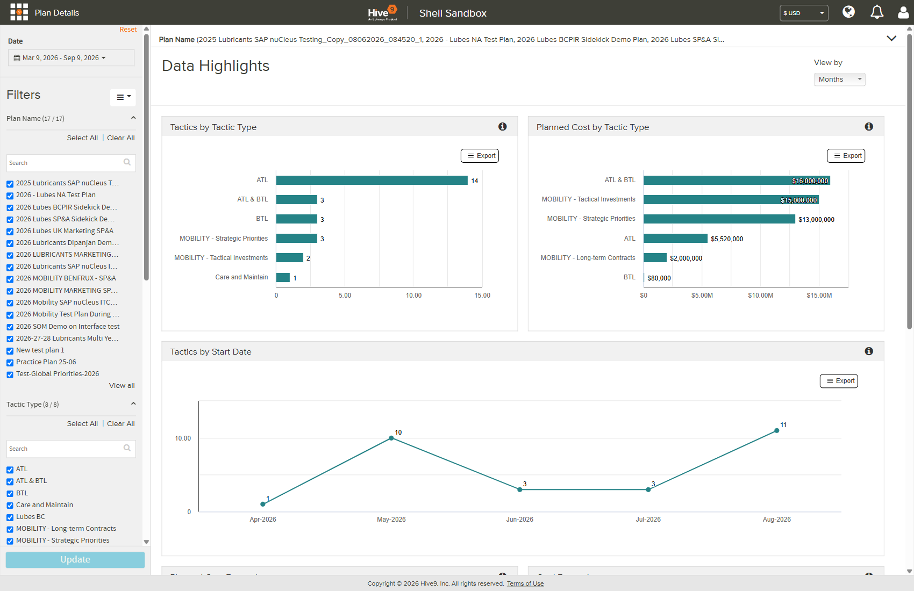

Figure 10 — Custom dashboard chrome: Plan Details. Left: Date Range picker and per-dashboard Filters. Right: 'Data Highlights', 'View by' and per-widget Export buttons.

## E3. Functional Analysis — screen by screen

Each screen below is documented with its purpose, layout regions, every control, every displayed field, the business logic behind the numbers, and the API calls that populate it.

### E3.0 The shared filter panel

Present in full on Summary, Revenue, Waterfall, Plan Budget and the Approvals Dashboard. Filter state is stored per user and persists across reports and sessions until changed, which is a frequent source of 'why is my dashboard empty?' support calls.

> Three screens differ: The panel is NOT universal across the module, and that matters for replication. Three of the nine screens differ: AR Invoice Details has a Date Range region and no Year or My Saved Views at all; the PR Dashboard has My Saved Views and Date Range but no Year; and Finance Budget has no left filter panel whatsoever — only the currency button, a budget selector, the Forecast checkbox and Update.

#### E3.0.1 Filter regions in order

Verified against the rendered DOM. Control types and element handlers are given because several regions are not the control type they appear to be.

| Region | Control type | Behaviour / notes |
|---|---|---|
| My Saved Views | Collapsible accordion, loaded on demand | Header is h2#PlanFilterHeader with onclick=LoadPreset(); the body div#DefaultFiltersData is empty until opened. Not a plain dropdown. Holds named presets of the full filter + column configuration, personal or shared. |
| Year | Checkbox list, multi-select | Drives the time axis. Sandbox exposes 2026, 2025, 2022, 2021, 2020. Element ids follow the pattern liYear<YYYY>; each fires OnYearChange(). |
| Plan | Checkbox list + search (txtPlanSearch) | Shows '(selected / total)'. The available plan list is itself filtered by the Year selection — one year showed 7 plans, all five years showed 27. Bulk actions via BulkPlanOperation(true/false). |
| Attributes | Tab strip (4 tabs) | Plan, Campaign, Initiative (=Program), Activity (=Tactic). Each tab carries its OWN attribute groups — see 3.0.2. Global Select All / Clear All above the heading (SelectAllAttribute), plus per-tab bulk actions (SelectPlanAttribute / SelectTacticAttribute …). |
| Plan View | Radio group, single-select (Attributes ▸ Plan tab) | THREE options: 'All Plans' (planviewvalue=0, default), 'Strategic/AOP Plans Only' (1), 'Exclude Strategic/AOP Plans' (2). ul#ulSelectedPlanView, onchange=OnPlanViewChange(). Posted as PlanViewFilterOptions. Present only when the AOP/Strategic Plan feature is enabled. |
| Date Sets | FIVE read-only date-picker inputs | Not a checkbox list. div.date-sets holds one picker per date type, each with its own Clear link: Start Date (dtTacticStartDate), End Date (dtTacticEndDate), Due Date (dtTacticDueDate), Build Date (dtTacticBuildDate), Completion Date (dtTacticCompletionDate). Counter spnDateSetCounter reads '( 0 / 5 )' — the 5 is the number of date TYPES, and none is set by default. |
| <Custom attributes> | Accordion groups of checkboxes + search | One group per custom attribute defined at that hierarchy level; each shows '(selected / total)'. 21 of them carry their own search box (ids CF_<fieldId>, onkeyup=LoadSearchedFilter). Bulk actions via BulkCustomFieldOperation. |
| Owner | Checkbox list + search | One Owner filter PER hierarchy level — txtPlanOwner, txtCampOwner, txtProgOwner, txtTacOwner, txtLineItemOwner. Bulk actions via BulkOwnerOperation. |
| Activity Type | Checkbox list + search (txtTacticType) | Tactic Type filter (renamed per tenant). Values carry a usage count, e.g. 'ATL(1)'. Bulk actions via BulkTTOperation. |
| Status | Checkbox list | SIX values, all ticked by default: Created, Submitted, Declined, Approved, In-Progress, Complete (ids liStatusCreated … liStatusComplete). Bulk actions via BulkStatusOperation. |
| Line Item | Top-level accordion SECTION (not a toggle) | A peer of 'Attributes' (#accordion-e-T-LineItem) with its own 'Filters Applied' badge, containing four attribute groups plus an Owner list — see 3.0.2. Posted as LineItemFilterOptions. |
| Show Hierarchies | Radio group, single-select (not a toggle) | FOUR options: 'Any Levels' (hierarchyvalue=0, default), 'All Levels Only' (1), 'No Initiatives' (2, internal name NoPrograms), 'No Activities' (3, internal name NoTactics). ul#ulSelectedHierarchy, onchange=OnHierarchyChange(). Posted as HierarchyFilterOptions. |
| Update | Button (#UpdatePlan) | Applies the filter set and re-queries every widget on the page. |

> Control types: Four regions are not the control type they appear to be: Date Sets is five date pickers, not a checkbox list of named ranges; Line Item is a filter section, not an include/exclude toggle; Show Hierarchies is a four-way radio, not a toggle; and Plan View is a separate radio group. Each posts its own key in the request payload, so a replication that models them as booleans will be wrong.

#### E3.0.1.1 The (Not Completed) pseudo-value — and why every count is off by one

Every custom-attribute group whose field can be left blank renders one extra checkbox at the end of its list, rendered as '(Not Completed)':

- DOM: <li class="accordion-inner filterBlankOption" title="(Not Completed)" id="li_<fieldId>_0"> with an input carrying isblank="isBlank" and id="<fieldId>_0".
- It matches records where no pick-list value has been chosen for that attribute. The product guide confirms this has the same meaning as Blank.
- It is EXCLUDED from the '(selected / total)' counter. 'Business Unit ( 2 / 2 )' actually presents three checkboxes — Lubricants, Mobility and (Not Completed).

> Read the counts this way: Consequence for this document and for any replication: every cardinality in section E3.0.2 is the count of real values and understates the number of checkboxes rendered by one wherever the attribute is nullable. Unticking (Not Completed) is how a user excludes records with missing segmentation — it is the filter-bar counterpart of the Plan Details completeness charts.

#### E3.0.2 Attribute filter groups — by hierarchy level

The four Attributes tabs are not cosmetic: each exposes a different set of attribute groups, because attributes are defined per hierarchy level. Opening a tab appends that level's groups to the panel. The complete, verified inventory for this tenant follows, with every value list observed live. The bracketed number is the cardinality of that dimension.

##### Plan-level attributes (Plan tab)

| Attribute group | n | Values |
|---|---|---|
| Plan View | 3 | RADIO, not checkboxes — All Plans (default); Strategic/AOP Plans Only; Exclude Strategic/AOP Plans. Only one can be active at a time. |
| BCPIR Plan? | 2 | No; Yes |
| Business Unit (Mobility/Lubricants…) | 2 | Lubricants; Mobility; (Not Completed) |
| Strategic Marketing Plan? | 2 | No; Yes |
| Owner | 1 | The plan owner list (txtPlanOwner), scoped to the selected plans |

##### Campaign-level attributes (Campaign tab)

| Attribute group | n | Values (sample) |
|---|---|---|
| Cluster | 51 | Lubes EMEA; Lubes GKA; Lubes-Egypt; Lubes-Europe; Lubes-Global B2B Team; Lubes-Global Comm Road Transport Sector; Lubes-Global Consumer Road Sector; Lubes-Global Customer Solutions; Lubes-India; Lubes-Indonesia; Lubes-Korea; Lubes-Latin America; Lubes-Malaysia; Lubes-North America; Lubes-Oman; Lubes-Pakistan; Lubes-Philippines; Lubes-Russia UCAS; … |
| Insight Session Completed | 2 | No; Yes |
| Region | 14 | LUBES - Americas; LUBES - APAC; LUBES - China HK; LUBES - EMEA; LUBES - EUSA; LUBES - Global Marketing; LUBES - North East Asia Region; Lubes GKA Marketing; Lubes-South Africa; RETAIL - AMERICAS; RETAIL - CHINA; RETAIL - EAST; RETAIL - EUSA; RETAIL - Global Marketing; (Not Completed) |
| Workshop Completed | 2 | No; Yes |
| Global GM Signoff Completed | 2 | No; Yes |
| Owner | 1 | Campaign owner list |

##### Initiative / Program-level attributes (Initiative tab)

| Attribute group | n | Values (sample) |
|---|---|---|
| Growth Ambition | 11 | MOBILITY - Integrated Offer; MOBILITY - Other; MOBILITY 1a - NFR 50/50; MOBILITY 1b - Fuels 50/50; MOBILITY 2 - Low Emission Energy; MOBILITY 3 - Low carbon sites; MOBILITY 4a - TLAG onsite; MOBILITY 4b - TLAG Service Beyond Forecourt; MOBILITY 4c - TLAG Digital Experience; MOBILITY 5a - Reduce Reuse Recycle; MOBILITY 5b - Global Social Cause; (Not Completed) |
| Function | 8 | COE Marketing; CR Alliances and Colocators; Digital and Payment; Integrated Mobility; Loyalty and CRM; Mobility Products; Site Operational Excellence; Take Care Of Your Car; (Not Completed) |
| Focus Area | 81 | Accessories Range; Alliances; Analytics; Bio Fuels; Brand Assurance Programmes; Capability Programmes; Card Production; CEoFS; Channel; Co-Locators; Community Programmes; Connected Car and APIs; CR - Alcoholic Beverages; CR - Cross Category; CR - Formats; CR - Fresh Food & Drinks; CRM; Customer Experience; Customer Insights; … |
| FIT4 Initiative? | 3 | Yes; No; To Be Confirmed; (Not Completed) |
| Owner | 1 | Initiative owner list |

##### Activity / Tactic-level attributes (Activity tab)

| Attribute group | n | Values (sample) |
|---|---|---|
| Date Sets | 5 | Start Date; End Date; Due Date; Build Date; Completion Date |
| Focus Area (Mobility) | 84 | Accessories Range; Alliances; Analytics; Bio Fuels; Brand Assurance Programmes; Capability Programmes; Card Production; Channel; Co-Locators; CR - Snacks; CR - Tobacco; CRM; … |
| Focus Area (RETAIL) | 82 | As above, minus 'Capability Programmes', plus 'Data Privacy' |
| Function (Mobility) | 8 | COE Marketing; CR Alliances and Colocators; Digital and Payment; Integrated Mobility; Loyalty and CRM; Mobility Products; Site Operational Excellence; Take Care Of Your Car; (Not Completed) |
| Function (RETAIL) | 17 | Alliances and Colocators; COE Marketing; CRM; Data Privacy and Analytics; Digital and Payment; Fleet Solutions; Insights; Integrated Mobility; Loyalty and CRM; Mobility Products; Other; RBLA; Site Operational Excellence; Sponsorship; Vehicle Care; VP; (Not Completed) |
| (Zero Based) Cost Hierarchy | 10 | LUBES - Growth drivers; LUBES - Legal or regulatory requirements; LUBES - Long term contractual obligations; LUBES - Other; LUBES - Protecting the core; LUBES - Strategic Priorities; LUBES - Tactical initiatives; RETAIL - Long-Term Contracts; RETAIL - Strategic Priorities; RETAIL - Tactical Investments; (Not Completed) |
| Brand (LUBES) | 29 | Advance; Argina; Coolant; Diala; Formula Shell; Gadina; Gadus; HDDEO GPO; Helix; MCO Cobrand; MCO GPO; Morlina; Mysella; Omala; Ondina; PCMO GPO; Pennzoil; Quaker State; Rimula; Risella; Rotella; Spirax; Tellus; None; Other; … |
| Channel/Audience | 10 | External; Internal; LUBES - All B2B; LUBES - All B2C; LUBES - Direct B2B; LUBES - Direct B2C; LUBES - E-Commerce2B; LUBES - GKA; LUBES - Indirect B2B; LUBES - Indirect B2C; (Not Completed) |
| Company Code | 61 | SAP company codes — 2290; 2338; 4682; 9806; A017; AT01; BE01; BG08; CA48; CH01; CN04; CZ01; DE01; EG12; ES01; FR01; GB01; … |
| Cost Centre | 1,217 | SAP cost centres — 5709280063; AT01000001; BE01000170; … (highest-cardinality dimension in the instance) |
| Country/OU | 125 | Austria; Austria/GKA Local; Belgium; Brasil; Bulgaria; Canada; China; China/GKA Local; China/GM Local; Czech Republic; Egypt; Europe; France; Germany; GLOBAL; Global B2B/CC China; … |
| Fit4 Initiative | 2 | No; Yes; (Not Completed) |
| Global Campaign | 15 | SVP $1 Billion +; Total Fuels (inclusive of MG); Go Well Integrated Campaign; Shell Cafè /Other coffee and food; LUBES - B2B Brand Campaign; LUBES - B2B CRM; LUBES - B2B Portfolio; LUBES - Benefit Led; LUBES - Drive On; LUBES - Shell Advance Outride Anything; LUBES - The Proof is in the Pennzoil; LUBES - What Matters Is Inside (WMII); None; (Not Completed) |
| Global Key Account (LUBES) | 79 | _None; ABB; AGCO; AGGREKO; ANGLO AMERICAN; ATLAS COPCO; BHP; BMW; CATERPILLAR; CHERY; CNH INDUSTRIAL; DAF/Paccar; DAIMLER Cars; DUCATI; FAW-VW; Fiat Chrysler Group; GEELY; GLENCORE; GM (ACDELCO); … |
| Growth Ambition | 28 | LUBES - B2B Breakthrough; LUBES - Digital Innovation; LUBES - GKA (and GKA OEM variants); LUBES - Premium Acceleration; LUBES - Sustainability variants; MOBILITY 1a–5b variants; … |
| PIR | 2 | No; Yes; (Not Completed) |
| Product Launch (LUBES) | 2 | No; Yes; (Not Completed) |
| Sector (LUBES) | 30 | Agriculture OEM; Auto Component OEM; Cement; Commercial Road Transport; Construction; Consumer Road; Digital; Fast Fit; Fast Lubes; GKA; Industrial; Light Duty; Metals; Mining; Off-Highway; Power; … |
| Sub-Sector | 39 | Agriculture; Auto OEM; Cement; Commercial Fleet; Construction; Fast Fit; Forestry; General Engineering; General Manufacturing; Heavy Duty Installed; HighStreet; IWS; Light Duty; MCO; Metals; Mining; Non-Lube; … |
| Owner | 1 | Tactic owner list |
| Activity Type | 1 | Tactic Type, shown with a usage count — e.g. 'ATL(1)' |
| Status | 6 | Created; Submitted; Declined; Approved; In-Progress; Complete |

##### Line Item-level attributes (Line Item section)

Line Item is a top-level section of the panel rather than a tab inside Attributes, but it behaves identically and is where the finance-facing filters live. These four groups plus an Owner list are the bridge between marketing filtering and accounting filtering:

| Attribute group | n | Values |
|---|---|---|
| Contracted Spend | 5 | Not Applicable; No; Yes - Both; Yes - LT; Yes - ST — flags whether the spend is contractually committed, and whether long-term, short-term or both |
| GL Code | 15 | The general-ledger accounts marketing spend posts to — 6140900 - PMTDR Credit; 7250050 - Advertising - Media Planning/Auditing; 7250060 - Advertising - Corp/Agency/Production; 7250070 - Advertising - Media Buying; 7250080 - Advertising - Digital; 7250100 - Public Relations; 7250150 - Sponsorship programmes; 7250190 - Loyalty Programmes - Materials; 7250200 - Loyalty Programmes - Services; 7250250 - Market Research; 7250300 - Promotions & POP - Incentives/Reimbursement; 7250310 - Promotions & POP - Agency/Print/Logistics; 7250350 - Brand Development & Coordination; (Not Completed) |
| Spend Category | 19 | Not Applicable; ABM (B2B Media); B2B Customer Specific; Brand; Canada Customer Specific; Channel - DIFM; Channel - DIY; Channel - Indirect; Consumer Media; Content, Creative & Assets; Influencer Marketing; Innovation; Insights; MarTech; Motorsports; Program; Promotions; Sustainability; Tradeshow; (Not Completed) |
| Spend Type | 57 | ATL and BTL spend detail — ATL - Agency Fees - Creative; ATL - Agency Fees - PR; ATL - Digital; ATL - Event; ATL - Paid Media Campaign Activation; ATL - Paid Media Strategy and Planning; ATL - Public Relations; ATL - Sponsorships; Audits e.g. mystery shopper; BTL - Agency Fees; BTL - Branded Shop; BTL - Capability building Training; BTL - CRM Campaign; BTL - Customer Meetings/Conference; BTL - Distributor Marketing Budget; BTL - Event; BTL - Incentive Scheme; BTL - Loyalty Operations Costs; BTL - Market research/Insights; BTL - Merchandise; BTL - Pipeline; BTL - Promotions; BTL - Sponsorship; Contractors or Field Support; CRM - Agency Fee; … (57 total) |
| Owner | 1 | Line-item owner (txtLineItemOwner, ul#ulLineItemSelectedOwner) |

> Where to find them: Cluster, Region and Business Unit are all filterable — Cluster and Region under the Campaign tab, Business Unit under the Plan tab. They do not appear under the Activity tab, which is the tab the panel opens on by default, so they are easy to miss.

> Same name, different field: A genuine trap for implementers: Growth Ambition, Function and Focus Area exist at BOTH Initiative and Activity level, under the same display names but with different value sets — Growth Ambition has 11 values at Initiative level and 28 at Activity level; Focus Area has 81 at Initiative level and is split into Focus Area (Mobility) 84 and Focus Area (RETAIL) 82 at Activity level. They are different fields that happen to share a label. Key them by hierarchy level plus field id, never by name.

#### E3.0.3 Filter panel mechanics and rules

These behaviours are documented in the product guide and were confirmed live. They explain most 'why am I seeing no data?' situations:

| Rule | Behaviour |
|---|---|
| Parent-child cascade | Year and Plan act as PARENTS to the attribute dropdowns. Choosing a year shows only the plans belonging to that year; choosing a plan restricts the Owner and Tactic Type attributes to those associated with the selected plan(s). Observed live: 1 year selected → 7 plans offered; all 5 years selected → 27 plans offered. |
| Default selection | When a new plan is loaded, all attributes are selected by default. |
| Counter | Each group header shows '(selected / available)', e.g. 'Cost Centre ( 1217 / 1217 )'. |
| Search bar threshold | Any attribute with more than 10 values automatically displays a search bar in its list — which is why Cost Centre and Country/OU are usable at all. |
| Select All / Clear All | Every group carries Select All and Clear All links; the jQuery multi-select widgets additionally carry their own Select All / Deselect All header actions. |
| (Not Completed) | Every attribute offers a '(Not Completed)' value, meaning no pick-list value has been selected for that attribute. The guide states this has the same meaning as Blank. This is the mechanism for finding records with missing segmentation — the filter-level counterpart of the Plan Details completeness charts. |
| Plan View (AOP/Strategic) | If the AOP/Strategic Plan feature is enabled, a Plan View section offers three mutually exclusive filters: All plans, Strategic/AOP Plans Only, Exclude Strategic/AOP Plans. Only one can be active at a time. |
| Apply | Nothing re-queries until Update is pressed. |
| Persistence | Filter state is stored server-side per user and survives logout. Unless a default saved view is set, your last used view settings are restored at next login. |

#### E3.0.4 My Saved Views — full specification

The 'My Saved Views' control at the top of the filter panel is far more than a dropdown; it is the persistence and collaboration mechanism for the entire reporting experience.

A saved view captures: all filter selections from the filter panel, the column selections from Column Management, the exact column order as arranged by dragging, and the View By hierarchy selected on the main control panel.

| Task | Steps |
|---|---|
| Save a new view | Select filters → Update → configure columns via Column Management → drag columns into order → expand My Saved Views → Save New View → name it → Save. |
| Load a view | Expand My Saved Views → select the radio button next to the view. |
| Set as default | Select the yellow star icon next to the view. |
| Update a view | Load it → adjust filters/columns/order → click the Save icon → confirm Yes. |
| Delete a view | Press the trash can icon next to the view. |
| Reset to default | Expand My Saved Views → click Set Default View. Resets filters and/or presets to your default state. |
| Share a view | Select the view → click the Share icon → in the 'Share View: [name]' popup choose teams and/or users → Share. Recipients get an email and/or in-app notification and the view appears in their own My Saved Views at next login. |
| Manage shared views | User Menu → Settings → Shared Views tab → Edit icon to change who has access, Delete icon to withdraw the view from everyone. |

##### Endpoints behind My Saved Views and the filter panel

The panel names its own endpoints in hidden configuration fields. These are the real filter API, of which POST /Filter/Index is only one part:

| Endpoint | Purpose |
|---|---|
| GET /Filter/GetFilterPresetByUserId?activeMenu=Report | Loads the user's saved presets |
| POST /Filter/UpdatePresetValues | Saves changes to a preset |
| POST /Filter/LastSetOfViews | Reads the last-used filter state |
| POST /Filter/SaveLastSetOfViewFilter | Persists the last-used filter state (this is the mechanism behind filters surviving logout) |
| GET /Filter/GetPlanListForFilter | Populates the Plan list for the selected years |
| GET /Filter/GetOwnerListForFilter | Populates the Owner lists |
| GET /Filter/GetTacticTypeListForFilter | Populates the Activity Type list |
| POST /Filter/Index | Loads the whole panel for a given preset name |

Associated state fields and UI strings: FilterPresetName, IsSharedPreset ('False'), DefaultPresetName ('My Saved Views'), ResetPresetName ('My Saved Views'), and the messages 'Preset Saved Successfully' and 'Please provide filter name'.

> Constraints and a documentation gap: Two constraints matter. First, sharing is limited to users who already have access to the plans in the view — you cannot widen someone's data access by sharing a view. Second, the reset action applies only to the current session; to make a state persist across sessions the preset must be marked as Default. Also note the guide lists saved-view support for the Plan, Budget & Cost, PR and AR grids — yet the control is present on the Measure standard reports too, so treat the documented grid list as incomplete rather than as a statement that Measure lacks the feature.

### E3.1 Summary

URL: /NewReport/ReportOverview

Purpose: The executive landing view: a single answer to 'are we on track?' plus the four best-performing segments and a funnel health check.

Primary API: POST /NewReport/GetSummaryData/

#### E3.1.1 Layout

The screen is divided into two stacked sections, exactly as described in the product guide:

1. Revenue section (upper) — the revenue prediction for the selected plans, plus four segment league tables.
2. Waterfall section (lower) — stage volumes and stage conversion rates versus plan.

#### E3.1.2 Header controls

| Control | Element id | Values | Effect |
|---|---|---|---|
| Currency | (masthead) | 30 currencies — AED, ARS, AUD, BRL, CAD, CHF, CNY, DKK, EUR, GBP, HKD, HUF, IDR, INR, MXN, MYR, NOK, OMR, PHP, PKR, PLN, RMB, SEK, SGD, THB, TRY, UAH, USD, VND, ZAR | Re-expresses every monetary figure using the instance conversion table. |
| Aggregation | ddlAllocate | Monthly, Quarterly | Time bucket size for the trend charts. |
| Tactic Category | ddlAssetTypeSelector | AdminOnly, Asset, Asset_01, BC_Lubes, BC_Retail, BCPIR_Lubes, BCPIR_Retail, Mobility_UnlinkedActivity, PIR_Lubes, PIR_Retail, Promotion, SMP Plan on a Page | Restricts the report to one Tactic Category. The default is set by the admin option 'Default Tactic Category'. |
| Share Report | #BtnShareReport | — | Shares/distributes the configured report. |
| Details (Revenue) | #btnRevenueDetails | — | Navigates to the Revenue dashboard. |
| Details (Waterfall) | #btnConversionDetails | — | Navigates to the Waterfall dashboard. |

#### E3.1.3 Revenue section fields

| Field | Example | Meaning | Source |
|---|---|---|---|
| Period label | FY 2026 | The fiscal year in scope, from the Year filter | Derived — Year filter + fiscal calendar (/api/FiscalCalendar/GetFiscalYears) |
| Projected Vs Goal | $0 / $0 | Projected revenue over goal revenue | Calculated (Measure star schema) / Plan-entered goal |
| Variance | 0% AbovePlan | Signed variance of projection to goal; label flips to 'BelowPlan' | Calculated |
| Trend chart | Jan–Dec 2026 | Two series — Actual/Projected and Goal — with a vertical 'Today' marker. Left of Today = actuals; right = model projection | Actuals: integration. Goal: plan entry. Projection: attribution + predictive model |

#### E3.1.4 The four segment league tables

Four identical widgets, each with its own segment selector. Each renders a three-column table plus a sparkline, and a Total row.

| Widget | Selector id | Table id | Columns |
|---|---|---|---|
| Top Revenue by | custmDDL_Revenue | table-sparkline_Revenue | Name \| Revenue \| Trend |
| Top Performance by | custmDDL_Performance | table-sparkline_Performance | Name \| Proj. vs Goal \| Trend |
| Top Cost by | custmDDL_Cost | table-sparkline_Cost | Name \| Cost \| Trend |
| Top ROI by | custmDDL_ROI | table-sparkline_ROI | Name \| ROI \| Trend |

All four selectors offer the same 17 segments: (Zero Based) Cost Hierarchy, Brand (LUBES), Channel/Audience, Company Code, Cost Centre, Country/OU, Fit4 Initiative, Global Campaign, Global Key Account (LUBES), Growth Ambition, PIR, Product Launch (LUBES), Sector (LUBES), Sub-Sector, Cluster, Region, and Business Unit (Mobility/Lubricants...).

> Business logic: ROI here is computed against the attribution model the organisation has designated as the ROI source. If the tenant has no financial integration, the admin option 'Use Planned Cost as Actual Cost' makes ROI and other actual-cost calculations fall back to Planned Cost — so an ROI figure can be produced even with no actuals feed. Knowing which mode a tenant is in is essential before interpreting ROI.

#### E3.1.5 Waterfall section fields

The funnel stages are configured per tenant. In this sandbox the stages are INQ → MQL → Closed Won.

| Element | Displayed as | Meaning |
|---|---|---|
| Volume block | INQ 0/0, MQL 0/0, Closed Won 0/0 | Actual-or-projected volume over goal volume at each stage, with a % variance |
| Conversion card (per stage) | MQL Conversion 0% — Goal: 50% — 100% Below Plan | Stage-to-stage conversion rate, the planned conversion goal, and the variance |
| Conversion trend chart | Actual/Projected vs Goal by month with Today marker | Conversion rate over time against the goal line |

Observed goals in this tenant: MQL conversion goal 50%, Closed Won conversion goal 20%.

#### E3.1.6 Request contract

POST /NewReport/GetSummaryData/ carries the complete report state:

| Payload key | Example | Meaning |
|---|---|---|
| timeframeOption | "2026" | Selected year(s) |
| assetType | 51 | Internal id of the selected Tactic Category |
| isQuarterly | "Monthly" | Aggregation granularity |
| planIds | ["9025"] | Selected plan ids |
| filterOptionsString | A JSON string — see the full key list below | The serialised left-panel filter state |

filterOptionsString carries SEVEN keys, not the four a first inspection suggests. The complete contract:

| Key | Type | Fed by |
|---|---|---|
| PlanFilterOptions | object | Attributes ▸ Plan tab selections |
| CampaignFilterOptions | object with MaxStartDate / MinEndDate | Attributes ▸ Campaign tab |
| ProgramFilterOptions | object with MaxStartDate / MinEndDate | Attributes ▸ Initiative tab |
| TacticFilterOptions | object with MaxStartDate, MinEndDate, UserTimeZoneoffset (e.g. "%2B05:30") and ShowOnlyEvergreenTactics (bool) | Attributes ▸ Activity tab, plus the browser timezone and an evergreen-tactic switch |
| LineItemFilterOptions | object | The Line Item filter section |
| HierarchyFilterOptions | string "0"–"3" | The Show Hierarchies radio |
| PlanViewFilterOptions | string "0"–"2" | The Plan View radio |

> Hidden request semantics: Two things here are not visible anywhere in the UI documentation. UserTimeZoneoffset means date boundaries are evaluated against the viewer's browser timezone, so two users in different regions can get different row counts from identical filters. ShowOnlyEvergreenTactics is an entire filter concept — always-on, non-date-bounded tactics — that has no visible control on these screens.

#### E3.1.7 The Share Report modal

'Share Report' is not a one-click action. It loads a modal from GET /NewReport/ShowShareReport/?reportType=<leftPaneOption> into div#DivShareReport, containing:

| Field | Type | Notes |
|---|---|---|
| (helper text) | Label | 'All fields required.' |
| Email | Text input | Recipient address |
| Add Optional Message | Textarea | Covering note — despite the 'all fields required' helper |
| Attachment chip | Read-only | A paperclip chip labelled with the report name, e.g. 'Summary' |
| Share | Button | Sends the report |
| Cancel | Button | Dismisses without sending |

#### E3.1.8 How the four league tables refresh

Changing any of the four segment selectors does NOT re-query the page. It fires a single partial-refresh call that redraws only that one table:

Endpoint: POST /NewReport/LoadSparkLineChartPartial

Parameters: strCutomfield=<TacticCustom####> · timeFrameOption=<years> · strRevenueType=<Revenue | Performance | Cost | ROI> · planIds=<ids>

This is why the four widgets can each show a different segmentation simultaneously, and it is the pattern to copy if the page is being rebuilt — a full report refresh for a segment change would be a visible regression.

> Important date semantics: The date bounds are expressed as MaxStartDate and MinEndDate per level (e.g. MaxStartDate 2026-12-31, MinEndDate 2026-01-01). This is an overlap test, not a containment test: an entity is included if its date range overlaps the selected period at all. A tactic running Nov 2025 – Feb 2026 therefore appears in both FY2025 and FY2026 reports. This materially affects how multi-year activity is counted.

### E3.2 Revenue

URL: /NewReport/ReportRevenue

Purpose: Stack-ranking dashboard focused on revenue. One of three 'flavours' of the same stack-ranking pattern (the others being Waterfall, configurable to any stage, and Plan Budget, focused on cost).

Primary APIs: GET /NewReport/GetReportData/?reportType=Revenue · POST /NewReport/GetCardDropDown/ (reportName=Revenue) · POST /NewReport/Revenue/ · POST /NewReport/RevenueCardSection

#### E3.2.1 Layout

1. Heads-up display (HUD) — a card strip of goal-coverage metrics.
2. Trend chart — Actual vs Projected vs Goal revenue over the period, split at Today.
3. Control bar — View By, Group By, Sort By, Compare, page size and order.
4. Stack-ranked list — two hierarchy layers at a time, drillable.

#### E3.2.2 Control bar

| Control | Element id | Options | Purpose |
|---|---|---|---|
| Time frame | ddlRevenueTimeFrame | Monthly, Quarterly | Chart bucket size |
| Tactic Category | ddlAssetType | 12 categories (as Summary) | Scope to one category |
| View By | ddlViewByEntity | Plan, Campaign, Initiative, Activity | Which hierarchy level forms the rows |
| Group By | ddlGroupByEntity | None, Plan, Owner, Cluster, Insight Session Completed, Region, Workshop Completed, Global GM Signoff Completed | Secondary grouping. Note the last five are Campaign-level custom fields, so this list is tenant-specific |
| Sort By | ddlSortBy | Actual Revenue, Projected Revenue, Actual ROI | Ranking metric |
| Compare | ddlPlan / ddlCampaignConversionToPlan / ddlProgramConversionToPlan / ddlTacticConversionToPlan / ddlTacType | Dynamic | Selects a comparison baseline; the visible selector depends on the View By level |
| Per page | ddlPerPage | 5, 10, 20, 25, 50, 100 | Rows per ranked page |
| Order | ddlOrderBy | High to Low, Low to High | Ranking direction |
| Share Report | #BtnShareReportRevenue | — | Share/distribute |

#### E3.2.3 Heads-up display fields

The HUD is generated per stage and per Tactic Category. For each of Revenue, INQ, MQL and Closed Won it renders a Plan Goal card, a Goal Coverage By Category card, and then one 'Activity Rollup Goal' card per Tactic Category (12 in this tenant). It closes with an ROI card per category.

| Card | Format | Meaning |
|---|---|---|
| <Stage> Plan Goal | actual / goal | The goal recorded at Plan level for that stage |
| <Stage> Goal Coverage By Category | actual / goal | How much of the plan-level goal is covered by the sum of category-level goals — a planning-completeness check |
| <Stage> <Category> Activity Rollup Goal | actual / goal | The sum of activity-level goals rolled up within that Tactic Category |
| ROI <Category> | percentage | Return on investment for that category |

> Interpretation: 'Goal Coverage By Category' is a genuinely useful but easily misread control: a large gap between the Plan Goal and the Goal Coverage figure means goals have been set at the top of the plan but not yet cascaded down to categories and activities. It is a planning-hygiene metric, not a performance metric.

#### E3.2.4 Trend chart / data table

Table id tblRevenueDataTable, rendered beneath the chart as an accessible equivalent of the SVG series. It carries EIGHT rows, not the three plotted on the chart — the chart shows the revenue trio, the table adds the cost and efficiency rows that let you read ROI directly:

| Row | Meaning | Time extent | Source |
|---|---|---|---|
| Actual Revenue | Revenue credited by the attribution model | Past only (to Today) | Integration → Measure star schema |
| Projected Revenue | Model prediction | Future (from Today) | Calculated — predictive model |
| Goal Revenue | Planned revenue goal | Full period | Plan entry (manual or imported) |
| Performance | Actual/projected against goal, as a percentage | Full period | Calculated |
| Actual @ Monthly FX Cost | Spend at the FX rate of the month it occurred | Past only | Finance transactions × monthly FX table |
| Actual Cost | Spend at the standard rate | Past only | Finance transactions |
| ROI | Return on investment for the period | Full period | Calculated |
| Actual Total | Cumulative actual to date | Past only | Calculated |

The Waterfall equivalent (tblWaterFallDataTable) follows the same shape: the three stage rows plus 'Performance' and 'Actual Total'.

> Note: The rows beyond the three charted series matter because they are where cost and ROI appear on a screen otherwise framed as revenue-only.

> Undocumented behaviour: Column headers adapt to the Year selection. With a single year selected the axis is monthly (Jan 2026 … Dec 2026). With multiple years selected, prior years collapse to a single bucket each and only the most recent year stays monthly — observed as: 2020 \| 2021 \| 2022 \| 2025 \| Jan 2026 … Dec 2026. This mixed-granularity axis is not labelled as such in the UI and can mislead when comparing bar heights.

#### E3.2.5 Stack-ranked list and drill behaviour

- Always exactly two hierarchy layers are displayed at once.
- Clicking a lower-layer entry promotes it to the upper layer and reveals the next level down as the new lower layer — a progressive drill rather than a tree expand.
- On any lower-level entry an orange breadcrumb in the upper-right corner deep-links straight to that object in the Plan module, so a user can act on the finding immediately.
- Any change to investment made in Plan is reflected the next time the dashboard is refreshed.

#### E3.2.5.1 Anatomy of a stack-ranking screen (shared by Revenue, Waterfall and Plan Budget)

These three screens are one template. Documenting it once here avoids repeating it three times, and corrects several under-statements in the earlier per-screen sections.

##### The heads-up display is generated, not fixed

The HUD is not a handful of tiles. On Plan Budget it renders exactly 70 cards (container ids hive9HudCard*), generated combinatorially from the stages and the Tactic Categories:

| Card group | Count | Ids |
|---|---|---|
| Cost cards | 6 | hive9HudCard1, 2, 3, 4, 9, 22 — Planned Cost: Annual, Allocated Planned Cost: Total, Plan Budget: Annual, Plan Budget: Total, Actual Cost: Total, Actuals @ Monthly FX Cost: Total |
| Revenue goal coverage | 1 + 12 | hive9HudCardrevenue_GoalByCategory, then one hive9HudCardrevenue_tactic_<Category> per Tactic Category |
| INQ stage | 1 + 12 | hive9HudCardwaterfall_inq_revenue + one per Category |
| MQL stage | 1 + 12 | hive9HudCardwaterfall_mql_revenue + one per Category |
| Closed Won stage | 1 + 12 | hive9HudCardwaterfall_cw_revenue + one per Category |
| ROI | 12 | hive9HudCardgoal_roi_tactic_<Category> |

The Waterfall HUD follows the same pattern and renders 52 cards. The count therefore scales as roughly 6 + 5 × (1 + number of Tactic Categories) — a tenant with 30 categories would see well over 150 tiles.

| HUD control | Element | Behaviour |
|---|---|---|
| Settings | Gear icon (fa-cog) → #waterfallReportHudSettingsModalContainer | Opens a modal to choose which cards are shown. This is what the guide means by a 'configurable heads-up display'. |
| Scroll | Left/right arrows | Pages horizontally through the card strip |
| Reorder | Drag and drop | Cards can be dragged into a preferred order |
| Sparklines | Chart.js canvases, 175 × 48 | The only place Chart.js is used on these screens |

> Scale: Plan Budget's HUD is not six cost cards: those are the first group of six out of seventy. The HUD is generated per stage per Tactic Category and is user-configurable, which makes it one of the more substantial components to replicate on this screen.

##### The Compare control is seven dropdowns, not one

div#CampaignChildDDL carries the label 'Compare' and wraps SEVEN sibling selects, of which exactly one is visible at a time depending on the current View By level:

| Select id | Wrapper | Shown when comparing against… |
|---|---|---|
| ddlPlan | #spddlPlan | A plan (the default visible control) |
| ddlCampaignConversionToPlan | #spddlCamp | A campaign |
| ddlProgramConversionToPlan | #spddlProg | An initiative / program |
| ddlTacticConversionToPlan | #spddlTact | An activity / tactic |
| ddlTacType | #TacTypeDDL | A tactic type |
| ddlReportOwner | #OwnerDDL | An owner |
| ddlCustAttr | #CustAttrDDL | A custom attribute value |

The full on-screen control bar therefore reads: View By · Group By · Sort By · Compare · Items per page · Order.

##### Export and card-list controls

| Control | Element | Behaviour |
|---|---|---|
| Export (chart) | #btnExportSegment | A Bootstrap dropdown in div.export-button-wrap directly above the chart container |
| Export (ranked list) | #btnExportCard | onclick=ExportToExcelFinanceData(); posts to /NewReport/ExportToExcelFinanceData then redirects to ExportCsvFinanceData |
| Back | Card list header | Steps back up one drill level |
| Expand All / Collapse All | Card list header | Expands or collapses every ranked row at once |
| Sort highlight | SetOrangeClassonSortBy() | Highlights the column currently being sorted on in orange |
| Empty state | div#dvNoRecord | Renders 'No records found.' |
| Missing value sentinel | — | Absent metrics render as '--' rather than zero |

##### Which endpoint does what

| Endpoint | Actually returns |
|---|---|
| POST /api/PlanOverview/GetPlanHUD | THE HEADS-UP DISPLAY. Request carries startDate, endDate and planOverviewGridRequest {PlanIds, FilterOptions}. Response carries PlanTotalCount, MediaCodesCount, PlanAnnualBudget, TacticAnnualPlannedCost, Stages, per-month PlanCount[] / CampaignCount[] / … and MonthlyActual{}. |
| POST /NewReport/FinanceCardSection | THE STACK-RANKED CARD LIST — not the HUD. Request carries viewBy, filterBy {FieldCategory, FieldId, FieldOptionId}, searchString, page, pageSize, financeSortBy, orderBy. Response renders into #dvFinanceCardSectionData with LoadPagination() and SetOrangeClassonSortBy(). |
| POST /NewReport/Finance/ (and /Revenue/, /Waterfall equivalents) | The time-series chart data |

> Naming trap: FinanceCardSection is the paged ranked list, not the heads-up display; the HUD comes from /api/PlanOverview/GetPlanHUD. The same applies to RevenueCardSection on the Revenue screen.

#### E3.2.6 Embedded help text — the projection model, in the product's own words

An information icon on this dashboard carries the clearest statement of the projection logic anywhere in the product. Reproduced verbatim:

> “A Plan model specifies waterfall stages and how stages transition from one to another with conversion rate and velocity. Once a goal is set to a Activity at a designated stage, the model can project progression of any stage following the designated stage over the time from Activity start date to any later date within the Plan year. Revenue report cards presented below compare actual revenue realized YTD and projected revenue YTD from which one gets an idea where his/her Plan stands regarding to revenue goal.”

Three things follow from this and matter for replication:

- Projection is driven by the Model attached to the Plan, not by the dashboard. The Model defines the stages, the conversion rate between them and the velocity (time lag).
- Projection only runs forward from the stage at which a goal was set. If a goal is set at INQ, the model can project MQL and Closed Won; if no goal is set at any stage, nothing projects — which is exactly the all-zero condition observed in this sandbox.
- The projection horizon is bounded by the Plan year: from the Activity start date to any later date within that year.

### E3.3 Waterfall

URL: /NewReport/ReportWaterfall

Purpose: The second flavour of stack-ranking dashboard — structurally identical to Revenue but configurable to any funnel stage rather than fixed on revenue.

Reachable from: The Measure menu, or the 'Details' button in the Summary dashboard's Waterfall section.

#### E3.3.1 Controls unique to Waterfall

| Control | Element id | Options | Purpose |
|---|---|---|---|
| Stage selector | ddlINQToPlan | INQ To Plan, MQL To Plan, Closed Won To Plan | Chooses which stage the whole dashboard reports on. This is the defining control of the screen. |
| Time frame | ddlWaterFallTimeFrame | Monthly, Quarterly | Chart bucket size |
| Sort By | ddlSortBy | INQ, MQL, Closed Won | Ranking metric — stage volumes rather than revenue |
| Share Report | #BtnShareReportWaterFall | — | Share/distribute |

View By, Group By, Per page, Order, Tactic Category and the filter panel are identical to Revenue.

#### E3.3.2 Data table

Table id tblWaterFallDataTable. The series names are generated from the selected stage, so with INQ selected:

| Series | Meaning | Source |
|---|---|---|
| Actual INQ | Attributed inquiries to date | Integration → Measure star schema |
| Projected INQ | Model-predicted inquiries | Calculated |
| Goal INQ | Planned inquiry goal | Plan entry |

Selecting MQL or Closed Won renames the series accordingly. The chart legend follows the same pattern (Actual INQ / Goal INQ / Projected INQ).

### E3.4 Plan Budget

URL: /NewReport/ReportFinance

Purpose: Detailed visual of what is being spent from a campaign and initiative point of view over time — the marketing-plan view of money, as opposed to the finance view.

Primary APIs: POST /NewReport/GetReportData/ (reportType=Budget) · POST /NewReport/GetCardDropDown/ (reportName=Finance) · POST /NewReport/Finance/ · POST /NewReport/FinanceCardSection

#### E3.4.1 The four money series

This is the most important table in the module for financial interpretation. Table id tblFinanceDataTable:

| Series | Meaning | Projects into future? | Source |
|---|---|---|---|
| Plan Budget | Budget assigned within the marketing plan | Yes | Plan/Finance entry |
| Allocated Cost | Planned/allocated cost from line items | Yes | Plan entry (line-item allocation) |
| Actual Cost | Actual spend at the standard conversion rate | No — past only | Finance transactions (usually ERP integration) |
| Actual @ Monthly FX Cost | Actual spend converted at the exchange rate of the month in which it occurred | No — past only | Finance transactions + monthly FX table |

> Critical business logic: Only Plan Budget and Allocated Cost project into the future; the two actual-cost series stop at today. That is by design — a chart showing actuals trailing budget in future months is expected, not a data gap. The distinction between 'Actual Cost' and 'Actual @ Monthly FX Cost' exists because Hive9 supports 'Use Monthly Actual Rates' per currency: the former restates history at the current rate, the latter freezes each transaction at its period rate. For multi-currency tenants the two will differ, and the monthly-FX figure is normally the audit-defensible one.

#### E3.4.2 Heads-up display

| Card | Observed value | Meaning |
|---|---|---|
| Planned Cost: Annual | $200 | Planned cost for the fiscal year |
| Allocated Planned Cost: Total | $200 | Planned cost allocated to line items across the whole selection |
| Plan Budget: Annual | $40k | Plan budget for the fiscal year |
| Plan Budget: Total | $0 | Plan budget across the whole selection |
| Actual Cost: Total | $0 | Total actual spend |
| Actuals @ Monthly FX Cost: Total | $0 | Total actual spend at period FX rates |

> The HUD is much larger than this: These six are only the FIRST GROUP of the 70 cards this HUD actually renders. The remaining 64 are generated per stage and per Tactic Category — see 3.2.5.1 for the full breakdown, the settings gear that controls which cards show, and the drag-to-reorder behaviour.

Alongside the cards the HUD renders four Chart.js sparkline canvases (175 × 48). These are the only Chart.js elements on the screen; the main budget chart is Highcharts.

#### E3.4.3 Controls

| Control | Element id | Options |
|---|---|---|
| Time frame | ddlFinanceTimeFrame | Monthly, Quarterly |
| View By | ddlViewByEntity | Plan, Campaign, Initiative, Activity |
| Group By | ddlGroupByEntity | None, Plan, Owner, Cluster, Insight Session Completed, Region, Workshop Completed, Global GM Signoff Completed |
| Sort By | ddlSortBy | Allocated Cost, Actual @ Monthly FX Cost, Actual Cost, Plan Budget |
| Per page / Order | ddlPerPage / ddlOrderBy | 5–100 / High to Low, Low to High |
| Share Report | #BtnShareReportFinance | — |

Stack ranking, drill-to-detail navigation and export behave exactly as on the Revenue dashboard.

### E3.5 Finance Budget

URL: /NewReport/ReportFinanceBudget

Purpose: The same money viewed from the construct of the financial budget rather than the marketing plan — cost-centre and GL-code focused.

Primary APIs: POST /api/FinanceBudgetReport/FinanceBudgetOverview · POST /api/FinanceBudgetReport/FBFilters

> Structural note: This screen reuses the same left-panel COMPONENT as the other standard reports (the same common-filter-panel / hive9-filter-panel-container chrome, down to the Update button in the panel footer) but fills it with completely different CONTENT: a budget selector and a Forecast checkbox instead of Year, Plan and Attributes. It is the panel's contents that are exceptional, not the panel.

> How the period is determined: There is no date or Year control on this screen at all. The reporting window is derived from the selected budget's own Year field: budget '2023 MARKETING SPA' carries Year 2023, so the page posts FiscalYears [2023] and requests the overview for 2023-01-01 to 2023-12-31. Choosing a different budget silently changes the period.

#### E3.5.1 Controls

| Control | Type | Observed values | Purpose |
|---|---|---|---|
| Budget selector | Dropdown | 2023 MARKETING SPA; 2023 Test Finance Budget Arpit; Other | Selects the finance budget to report on |
| Forecast | Checkbox (#forecastCheckbox), default off | on / off | Adds the Forecast series to the charts |
| Update | Button | — | Applies selection |
| Compare this budget to — metric | Dropdown | Actual @ Monthly FX Cost; Actual Cost; Budget; Planned Cost | Chooses WHICH MEASURE the comparison is made on |
| Compare this budget to — budget | Dropdown | 2023 Test Finance Budget Arpit; Other | Chooses WHICH OTHER BUDGET to compare against (the currently-selected budget is excluded from its own list) |
| Currency | Masthead | 30 currencies | Re-expresses all values |

> Two controls: 'Compare this budget to' is two controls, not one: a measure selector and a comparison-budget selector. The comparison budget list excludes the budget already selected above, so the two dropdowns are not symmetric.

#### E3.5.2 Overview heads-up display

| Displayed metric | API field | Meaning |
|---|---|---|
| Annual Budget | AnnualBudget | Budget for the full fiscal year |
| Total Budget | (derived) | Budget across the full selected scope |
| Budget YTD | BudgetUpToDate | Budget elapsed to date — the pacing baseline |
| Total Planned Cost | (derived) | Planned cost linked to this budget |
| Planned YTD | PlannedUpToDate | Planned cost elapsed to date |
| Total Actual | (derived) | Actual spend against this budget |
| Total Actual @ Monthly FX | ActualUpToDate / ActualMonthly | Actual spend at period FX rates |
| Burn Rate | BurnRate | Consumption rate of the budget, as a percentage |
| (series only) | AnnualForecast / Forecast | Forecast series, shown when the Forecast checkbox is ticked |

#### E3.5.3 Chart series returned by the API

FinanceBudgetOverview returns parallel arrays indexed by xAxisLabels (format 'Mon-YYYY'):

| Array | Series |
|---|---|
| xAxisLabels | Time axis, e.g. Jan-2015 … Dec-2030 |
| Budget | Budget by period |
| Forecast | Forecast by period |
| Planned | Planned cost by period |
| Actual | Actual cost by period |
| ActualMonthly | Actual cost at monthly FX rates by period |

#### E3.5.4 Charts on this screen

Six chart canvases render, not four. In top-to-bottom order:

1. The Overview chart — a full-width time series (1341 × 259) plotting all five API series (Budget, Forecast, Planned, Actual, ActualMonthly) across the budget's year. This is the primary widget on the screen and exports as '<Budget name>_Overview.png'.
2. Four comparison charts, in a 2 × 2 grid (653 × 224 each).
3. The 'Compare this budget to' chart (1339 × 224), driven by the two dropdowns described above and exporting as '<Budget name>_By_<dimension>.png'.
Each chart carries its own small toolbar of view-switcher icons. Critically, the four comparison charts do NOT all offer the same renderings:

| Chart | Bar | Line | Table | Export |
|---|---|---|---|---|
| Overview (full width) | Yes (default) | Yes | Yes | Yes |
| Budget vs. Planned Cost | Yes (default) | — | Yes | Yes |
| Budget vs. Actual Cost | Yes (default) | — | Yes | Yes |
| Actual Cost vs. Budget | — | Yes (default) | Yes | Yes |
| Actual Cost vs. Planned Cost | — | Yes (default) | Yes | Yes |
| Compare this budget to | Yes | Yes | Yes | Yes |

> Display modes: Each comparison chart offers only two of the three display modes: the two 'Budget vs …' charts are bar-or-table and the two 'Actual Cost vs …' charts are line-or-table. Only the Overview and Compare charts carry all three.

After the time-based charts, a series of donut (pie) charts explores the distribution of investment. The donuts offer the same capabilities as the bar/line charts, including export.

#### E3.5.5 Budget metadata — the GetBudgets contract

GET /api/FinanceBudget/GetBudgets populates the budget selector and returns 17 fields per budget. Several of them govern behaviour elsewhere in the product and are worth modelling explicitly:

| Field | Meaning |
|---|---|
| Id / Name / Description | Identity of the budget |
| ClientId | Owning tenant |
| Year | The fiscal year — this is what determines the report's date window |
| OwnerId / TeamId | Ownership and team assignment, which drives visibility |
| DefaultUserPermission | Baseline permission granted on the budget |
| CascadeParentPermission | Whether permissions inherit down the budget tree |
| BudgetLock / ForecastLock | Whether budget and forecast values are locked against editing |
| IsHardLimit | Whether the budget is a hard ceiling rather than a guide |
| DefaultTimeFrame | Default aggregation period |
| Level | Depth of the budget structure. All three sandbox budgets return Level 0, which is precisely why only a single 'Overview' tab renders (see 3.5.6) |
| AccrualMethod | How accruals are calculated for this budget |
| AccrualCutOffDay | Day of the month after which accruals roll to the next period |
| AccrualThresholdAmount | Minimum value below which an accrual is not raised |

The overview request itself is POST /api/FinanceBudgetReport/FinanceBudgetOverview with {budgetDetailIds: [], startDate, endDate, filteredBudget: false}. budgetDetailIds is the array of selected budget-element ids that narrows the report, and filteredBudget is the flag saying whether budget-element filtering is in force — together these are the mechanism behind the 'filters are the elements of your budget' behaviour.

#### E3.5.6 Auto-generated tabs

The tab strip is generated automatically from the level depth of the finance budget, and each tab is named from the labels configured in Organizational Setup › Finance Budget Levels. In this sandbox only the 'Overview' tab was present for the selected budget, indicating a shallow budget structure. A tenant with a four-level budget (e.g. Company › Cost Centre › GL › Sub-GL) would see a tab per level.

> Replication implication: Because tabs are generated from configuration rather than coded, a replication effort must implement the Finance Budget Levels configuration first — the report cannot be built with hard-coded tabs.

### E3.6 Approvals Dashboard

URL: /NewReport/ReportApproval

Purpose: Governance view of approval workload and cycle time across every approvable object type.

Primary APIs: /api/ApprovalReport/GetApprovalForReports · GetAverageNoOfDaysForApproval · GetApprovalActivity · GetHeaderMappings · GetPlanOverviews · GetApprovalActivityViewOptions · /api/ApprovalWorkflows/GetCustomFieldGroupApprovalObjectsForApprovalReport · /api/CustomObjectWorkflows/GetCustomObjectWorkflowsForEntity

#### E3.6.1 Widgets

| Widget | Position | Content |
|---|---|---|
| Current Approval Status | Upper left | Distribution of approvals by current status for the selected entity type |
| Average | Upper right | 'Number of days taken by user to approve an entity' — the mean approval cycle time in days |
| Approval Activities | Lower, full width | A configurable, searchable, paginated grid of individual approval records |

#### E3.6.2 Entity type selector

Two independent dropdowns (one for the status chart, one for the grid) select which object type is being reported. The list is driven by which objects have approval workflows enabled, and includes both the hierarchy objects and the financial objects:

- Plan, Campaign, Initiative (Program), Activity (Tactic), Line Item
- Purchase Request and Purchase Request Line Item
- Accrual Request and Accrual Request Line Item
- Custom object workflows and custom attribute group approvals, where configured

#### E3.6.3 Approval Activities grid — full column inventory

Retrieved from POST /api/ApprovalReport/GetHeaderMappings, which returns each column's client-facing label, internal field name, format, expected length, precision and alignment. This is the authoritative field list:

| Client label | Internal field | Format | Len | Prec. | Align | Meaning |
|---|---|---|---|---|---|---|
| Hive9 Activity ID | ItemId | id | 12 | 0 | center | System id of the approved object |
| Item Name | ItemName | text | 20 | 0 | left | Name of the approved object |
| Approver Name | ApproverName | id | 20 | 0 | left | User who approved / is due to approve |
| Sign-Off Date | SignOffDate | date | 10 | 0 | center | Date the approver signed off |
| Sign-Off Status | SignOffStatus | text | 10 | 0 | center | Outcome of that approver's step |
| Submitted Date | SubmittedDate | date | 10 | 0 | center | Date the object was submitted for approval |
| Level | LevelNotation | text | 7 | 0 | center | Approval level within the workflow |
| PO Number | PONumber | text | 30 | 0 | left | Linked purchase order number |
| Amount | Amount | currency | 15 | 2 | center | Monetary value of the approved object |
| Owner | Owner | id | 20 | 0 | left | Owner of the object |
| Comments | Comments | text | 30 | 0 | left | Approver comments |
| Custom Attribute Group Name | CustomFieldGroupName | id | 25 | 0 | left | Attribute group, when the approval is a custom attribute group approval |

#### E3.6.4 Filters unique to this screen

| Filter | Cardinality | Notes |
|---|---|---|
| Approver | 82 users | Searchable (txtApproverSearch) |
| Vendor | 77 vendors | Present because PR/Accrual approvals are in scope |
| Purchase Request / PR Line Item | sections | PR owner (chkPurchaseRequestOwner*), PR line owner (chkPRLineOwner*) and status |
| Accrual Request / AR Line Item | sections | Accrual owner (chkAccrualRequestOwner*, 17 owners) and status |
| Status values | Created, Submitted, Declined, Approved, Closed | Observed on the approval status filter |

Grid controls: a free-text Search box and a page-size selector defaulting to 50 per page.

> Scale of this filter panel: The Approvals filter panel is the widest in the module: because it covers every approvable object type, it carries the complete Plan/Campaign/Initiative/Activity attribute set (section E3.0.2) AND the full purchase-request and accrual attribute sets (sections E3.7.1.1 and E3.8.1.1) — including GL Code, PR Type, Marketing Category, Cost/Spend Type, LT/ST classification, Email Group, OA number, Requester and Vendor. Verified live: 42 expandable filter groups on this one screen. Budget for this when estimating a replication of the filter panel.

### E3.7 PR Dashboard

URL: /NewReport/ReportPurchaseRequest

Purpose: Procurement analytics — forward commitment to vendors, commitment by owner, and vendor delivery reliability.

Primary APIs: POST /api/PurchaseRequestReport/GetPurchaseRequestReportData · POST /api/PurchaseRequestGrid/GetPRHUD · GET /api/PurchaseRequestGrid/GetPRGridViewOptions

#### E3.7.1 Filters

| Filter | Type | Notes |
|---|---|---|
| My Saved Views | Dropdown | PR-specific presets (UpdatePRPresetValues) |
| Date Range | From / To (StartDate, EndDate) | Replaces the Year checkbox model used elsewhere. Defaults to the current fiscal year |
| Vendors | Checkbox list, 77 values | Searchable (txtVendorSearch) |
| Purchase Request (tab) | Attribute group | PR-header level attributes — see the full list below |
| Purchase Request Line Item (tab) | Attribute group | PR-line level attributes — see the full list below |
| PR Owner / PR Line Owner | Checkbox list | Ashok K; Kanishk Punekar; Nadia Rahaman (txtPurchaseRequestOwner / txtPRLineOwner) |
| PR Status values | Checkboxes | Created; Submitted; In-Review; Declined; Approved; Closed |
| Update | Button (#UpdatePurchaseRequest) | Applies filters |

##### E3.7.1.1 The seven PR custom-attribute filter groups

The Purchase Request attribute tab carries exactly seven custom-attribute groups. They are collapsed by default, which is why a first pass over this screen misses them entirely. Note the cardinalities — this is one of the highest-volume filter panels in the product:

| Attribute group | Field id | Values | Content |
|---|---|---|---|
| PR Type | 1984 | 4 (+blank) | Standard PR/PO; Manual PR/PO; FI Payment; (Not Completed) |
| Email Group | 2014 | 145 (+blank) | Notification distribution groups — AT_RETAIL; BE_LUBES; BE_RETAIL; CA_LUBES; CN_MKT_CONSUMER_LUBES; CN_MKT_ICE_LUBES; CN_MKT_MO_LUBES; CN_MKT_MOBILITY; CN_MKT_OEM_LUBES; CN_RETAIL; DE_LUBES; EG_LUBES; EU_LUBES; FR_LUBES; G_GB_RETAIL; … |
| PR Recipients | 2015 | 153 (+blank) | Individual Shell addresses, most paired with SITI-PRISM-Implementation-Team@shell.com |
| OA Vendor (China Specific) | 2229 | 126 (+blank) | Vendors on outline agreements, including Chinese-language legal entity names (上海升华广告有限公司, 广州市连顺汽车维修服务有限公司 …) |
| Sub Category (China Specific) | 2230 | 95 (+blank) | Anti-counterfeit; Apple products; B2B Sensor; Branded Item; Cargo Inspection; Cinema; Consultants Marketing; Creative; Demo Tool; Digital Marketing; … |
| Outline Agreement (dropdown) | 1982 | 287 (+blank) | SAP outline agreement numbers — 4600087053; 4600156663; 4600168338; 4600178164; 4600258678; 4600263305; … |
| Contract Holder (dropdown) | 2125 | 58 (+blank) | Ai Zhang; Allan Chen; Allen Gao; Andy Tang; Anthea Dong; Betty Wang; Blair Wang; Carolyn Wang; Charles Qi; Claire Xiao; Cynthia Li; Edith Hou; Ella Yang; Erin Zhou; … |

> Default state: '(Not Completed)' is present on all seven groups and is TICKED BY DEFAULT — so the default view includes records with no value for these attributes. Unticking it is how a user narrows to fully-classified PRs.

> Where these live: The GL Code, Spend Category, Spend Type and Contracted Spend groups belong to the Line Item section of the shared panel (section E3.0.2), not to this screen. The Approvals Dashboard carries both sets, because it filters across every approvable object type.

> Observed data quality: Several value lists show visible data-quality noise — 'Branded Item' vs 'Branded Items', 'Digital Marketing' vs 'Digital MKT' vs 'Digital Marketing Service', '7250080 - Advertising - Digital' vs '7250080 - Advertising-Digital', and a literal '????' entry. These are free-growing pick-lists without governance, and they will fragment any grouping or reporting built on them.

##### E3.7.1.2 The PR overview grid

Below the charts the screen carries a hierarchical grid:

| Element | Detail |
|---|---|
| Containers | #prGridArea, #prTreeGrid, #prGridContainer; row detail opens in modal #prModal |
| Hierarchy levels | Four, all enabled: Vendor › PurchaseRequest › PurchaseRequestLineItem › TacticLineItem (GetPRGridViewOptions ViewOptions.Levels) |
| Columns | 19 persisted ColumnType entries — ordinals 0–9 and 12–20. ColumnType 1 is Hidden:true by default; ordinals 10 and 11 are absent from the set |
| HUD configuration | A gear icon (i.fa.hive9-icon.fa-cog) opening #prHudSettingsModalContainer, so the commitment tiles are user-configurable like the other HUDs |

> Inconsistency observed: The PR status set includes 'In-Review', which the Approvals dashboard's status filter does not. The two screens therefore expose slightly different status vocabularies for related objects — worth normalising in any replication.

#### E3.7.2 Heads-up display

| Card | API field | Meaning |
|---|---|---|
| Purchase Requests | PurchaseRequestTotalCount | Count of PRs in scope, with a 'Distribution' sub-link |
| Purchase Request LineItems | PurchaseRequestLineItemTotalCount | Count of PR line items, with Distribution |
| Vendors | VendorTotalCount | Count of distinct vendors, with Distribution |
| GRSP Amount | TotalGRSPAmount | Goods Receipt / Service Performance value — what has actually been received |
| Invoice Amount | TotalInvoiceAmount | Value invoiced |
| Purchase Request Line Item Amount | TotalPurchaseRequestLineItemAmount | Total committed value on PR lines |

The API additionally returns PurchaseRequestStatusCount and per-entity count arrays (VendorCount, PurchaseRequestCount, PurchaseRequestLineItemCount) that drive the 'Distribution' pop-ups.

#### E3.7.3 Charts

| Chart | API object | Definition |
|---|---|---|
| PR Total by Vendor by Period (Delivery date) | PRTotalByVendorByPeriod | Expected commitment to each vendor, bucketed by the delivery date on the PR line. Returns Periods[] (e.g. 'Jan-15') and SeriesData keyed by vendor |
| PR Total by Owner by Period (Delivery date) | PRTotalByOwnerByPeriod | The same data grouped by the PR owner recorded on the PR record |
| Vendor Performance Percentage | VendorPerformanceChart | Delivery performance per vendor. Only populated if receipt transactions are being imported |

> Business logic: Both period charts bucket by delivery date, not by PR creation or approval date. This makes the dashboard a forward commitment view rather than a historical spend view — it answers 'what have we committed to receive, and when', which is precisely what is needed to drive accruals.

> Dependency: Vendor Performance Percentage is silently empty when receipt (GR/SE) transactions are not imported. There is no message distinguishing 'no receipts imported' from 'all vendors performed at 0%', which is a real usability risk.

### E3.8 AR Invoice Details

URL: /ARInvoiceDetail/Index

Purpose: Operational reconciliation grid joining accrual requests and their line items to budgets, plan line items, POs and actuals. The only Measure screen that is a true data grid rather than a dashboard.

Primary APIs: POST /api/ARInvoiceDetail/GetARInvoiceDetailOverviewGrid · GET|POST /api/ARInvoiceDetail/GetARInvoiceGridViewOptions|SaveARInvoiceGridViewOptions · GET /api/Accruals/GetARGridsViewByOptions · GET /api/CustomObjectWorkflows/IsAWFFeatureActive?customObjectType=Accrual Request

#### E3.8.1 Filters

| Filter | Cardinality | Notes |
|---|---|---|
| Date Range | From / To | Shows a 'Filters Applied' indicator and a Clear link |
| Accrual Request (tab) | — | Accrual header attributes — see full list below |
| Accrual Request Line Item (tab) | — | Accrual line attributes — see full list below |
| Plan | 27 plans | Searchable. Values are operating-unit style plan names: Lubes China; Lubes Global DT/CC SIPC; Lubes USA; Mobility Global; Mobility India; Mobility Indonesia; Mobility UK; Lubes Belgium/GKA Local; Lubes Canada; Lubes China/GKA Local; Lubes Egypt; Lubes Europe; Lubes France; Lubes Germany; Lubes Global B2B/CC China; Lubes Global B2B/CC India; Lubes Global B2B/CC UAE; Lubes Global B2B/CC USA; Lubes Global B2C/CC SIPC; Lubes Global GKA/CC SIPC; … |
| Budget Name | 12 budgets | Finance budgets |
| Budget Item Name | 33 items | Budget line items |
| Update | #UpdateARInvoiceGrid | Applies filters |

##### E3.8.1.1 Full accrual attribute filter inventory

| Attribute group | Values |
|---|---|
| Accrual Request Status | Created; Submitted; Approved & Sent; In-Progress; Closed; Declined |
| Accrual Request Line Item Status | Created; Submitted; Approved & Sent; Processed; Declined |
| Accrual Owner | 17 users — Alicja Kudasik; Arpit Mathur; Ashok K; Beverley Blake; Bich Nguyen; Hari Haran Soman; Hive9 Admin; Juno May; Justyna Orman; Kanishk Punekar; Katarzyna Starke-Zaranska; Marina Shovkivska; Pei-Yen Lew; Sanita Rojanapanich; Sanjay Bhagat; Selina Yao; Yuvaraj Natarajan |
| Business Unit | Lubes; Mobility; (Not Completed) |
| Notification recipients | Shell email addresses, many paired with SITI-PRISM-Implementation-Team@shell.com |

> Data model detail: The two status enumerations differ deliberately and both use the display form 'Approved & Sent' (the API carries it as the token ApprovedAndSent). The header has 'In-Progress' where the line has 'Processed': a request is In-Progress while its individual lines are Processed one by one. Model these as two distinct enumerations, and do not assume the API token and the UI label are identical anywhere in this module.

> Data model detail: The Accrual Request and Accrual Request Line Item status vocabularies differ: the header has 'InProgress' where the line has 'Processed'. Both include ApprovedAndSent. This asymmetry is deliberate — a request can be in progress while individual lines are processed one by one — but it must be modelled as two distinct enumerations.

#### E3.8.2 Complete grid column inventory

Retrieved from the columns array of GetARInvoiceDetailOverviewGrid, which carries full rendering metadata. Column visibility, order and width are user-configurable and persisted via SaveARInvoiceGridViewOptions:

| # | Field | Column title | Type | Width | Expandable | Align |
|---|---|---|---|---|---|---|
| 1 | Name | Name | text | 330 | Yes | left |
| 2 | AccrualType | Accrual Type | text | 100 | Yes | left |
| 3 | Add | Actions | — | 85 | No | left |
| 4 | Id | ID | text | 85 | No | left |
| 5 | EntityType | Level | text | 190 | No | center |
| 6 | Status | Status | text | 100 | No | center |
| 7 | Owner | Owner | text | 150 | No | center |
| 8 | ARDate | AR Date | date | 100 | No | center |
| 9 | ARLineAmount | ARLine Amount | currency | 100 | No | right |
| 10 | LineItemId | Line Item Id | text | 85 | No | left |
| 11 | BudgetId | Budget Id | text | 85 | No | left |
| 12 | PlannedAmount | Planned Amount (in period) | currency | 100 | No | right |
| 13 | ActualAmount | Actual Amount (in period) | currency | 100 | No | right |
| 14 | PlannedActualAmount | Planned - Actual Amount (in period) | currency | 100 | No | right |
| 15 | ApprovalWorkflow | Approval Workflow | text | 100 | Yes | left |
| 16 | AccrualMonth | Accrual Month | text | 100 | No | center |
| 17 | POCount | PO Count | numeric | 100 | No | left |
| — | ColorCode | (hidden by default) | — | — | — | — |

The 17 columns above are only the DEFAULT 'Standard Attributes' set returned by the live call. Column Management exposes four further sections of selectable columns, and two of them are what make this an 'Invoice Details' screen at all:

| Column section | Columns |
|---|---|
| Standard Attributes | The 17 listed above |
| PO Attributes | Invoice Count; PO Amount; PO Number |
| Invoice Attributes | Accruals; GR Date; Invoice Amount; Invoice Date; Invoice Number; Recommended Accrual; SE Date |
| Accrual Request Custom Attributes | Every custom attribute defined at accrual-request level |
| Accrual Request Line Item Custom Attributes | Every custom attribute defined at accrual-line level |

> Business logic: 'Recommended Accrual' is the system's own proposed accrual figure and is arguably the single most important field on the screen — yet it is off by default. 'Planned − Actual Amount (in period)' is the variance that justifies an accrual; 'Recommended Accrual' is the product's answer. Any replication should surface both. Note also the column object's 'id' field: null for standard columns, populated for custom-attribute columns.

#### E3.8.3 Grid structure — three nested levels, not two

The grid expands through three levels, not the two an inspection of the default columns suggests:

1. Top level — Accrual Requests and their AR Lines.
2. Second level — nested PO Numbers under each AR Line.
3. Third level — nested Invoice details under each PO Number.
The PO and Invoice nesting is the reason the screen exists: it is how a user walks from an accrual down to the individual invoices that may discharge it. The 'expandable' flag on the Name, Accrual Type and Approval Workflow columns is what drives this. The response also returns IsAWFFeatureActive, confirming whether the Advanced Approval Workflow feature governs accruals in this tenant.

#### E3.8.4 Controls on this screen

| Control | What it is | Notes |
|---|---|---|
| Column Management | Pencil-square icon button in the toolbar above the grid | Opens show/hide, reorder and resize for columns. This is the UI behind SaveARInvoiceGridViewOptions. It is AR-specific — it does not exist on the standard reports. |
| Line Item Cost Allocation | Icon on each AR Line row — the 'Add / Actions' column | Opens a read-only popup of allocated planned costs, presented like the Activity information window, dismissed with a button. Modal host div#lineItemAllocationCost. |
| My Saved Views | Preset machinery | Backed by /Accruals/GetARFilterPresetByUserId and /Accruals/UpdateARPresetValues, with POST /ARInvoiceDetail/FilterIndex {presetName}. Supports save, Set Default View and share, as on the other grids. |
| Update | #UpdateARInvoiceGrid | Applies filters |
| Currency | Masthead | 30 currencies |

> Differs from the other reports: This screen has NO Year filter, NO Monthly/Quarterly aggregation selector and NO Share Report button. Its only page-level buttons are the currency selector, Column Management and Update.

#### E3.8.5 The Attributes section — three custom-attribute groups

AR Invoice Details carries its own Attributes sidebar section, grouped by accrual object rather than by plan hierarchy (accordions 'Accrual Request' and 'Accrual Request Line Item'). Its custom-attribute groups:

| Group | Field id | n | Values |
|---|---|---|---|
| Country / OU | 4198 | 90 (+blank) | Operating units — Lubes China; Lubes Global DT/CC SIPC; Lubes USA; Mobility Global; Mobility India; Mobility Indonesia; Mobility UK; Lubes Belgium/GKA Local; Lubes Canada; Lubes China/GKA Local; Lubes Egypt; Lubes Europe; Lubes France; Lubes Germany; Lubes Global B2B/CC China; Lubes Global B2B/CC India; Lubes Global B2B/CC UAE; Lubes Global B2B/CC USA; Lubes Global B2C/CC SIPC; Lubes Global GKA/CC SIPC; … (+ (Not Completed)) |
| Recipient | 3955 | 43 (+blank) | Accrual notification e-mail recipients — individual Shell addresses (redacted in this copy), many paired with SITI-PRISM-Implementation-Team@shell.com. The page variable aREmailCFId = 3955 confirms this is the accrual e-mail field. |
| Mobility/Lubes | 5379 | 2 (+blank) | Lubes; Mobility; (Not Completed). Only three options, so no search box is rendered. |

### E3.9 Plan Details (custom dashboard, DashboardID 4)

URL: /Measure/Home?DashboardID=4&DashboardPageID=0&…

Purpose: A self-configuring dashboard that showcases how segmentation is balanced across plans, and how complete the segmentation data is.

#### E3.9.0 Shared chrome on every custom dashboard page

All eight custom-dashboard pages (both Plan Details and China Budget Reports) share the same frame. Verified across every page:

| Control | Location | Behaviour |
|---|---|---|
| Module switcher | Top-left 9-dot grid icon | Opens the main navigation flyout |
| Breadcrumb | Top-left, next to the icon | '<Dashboard>/<Page>', e.g. 'China Budget Reports/PO Report' |
| Scope banner | Below the masthead | Names the records in scope — e.g. 'Plan Name (2025 Lubricants SAP nuCleus Testing…, 2026 - Lubes NA Test Plan, …)' or 'Budget Name (2020 Shell Lubricants Budget, 2021 Shell Lubricants Budget)'. A chevron on the right collapses it. |
| Currency selector | Masthead | Same 30-currency list as the standard reports |
| Date range picker | Top of left panel | A from–to picker, e.g. 'Mar 9, 2026 - Sep 9, 2026'. Defaults to a rolling six-month window ending today — the single most common reason a custom dashboard looks empty. Opens a preset list: This Quarter · This Year · Year to Date · Last 12 Months · Last 4 Quarters · Last Calendar Year · Custom Range, plus From and To boxes and Apply / Cancel |
| Reset | Top-right of the left panel, orange link | Clears the dashboard's filter selections |
| Filters header + hamburger | Left panel | A three-item menu: 'Save current filters', 'Load saved filters', 'Clear all' |
| Filter group | Left panel, repeated | Each group has a collapse chevron, a '(selected / total)' counter, Select All \| Clear All links, a Search box, a checkbox list and a 'View all' link when the list is truncated |
| Update | Bottom of left panel, full width | Applies the filter and date selection |
| Data Highlights | Main area title | Static section title on every page |
| View by | Top-right of the main area | Aggregation granularity for time-based widgets. Options: Years, Quarters, Months, Weeks (ddlViewBy) |
| Per-widget icon | Top-right of each widget card | On Plan Details this behaves as a 'View Data' drill-through to the underlying rows rather than as help text |
| Per-widget Export — tables | Top-right of each table card | A two-item menu: 'Export as CSV' and 'Export as Excel' |
| Per-widget Export — charts | Top-right of each chart card | The Highcharts context menu (download as image / print), NOT a data export |
| Page Size | Table widgets only | Rows per page, default 20. Options: 5, 10, 20, 30, 50, 100, 200, 500 — a different list from the 5–100 used by the standard reports |
| Save As Preset | Filter panel | Saves the current dashboard filter selection as a named preset |

> Export and paging differ between the two shells: Three distinctions worth carrying into a replication. Export on custom dashboards is per-widget, whereas the standard reports expose one page-level Share Report; the table export gives real data (CSV/Excel) while the chart export only gives a picture; and the Page Size list here (up to 500) differs from the standard reports' list (up to 100).

#### E3.9.1 The self-configuring three-column pattern

Plan Details does not have a fixed set of charts. It generates them from the tenant's attribute configuration, producing one row per attribute at the selected hierarchy level, and up to three columns per row:

| Column | Chart | Answers |
|---|---|---|
| 1 — Count distribution | '<Entities> by <Attribute>' | How are my activities distributed across this attribute? |
| 2 — Value distribution | 'Planned Cost by <Attribute>' | How is my money distributed across this attribute? |
| 3 — Completeness | Data-completeness chart | Do I have a compliance issue — how many records have this attribute populated at all? |

The dashboard is available at the Tactic (Activity), Campaign and Program (Initiative) levels. Individual charts can be exported.

#### E3.9.2 Observed widgets on the landing page

| Widget | Chart type | Report ID | Observed data |
|---|---|---|---|
| Tactics by Tactic Type | Horizontal bar | 163 | ATL 14; ATL & BTL 3; BTL 3; MOBILITY – Strategic Priorities 3; MOBILITY – Tactical Investments 2; Care and Maintain 1 |
| Planned Cost by Tactic Type | Horizontal bar | 166 | ATL & BTL $16.0M; MOBILITY – Tactical Investments $15.0M; MOBILITY – Strategic Priorities $13.0M; ATL $5.52M; MOBILITY – Long-term Contracts $2.0M; BTL $80K |
| Tactics by Start Date | Line | — | Apr-2026 1; May-2026 10; Jun-2026 3; Jul-2026 3; Aug-2026 11 |
| Tactics by Status | Pie | 158 | Created 16; In-Progress 11; Complete 1 |
| Planned Cost Entered | Pie | 156 | Yes 26; No 2 — a completeness check |
| Goal Entered | Pie | 157 | No 28 — no goals entered on any tactic in scope |
| Is Integrated | Pie | 164 | No 28 — no tactic is linked to an integrated system |

> Diagnostic insight — highly practical: The 'Goal Entered' and 'Is Integrated' charts reading 'No 28' explain why every revenue and waterfall figure in this sandbox is zero: with no goals entered and no tactic integrated to a performance source, there is nothing for the attribution model or the predictive model to work with. These two completeness charts are the correct first diagnostic whenever the performance dashboards look empty.

#### E3.9.3 Sub-page: Custom Attributes – Tactic (DashboardPageID 11)

Demonstrates the self-configuring pattern at scale: a matched pair of pie charts for every Activity-level custom attribute. Observed pairs (Report IDs in brackets):

| Attribute | Report IDs (Tactics by / Planned Cost by) |
|---|---|
| (Zero Based) Cost Hierarchy | 168 / 169 |
| Business Case | 170 / 171 |
| Channel/Audience | 172 / 173 |
| Company Code | 174 / 175 |
| Cost Centre | 176 / 177 |
| Country/OU | 178 / 179 |
| Customer Segment | 180 / 181 |
| Focus Area/Brand | 182 / 183 |
| Function (RETAIL) | 184 / 185 |
| Global Campaign | 186 / 187 |
| Global Key Account (LUBES) | 188 / 189 |
| Growth Ambition | 190 / 191 |
| PIR | 192 / 193 |
| Primary Driver (RETAIL) | 194 / 195 |
| Product Launch (LUBES) | 196 / 197 |
| Sector (LUBES) | 198 / 199 |
| Spend Type (RETAIL) | 200 / 201 |

Every chart in the pair is defined as a pie with a right-middle legend and 20 default rows; the 'Planned Cost by' variant carries Symbol = '$' so values render as currency, while the 'Tactics by' variant has no symbol and renders counts.

> Definitions, not rendered charts: Important qualification: the table above lists the chart DEFINITIONS extracted from the requests the page issues, not rendered output. On this sub-page all 34 GetChart calls returned empty (80-byte) responses and nothing drew. The definitions are real and are what the page is configured to show; the data behind them was not available under any filter tried.

#### E3.9.4 Sub-page: Custom Attributes – Program (DashboardPageID 12)

This page does not repeat the Tactic pattern. It has NO chart widgets at all, and a different and smaller filter set — four groups rather than the landing page's six.

Its distinguishing content is the Program (Initiative) Status enumeration, which is materially different from the Tactic status set and includes two group-approval states found nowhere else in the module:

| Program Status value | Meaning |
|---|---|
| Created | Newly created, not yet submitted |
| Submitted | Submitted for approval |
| GroupSubmitted | Submitted as part of a group/bulk approval |
| GroupApproved | Approved as part of a group/bulk approval |
| In-Progress | Approved and executing |
| Complete | Finished |

> Worth investigating: GroupSubmitted and GroupApproved imply a bulk approval path for Initiatives that the approval documentation does not otherwise describe. Any replication of the workflow engine needs to account for group-level as well as record-level approval states.

#### E3.9.5 Sub-pages: User Details (10) and User Detail Report (13)

User Detail Report (table id ReportTable202) is a flat user-access listing — effectively an access-audit report living inside Measure. Full column list:

| Column | Meaning | Source |
|---|---|---|
| First Name | User's first name | Administration › Users |
| Last Name | User's last name | Administration › Users |
| Email | Login identifier | Administration › Users |
| Job Title | Free-text job title | Administration › Users |
| Last Login Date | Most recent successful login | System-generated (authentication) |
| Role Name | The user's single assigned role | Administration › Roles |
| Team Name | Comma-separated list of every team the user belongs to | Administration › Teams |

The column '[First NameSort]' visible in the raw payload is an internal sort key, not a user-facing column — the same pattern ([<Column>Sort]) appears in every custom table and should be filtered out of any reimplementation.

> Observed defect: Observed data quality issue: one row renders literally as '${user.firstName}' / '${user.lastName}' with a Shell email (redacted in this copy) and role Client Admin — an un-substituted template placeholder from a bulk user import. Worth flagging as a live data-quality defect in the sandbox.

### E3.10 China Budget Reports (custom dashboard, DashboardID 11)

URL: /Measure/Home?DashboardID=11&…

Purpose: A bespoke, country-specific financial control pack reconciling budget release, activity occupancy, PO commitment and goods receipt — built on SAP-sourced data.

Filters: Budget Name (2 values: 2020 Shell Lubricants Budget, 2021 Shell Lubricants Budget) plus the standard Date Range picker.

> Engine: These pages are driven by a generic table engine — POST /Measure/Home/GetTableData/ with a reportTableId, and GET /Measure/Home/GetTableRowsCount/ for paging. Each table carries a Page Size selector and an Export button. The engine is the same one that renders the Plan Details charts, simply configured to output tables instead of charts.

#### E3.10.1 Page 1 — China Budget Reports (reportTableId 8, table ReportTable209)

39 rows available. Column inventory with observed sample values:

| # | Column | Meaning | Example |
|---|---|---|---|
| 1 | BudgetName | Finance budget the row belongs to | 2020 Shell Lubricants Budget |
| 2 | Team | Owning team | Consumer |
| 3 | Initiative Name | Program/Initiative | Consumer_Entry Premium |
| 4 | FY Budget | Full-year budget amount | $400,000 |
| 5 | YTD Released Amount | Budget released to date | $400,000 |
| 6 | YTD Released % | Released ÷ FY Budget | 100% |
| 7 | Activity Occupied Amount | Budget consumed by planned activities | $0 |
| 8 | Activity Occupied Rate | Activity Occupied ÷ Released | 0% |
| 9 | Sum of PO Occupied Amount | Value committed on purchase orders | $8,000 |
| 10 | PO Occupied Rate | PO Occupied ÷ Released | 8% (and 325.44% on an over-committed row) |
| 11 | Sum of GR/SE Amount | Goods Receipt / Service Entry value received | $2,222.22 |
| 12 | Actuals | Posted actual cost | $0 |

> Observed edge case: A PO Occupied Rate of 325.44% was observed on a live row. The report does not flag or cap over-commitment — it is left to the reader to notice. Any replication should consider conditional formatting for rates above 100%.

#### E3.10.2 Page 2 — Activity Summary (reportTableId 9, table ReportTable210)

74 rows available. Extends the budget view down to activity and line-item level:

| Column | Meaning |
|---|---|
| Year | Fiscal year |
| BudgetName | Finance budget |
| Team | Owning team |
| Initiative Name | Program / Initiative |
| Activity Id | Tactic identifier |
| Activity Name | Tactic name |
| Line Item ID | Tactic line item identifier |
| Line Item Name | Tactic line item name |
| Activity Owner | Owner of the tactic |
| WBSCode | SAP Work Breakdown Structure code — the join key to SAP |
| FY Budget | Full-year budget |
| YTD Released Amount | Released to date |
| YTD Released % | Release percentage |
| Activity Occupied Amount | Consumed by activities |
| Activity Occupied Rate | Occupancy percentage |
| Sum of PO Occupied Amount | Committed on POs |
| Remained Amount | Budget still available |
| Sum of GR/SE Amount | Received value |

#### E3.10.3 Page 3 — PO Report (reportTableId 10, table ReportTable211)

49 rows available. The most detailed table in the module — a 30-column PR/PO/receipt ledger joined to the marketing plan. This table is the clearest single illustration of how far Hive9 integrates with an ERP:

| Column | Meaning | Likely source |
|---|---|---|
| Year | Fiscal year | Derived |
| Team | Owning team | Hive9 Teams |
| Initiative | Program / Initiative | Hive9 Plan |
| Activity ID | Tactic id | Hive9 Plan |
| Activity Status | Tactic workflow status (e.g. Complete) | Hive9 Plan |
| Activity Name | Tactic name | Hive9 Plan |
| Activity Start Date | Tactic start | Hive9 Plan |
| Activity End Date | Tactic end | Hive9 Plan |
| Activity Planned Cost | Planned cost on the tactic | Hive9 Plan |
| PR Line ID | Purchase request line identifier | Hive9 Purchase Support |
| PO Number | Purchase order number | ERP (SAP) |
| PR Status | PR workflow status (Created, Approved, …) | Hive9 Purchase Support |
| WBSCode | SAP WBS code | ERP (SAP) |
| Line Item Name | Tactic line item | Hive9 Plan |
| Line Item Planned Cost | Planned cost on the line item | Hive9 Plan |
| Cost Center | Cost centre code (e.g. CN04000735) | ERP (SAP) |
| Activity Owner | Tactic owner | Hive9 Users |
| PO Date | Date the PO was raised | ERP (SAP) |
| PR Name | Purchase request name | Hive9 Purchase Support |
| PR/PO Line Amount | Committed line value | Hive9 PR / ERP |
| Sum of GR Amount | Goods receipt value | ERP (SAP) |
| OA (Outline Agreement) | SAP outline agreement number | ERP (SAP) |
| OA Vendor | Vendor on the outline agreement | ERP (SAP) |
| PR Type | e.g. Standard PR/PO | Hive9 Purchase Support |
| Email Group | Notification distribution group (e.g. CN_MKT_MO_LUBES) | Configuration |
| To Be Delivered | Value still to be delivered | Calculated (PR/PO − GR) |
| Earliest Accrual | Earliest accrual date for the commitment | Calculated / Accruals |
| Most Recent Amount | Latest amount recorded | Calculated |
| Requested Action | Action required from the user | Calculated / workflow |

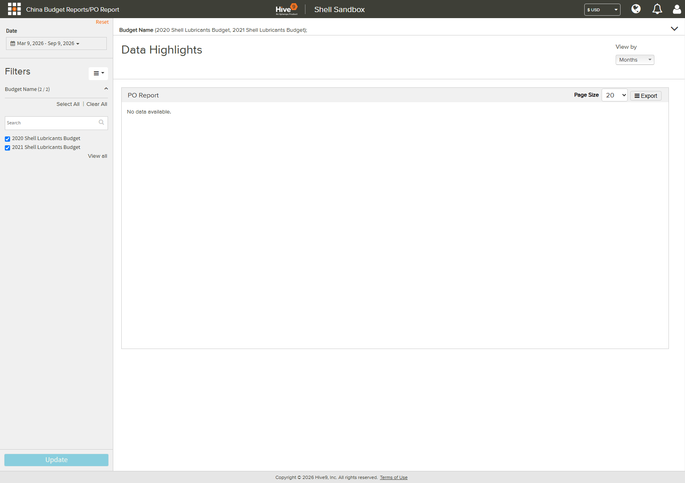

Figure 11 — PO Report. Note the custom-dashboard chrome: Date Range picker, a single 'Budget Name' filter group, 'View by' and a per-table Page Size and Export control.

## E4. Data Model Analysis

### E4.1 The two-database architecture

Restating the architectural fact from section E1, because every data-model question resolves to it:

| Database | Structure | Holds | Written by |
|---|---|---|---|
| Plan | Relational (normalised) | Plans, Campaigns, Programs/Initiatives, Tactics/Activities, Line Items, Budgets, Transactions, Purchase Requests, Accruals, Users, Roles, Teams, Attributes, Workflows | Users, imports and integrations via the Plan and Finance modules |
| Measure | Star schema (dimensional) | Performance facts — touches, responses, inquiries, MQLs, opportunities, closed deals, revenue — each related back to a Tactic | Connectors and one-off data loads only |

The star schema exists precisely so that facts arriving from many unrelated systems can be conformed against a single Tactic dimension. Once a fact is tied to a Tactic, it automatically inherits every cost figure and every segmentation attribute attached to that Tactic and its ancestors — which is what makes 'Top ROI by Cost Centre' possible without Cost Centre ever appearing in the source system.

### E4.2 Entity hierarchy and relationships

| Level | Default Hive9 name | Shell label | Cardinality | Notes |
|---|---|---|---|---|
| 1 | Plan | Plan | Root | Owns goals, teams, budget linkage, Eloqua/Marketo destination folders |
| 2 | Campaign | Campaign | 1 Plan → many | Carries Campaign-level custom fields (Cluster, Region, Business Unit …) |
| 3 | Program | Initiative | 1 Campaign → many | — |
| 4 | Tactic | Activity | 1 Program → many | The pivot of the whole model: costs, goals, attribution facts, media codes, integration ids all attach here |
| 4a | Line Item | Line Item | 1 Tactic → many | Allocates cost to Finance Budgets; the join between plan and finance |

Relationships that matter for Measure:

- A Tactic may be linked to multiple parent Programs across years (multi-year tactics).
- Tactics can be related to other Tactics, and Plans can be related to other Plans.
- Line Items link Tactics to Finance Budget items — this is the only structural bridge between the marketing plan view (Plan Budget dashboard) and the finance view (Finance Budget dashboard).
- Purchase Requests attach to Tactics and carry PR Line Items, which in turn carry vendor, delivery date and amount — the source for the entire PR Dashboard.
- Accrual Requests attach to Budget or Plan Budget line items and carry Accrual Request Line Items.

### E4.3 Consolidated metric dictionary

Every distinct metric observed anywhere in the Measure module, with its definition and its true origin. The Source column is the direct answer to 'do we fill this manually or does it come from a third-party system?'

| Metric | Definition | Source | Manual? |
|---|---|---|---|
| Goal Revenue | Planned revenue target for the period | Plan entry on Plan/Tactic; can be imported | Manual (or import) |
| Actual Revenue | Revenue credited to marketing by the attribution model | CRM connector (e.g. Salesforce) → Measure star schema | Integrated |
| Projected Revenue | Predicted revenue for the remainder of the period | Calculated — predictive model over actuals + goals | Derived |
| Goal <Stage> (INQ/MQL/Closed Won) | Planned stage volume | Plan entry on Tactic; defaults can come from the Tactic Type Model | Manual (or model default) |
| Actual <Stage> | Attributed stage volume | Marketing automation / CRM connectors | Integrated |
| Projected <Stage> | Predicted stage volume | Calculated | Derived |
| Stage Conversion % | Stage n ÷ stage n−1 | Calculated | Derived |
| Conversion Goal % | Planned conversion rate | Plan entry / Model | Manual |
| ROI | Return on investment using the designated attribution model | Calculated from attributed revenue and actual (or planned) cost | Derived |
| Plan Budget | Budget assigned within the marketing plan | Plan/Finance entry | Manual |
| Allocated Cost / Planned Cost | Cost allocated to line items | Plan entry (line-item allocation, optionally auto-distributed) | Manual |
| Actual Cost | Actual spend at standard FX | Finance transactions — usually ERP integration, or manual transaction entry/import | Integrated |
| Actual @ Monthly FX Cost | Actual spend at the FX rate of the month it occurred | Finance transactions × monthly FX table | Derived |
| Annual Budget / Total Budget / Budget YTD | Finance budget amounts | Finance Budget entry or import | Manual (or import) |
| Forecast | Finance budget forecast | Finance Budget entry | Manual |
| Burn Rate | Budget consumption rate | Calculated | Derived |
| Average approval days | Mean days from submission to sign-off | Calculated from workflow timestamps | System |
| GRSP Amount / Sum of GR/SE | Goods receipt / service performance value | ERP receipt transactions | Integrated |
| Invoice Amount | Value invoiced | ERP / AP integration | Integrated |
| PR Line Item Amount | Committed value on PR lines | Purchase Support entry | Manual |
| Vendor Performance % | Delivery reliability per vendor | Calculated from PR delivery dates vs receipts | Derived (needs receipts) |
| Planned − Actual Amount (in period) | Accrual candidate amount | Calculated | Derived |
| Activity/PO Occupied Amount & Rate | Budget consumed by activities / committed on POs | Calculated from Plan + ERP data | Derived |
| YTD Released Amount / % | Budget released to date | Finance Budget / ERP | Integrated |

### E4.4 Enumerations

| Enumeration | Values |
|---|---|
| Plan-object status (filter) | Created; Submitted; Declined; Approved; In-Progress; Complete (verified — the complete 6-value set) |
| Approval status | Created, Submitted, Declined, Approved, Closed |
| Purchase Request status | Created, Submitted, In-Review, Declined, Approved, Closed |
| Accrual Request status | Created, Submitted, ApprovedAndSent, InProgress, Closed, Declined |
| Accrual Request Line status | Created, Submitted, ApprovedAndSent, Processed, Declined |
| Tactic Category (this tenant) | AdminOnly, Asset, Asset_01, BC_Lubes, BC_Retail, BCPIR_Lubes, BCPIR_Retail, Mobility_UnlinkedActivity, PIR_Lubes, PIR_Retail, Promotion, SMP Plan on a Page |
| Tactic Type (this tenant) | ATL, ATL & BTL, BTL, Care and Maintain, Lubes BC, MOBILITY – Long-term Contracts, MOBILITY – Strategic Priorities, MOBILITY – Tactical Investments |
| Funnel stages (this tenant) | INQ → MQL → Closed Won |
| Aggregation | Monthly, Quarterly |
| View By entity | Plan, Campaign, Initiative (Program), Activity (Tactic) |
| Order | High to Low, Low to High |
| Page size | 5, 10, 20, 25, 50, 100 (grids default to 50; custom tables default to 20) |
| Currencies | AED, ARS, AUD, BRL, CAD, CHF, CNY, DKK, EUR, GBP, HKD, HUF, IDR, INR, MXN, MYR, NOK, OMR, PHP, PKR, PLN, RMB, SEK, SGD, THB, TRY, UAH, USD, VND, ZAR |
| Chart types (custom engine) | bar, pie, line, table, indicator |

### E4.5 Attribute (custom field) model

Segmentation attributes are the dimensions of every Measure dashboard, so their configuration rules are part of the Measure data model even though they are maintained in Administration:

- Attributes are defined instance-wide and can exist on every Plan object (Plan, Campaign, Program, Tactic, Line Item).
- Types: text box, single-select dropdown, multi-select dropdown.
- Attributes entered at a lower level can roll up into the level above on the grids.
- Attributes can be marked required — required for 'submit for approval', but not blocking record creation. Shown with an orange asterisk.
- Attributes support dependencies: a child attribute's available values are constrained by the parent's selection (e.g. Region → Country).
- Attributes can be driven by formulas — lookup, text manipulation, numeric, currency, and dependency-driving formulas.
- Attributes can be mapped to integrated third-party systems.
- Attributes can be custom-ordered on screen.

> Critical for replication: Multi-select attributes carry allocation semantics that directly affect Measure. When two values are selected, Hive9 splits both Cost and CVR (conversion/performance credit) 50/50 by default. The splits are independently editable and need only total 100% — the US might take 50% of cost but 75% of performance credit. This means a single Tactic's cost and performance can be apportioned across several values of the same dimension, and any replication of the star schema must model a bridge table with separate cost and performance weights, not a simple foreign key.

### E4.6 Goals

Custom Goals can be created for Plans and for the Tactics within them. Fields:

| Field | Rule |
|---|---|
| Goal Code | Exactly 4 characters; identifies the goal |
| Goal Name | Display name |
| Goal Type | Defines the entry type. Percentage goals are neither totalled nor averaged |
| Description | Short description |

A Custom Goal must first be added to a Plan before it can be chosen on a Tactic within that Plan — a sequencing dependency that catches users out.

## E5. Process Flows

### E5.1 End-to-end data flow into Measure

The sequence below is the master dependency chain. Every dashboard in the module is a read against the end of it, so any break upstream surfaces as an empty or wrong dashboard downstream.

| Step | Stage | What happens | Owner / system |
|---|---|---|---|
| 1 | Configure | Admin defines attributes, tactic types & categories, models, goals, finance budget levels, currencies, workflows | Administration |
| 2 | Plan | Users build Plan → Campaign → Program → Tactic → Line Item, entering planned cost and goals | Plan module |
| 3 | Budget | Finance budgets created; line items linked to budget items | Finance module |
| 4 | Commit | Once the Activity is approved, its line item requests an SWBS code from GSAP (daily file, interface FSSI 1523). The marketer submits the Hive9 PR form; it is approved in Hive9, e-mailed as an Excel file to the requisitioner and re-keyed by hand into GSAP with tracking number HX + line-item ID. GSAP returns the PR number, PO and invoices to the line item by daily file (interface PGSI 941). See Part D. | Plan + Purchase Support + GSAP |
| 5 | Transact | Actual cost transactions and goods receipts imported and linked to tactics/line items | ERP integration |
| 6 | Accrue | Accrual requests raised for planned-but-not-actualised amounts; approved; sent | Accruals |
| 7 | Execute | Tactics pushed to marketing automation (Eloqua/Marketo); media codes and integration ids assigned | Integrations |
| 8 | Collect | Connectors pull web analytics, marketing automation, CRM and lead-progression data, matched to tactics by unique tactic id / media code | Connectors |
| 9 | Attribute | The designated attribution model allocates credit across touchpoints | Measure star schema |
| 10 | Project | The predictive model extends actuals to end of period against goals | Measure |
| 11 | Report | Measure dashboards read and present the result | Measure module |

### E5.2 Workflow — reading the Summary dashboard

1. Open Measure › Summary.
2. Confirm the Year selection — this also determines which Plans are offered.
3. Select the Plans in scope, then any attribute filters, then press Update.
4. Choose the Tactic Category (the 'Asset' selector) — the default comes from the admin option 'Default Tactic Category'.
5. Read Projected vs Goal and the variance label to answer 'are we on track?'.
6. Use the four segment selectors to identify the leading segments by Revenue, Performance, Cost and ROI.
7. Scroll to the Waterfall section to see whether a specific stage conversion is below plan.
8. Click Details on the weak stage to open the Waterfall dashboard already scoped to that question.

### E5.3 Workflow — root-causing an under-performing stage

1. From Summary, click Details in the Waterfall section.
2. Set the stage selector (INQ / MQL / Closed Won To Plan) to the failing stage.
3. Set View By to Campaign and Sort By to the same stage, ordered Low to High, to surface the worst performers.
4. Click the worst-performing entry to promote it to the upper layer and reveal the level beneath it.
5. Repeat until reaching Activity (Tactic) level.
6. Use the orange breadcrumb on the entry to jump straight into that object in the Plan module and act.

### E5.4 Workflow — period-end accrual reconciliation

1. Open Measure › AR Invoice Details.
2. Set the Date Range to the accounting period.
3. Filter by Plan, Budget Name and Budget Item Name as required; optionally filter Accrual Request status.
4. Press Update.
5. Read the 'Planned − Actual Amount (in period)' column — this is the accrual candidate.
6. Expand rows from accrual request down to accrual request line item to see the detail.
7. Cross-check PO Count and the PR Dashboard's GRSP and Invoice amounts for the same period.
8. Raise or adjust accrual requests in the Accruals module; approvals then surface in the Approvals dashboard.

### E5.5 Workflow — data-quality / compliance audit

1. Open Measure › Plan Details.
2. Set the Date Range and select the Plans and Tactic Types in scope, then Update.
3. Read the completeness pies — 'Planned Cost Entered', 'Goal Entered', 'Is Integrated'.
4. Move to Custom Attributes – Tactic to check completeness of every segmentation attribute.
5. Export the individual charts for circulation to the owning teams.
6. Repeat on Custom Attributes – Program for the level above.

### E5.6 Dependency map

| Measure screen | Depends on (upstream) | Fails / empties when… |
|---|---|---|
| Summary | Goals on Plan/Tactic; attribution model; performance connectors; cost data | No goals entered, or no tactic integrated — both observed in this sandbox, producing all-zero output |
| Revenue | As Summary, plus Tactic Categories and Campaign custom fields for Group By | Same as Summary |
| Waterfall | As Summary, plus configured funnel stages | Stages not configured, or no stage data collected |
| Plan Budget | Plan budgets, line-item allocations, finance transactions, FX table | Line items not linked to budgets; no transaction feed |
| Finance Budget | Finance budgets, Finance Budget Levels configuration, transactions | No budget selected; budget has no levels configured |
| Approvals | Approval workflows configured and in use | No workflow enabled for the selected entity type |
| PR Dashboard | Purchase Support enabled; PRs with vendors and delivery dates; receipt transactions | Date range excludes delivery dates; receipts not imported (kills the vendor performance chart silently) |
| AR Invoice Details | Accruals feature enabled and configured; budgets; line items | Accrual feature not enabled; date range outside accrual dates |
| Plan Details | Custom attributes defined; tactics in scope | Date range excludes tactic dates |
| China Budget Reports | SAP integration supplying WBS, PO, GR/SE; specific budgets | Date range outside 2020–2021 budgets (observed); SAP feed interrupted |

## E6. Permissions & Access Control

### E6.1 The three-part model

| Construct | Rule | Effect in Measure |
|---|---|---|
| Role | A user has exactly one role. Roles grant create / edit / delete rights per hierarchy level (Plan, Campaign, Program, Tactic) and control whether a user can see content owned by members of another team. | Determines which plan objects appear at all in Measure results, and whether the orange breadcrumb drill-through into Plan is actionable or read-only. |
| Team | A user may belong to many teams. Each team has its own collaboration rules, including approval rights. | Determines approval visibility in the Approvals dashboard, and is a grouping dimension in several reports. |
| Teams assigned to Plans and Budgets | Plans and budgets are assigned to teams. | Scopes which plans and budgets are offered in the Plan and Budget Name filters. |

### E6.1.1 How a Role is actually configured

Role permissions are set across three tabs, one of which is dedicated to this module — which is the mechanism by which Measure access is granted or withheld:

| Tab | Controls |
|---|---|
| Plan | Create, edit and delete rights per hierarchy level (Plan, Campaign, Program, Tactic, Line Item) |
| Measure | Which Measure reports and dashboards the role can open. This is why the Measure menu differs between users of the same tenant. |
| Notification | Notification permissions for the role — the guide names this tab without detailing its settings |

Two further role-level content settings materially affect what Measure shows:

- Whether the role can see content owned by members of another team.
- Whether the role is restricted from financial information — a separate switch, which is what allows a user to see plan performance while being blocked from cost, budget and ROI figures.

> Field-level, not just row-level: The financial-information restriction means two users can open the same dashboard, apply the same filters, and legitimately see a different set of columns and tiles — not merely different row counts. Any replication needs field-level as well as row-level authorisation.

### E6.1.2 Two approval regimes

Approvals — and therefore the Approvals Dashboard — run on one of two distinct mechanisms, which is why the entity-type dropdown and the status vocabularies vary:

| Regime | Behaviour |
|---|---|
| Basic Approvals | Simple team-based sign-off |
| Approval Workflows (advanced) | Multi-level, configurable workflows with defined approver types and delegates |

| Workflow setting | Options |
|---|---|
| Approver type | User · Role · Record Owner · Custom Attribute — plus delegates |
| Eligible object types | Tactic · Purchase Request · Modified PR · Accrual Request |
| Accrual Duration | Previous month · Previous quarter · Year to date |

> Two non-obvious behaviours: 'Custom Attribute' as an approver type means the approver can be resolved dynamically from a field on the record (for example, route to the person named in a Contract Holder attribute). 'Modified PR' being a separate object type means a change to an already-approved purchase request re-enters approval as its own workflow.

### E6.2 Documented rules

- A user may belong to multiple teams; approval rights may differ per team.
- A user may have only one role.
- Whether a user can approve their own tactics is determined by the Approval Workflow and team settings — it is possible.
- Role permissions determine create/edit/delete at Plan, Campaign, Program and Tactic level; a user may see objects they cannot edit.
- Whether a user can see content owned by another team is a role setting.
- Administrators can impersonate users; regular users have privacy settings governing this.

### E6.3 Measure-specific access behaviour

| Area | Behaviour |
|---|---|
| Dashboard visibility | Custom dashboards are provisioned per tenant by Customer Success; access to a dashboard is granted rather than universal. A user who cannot see 'China Budget Reports' simply does not have it in the menu. The role screen lists eleven custom dashboards in this tenant — Plan Details, Actuals @ Hive9 Monthly FX, PR Track Invoices, Transactions Report, SWBS Not Received, Pending PR, China Budget Reports, Accrual Finance Report, Overlapping Actuals, SP & A Lubes - New and SP & A Mobility - New — each with separate View and Export permissions. The sandbox role sees two of them (section F4). |
| Data scoping | All dashboards inherit row-level scoping from role and team — two users on the same dashboard with the same filters can legitimately see different totals. |
| Saved views | Views can be personal or shared. Sharing a view shares the filter and column configuration, not the data — the recipient still sees only what their own permissions allow. |
| Accruals | Access to the accrual feature is granted explicitly by an administrator, and the Accrual Request step can be enabled or disabled within the Advanced Approval Workflow. |
| Currency | Every user can be assigned a default currency; the conversion table itself is editable only by users holding that permission. |
| Admin-only categories | The Tactic Category list in this tenant includes an 'AdminOnly' value, indicating category-level visibility control. |

> Verification gap: This analysis was run with a single sandbox account (role Business Champion). The permission settings of all 20 roles were read from Settings › Roles and are tabulated in section F4, but behaviour under each role was not exercised. A short multi-role pass is recommended before this section is relied on for design decisions.

## E7. Integration & Dependency Analysis

### E7.1 Why integration is not optional

The product guide is unambiguous: plan performance can be entered manually, but the module only adds real value when connectors populate the performance data. The sandbox analysed here demonstrates the point — with 'Is Integrated: No' on all 28 tactics and 'Goal Entered: No' on all 28, every revenue, waterfall and ROI figure reads zero while the plan-side and finance-side reports (Plan Details, China Budget Reports) are fully populated.

### E7.2 Connector categories

| Category | Feeds | Drives |
|---|---|---|
| Web analytics | Sessions, visits, engagement touches | Early-stage waterfall volumes; attribution touchpoints |
| Marketing automation (Eloqua, Marketo) | Responses, inquiries, MQLs; Hive9 can also push tactics out | INQ and MQL stages; tactic execution |
| CRM (e.g. Salesforce) | Opportunities, closed deals, revenue | Closed Won stage; Actual Revenue; ROI |
| Lead progression | Stage transitions | Conversion rates between stages |
| ERP / finance — GSAP (Shell's SAP) | SWBS codes, PR numbers, POs, invoices, service entries and actual cost transactions — exchanged by daily CSV files over SFTP (interfaces FSSI 1523 and PGSI 941), not by API. See Part D. | Plan Budget actuals; Finance Budget actuals; PR Dashboard; AR Invoice Details; China Budget Reports |

> Important: Data from different systems can feed different stages — one system may provide Responses while another provides MQL and Closed Deals. Not every field needs to be integrated. This means a tenant's Measure output is typically a patchwork, and understanding which stage comes from which system is a prerequisite to interpreting any waterfall.

### E7.3 How facts are matched to the plan

Performance data is collected from multiple sources against unique tactic IDs and media codes, so that performance can be aggregated into analysable views. The join keys observed or documented are:

- Tactic ID — the primary key of the Tactic dimension.
- Media Code — managed in the Plan module (Media Code Management) specifically for this purpose.
- Integration Id — a dedicated field on the tactic, exposed as a column in the Plan grid.
- External Name — configured on Models, used to align Hive9 names with third-party system names.
- Line Item ID — the key GSAP uses when it returns an SWBS code; the response is matched to the line item on this ID.
- HX + Line Item ID (e.g. HX64307) — typed by the requisitioner into the GSAP PR's tracking-number field. It is how GSAP's PR, PO and invoice data find their way back to the right Hive9 line item.
- SWBS (WBS) Code and Cost Centre — the SAP-side accounting keys, visible in Transactions, the China Budget Reports and the PO Report.

### E7.4 Integration setup (Administration › Integrations)

1. Menu › Settings › Integrations › Add Integration.
2. Choose the platform.
3. Enter the platform-specific connection information.
4. Click 'test integration credentials' and confirm the success message.
5. Save.
6. Expand the Push and Pull sections and complete the mapping for each required area, using the dropdowns to expose field data from the integrated system.
7. Save.
For Eloqua and Marketo, if tactics are pushed from Hive9 a destination folder must be configured at Plan level. Eloqua folders may be hierarchical (e.g. North America/Pending); Marketo folders must sit in the root Marketing Activities folder.

### E7.5 Attribution models

Hive9 supports eight named attribution models plus a custom statistically-inferred model. Users select one of these nine as the source for ROI calculations throughout the performance module — so the same underlying data can produce materially different ROI depending on this single setting.

| # | Model | Credit allocation | Best suited to |
|---|---|---|---|
| 1 | First Touch | All credit to the first touch | Demand-generation / awareness attribution |
| 2 | Last Touch | All credit to the last touch | Conversion-focused attribution |
| 3 | Equally Distributed | All touches share credit equally | Simple multi-touch baseline |
| 4 | Interaction Weighted | Each interaction type is weighted by the organisation; weighting is applied to the equal distribution | Organisations with a clear view of channel value |
| 5 | Linear Time Decay | All interactions count; newer interactions weigh more | Longer demand cycles |
| 6 | ½-life Time Decay | As linear decay but skewed significantly toward recent activity | Shorter demand cycles |
| 7 | U-shaped (position) | First and last touch receive equal weighting | Journeys with clear entry/exit |
| 8 | W-shaped (position) | First touch, last touch and the 'lead' inflection point receive equal credit | Journeys with a defined lead-creation milestone |
| 9 | Custom statistically inferred | Derived model, activated with the client success team | Mature, data-rich tenants |

### E7.5.1 Models — where every projected number actually comes from

Attribution decides how credit is shared out. The MODEL decides what the future looks like. Models are configured in Administration and are the true origin of every 'Projected' figure in Measure, so they are the first thing to build in a replication:

| Model field | What it does |
|---|---|
| Stages | Defines the funnel — in this tenant INQ → MQL → Closed Won |
| Conversion Rates | The expected percentage moving from each stage to the next. This is what turns a goal at one stage into projected volumes at every later stage. |
| Velocity | The expected time lag between stages. This is what places a projected conversion in a particular month rather than immediately. |
| Average Deal Size (ADS) | Converts projected Closed Won volume into projected revenue. |
| Allowed as Target Stage | Marks which stages a goal may be set against. A goal can only be entered at an allowed stage, and projection then runs forward from there. |
| Integration assignment | Models carry the integration mapping. This is the origin of the 'Is Integrated' flag reported on the Plan Details dashboard. |
| External Name | The name used to align Hive9 objects with third-party systems. It is generated only once the Tactic reaches Approved status, and has a 'Regenerate On Edit' option. |

> Critical dependency: Two consequences follow. First, changing a Model's conversion rates or ADS silently changes every projected number and every ROI in the module — there is no version stamp on the dashboards to tell you which model version produced a figure. Second, because External Name is only generated at Approved status, a tactic that is never approved can never be matched to third-party performance data, and will permanently read 'Is Integrated: No'.

### E7.6 Currency and FX dependency

- The instance maintains a universal conversion table, editable only by permitted users.
- Each user can be assigned a default currency.
- 'Use Monthly Actual Rates' can be enabled per currency for actuals.
- 'Use Monthly Rates for Purchase Requests' can be enabled per currency for PRs.
- These two options are what create the 'Actual Cost' versus 'Actual @ Monthly FX Cost' distinction that appears throughout the Plan Budget and Finance Budget dashboards.

### E7.7 Cross-module interaction summary

| Measure screen | Reads from | Writes to | Navigates to |
|---|---|---|---|
| Summary | Plan, Measure star schema | Nothing | Waterfall (Details) |
| Revenue | Plan, Measure star schema | Nothing | Plan objects (breadcrumb) |
| Waterfall | Plan, Measure star schema | Nothing | Plan objects (breadcrumb) |
| Plan Budget | Plan, Finance transactions, FX | Nothing | Plan objects (breadcrumb) |
| Finance Budget | Finance budgets, transactions | Nothing | — |
| Approvals | Approval workflow history across all approvable objects | Nothing | — |
| PR Dashboard | Purchase Requests, vendors, receipts | Nothing | — |
| AR Invoice Details | Accruals, budgets, line items, POs | Grid view options only (user preference) | Row actions |
| Plan Details | Plan objects and their attributes | Nothing | — |
| China Budget Reports | Finance budgets, PRs/POs, SAP receipt data | Nothing | — |

Measure is read-only with one narrow exception: AR Invoice Details persists the user's own grid column configuration. No Measure screen changes business data.

### E7.8 Technical / platform dependencies

| Dependency | Detail |
|---|---|
| Authentication | OpenID Connect against h9auth.hive9.com; client_id RevenuePlanner, response_type id_token, scope 'openid profile roles', form_post response mode, redirect to /signin-oidc |
| Session | Application timeout is an administrator-configurable setting |
| Fiscal calendar | /api/FiscalCalendar/GetFiscalYears is called on every standard report load — the fiscal calendar is a hard dependency of the time axis |
| Timezone | /api/User/UpdateUserTimezone is posted on page load; the client timezone influences date boundaries |
| Monitoring | New Relic browser agent (bam.nr-data.net) is active on every page |
| Charting | Mixed stack — inline SVG, Chart.js (chartjs-render-monitor) and a Highcharts-style JSON series contract for the custom engine |
| Support | In-application support request available from the upper-right corner; response times per support package |

## E8. Observations & Recommendations

### E8.1 Strengths

- The star-schema design genuinely solves the hard problem: any external fact tied to a Tactic instantly inherits the full cost and segmentation context, which is why 'Top ROI by Cost Centre' works without Cost Centre existing in the CRM.
- Prediction is built into every stage chart rather than bolted on, and the Today split is applied consistently.
- The self-configuring Plan Details dashboard scales automatically with the tenant's attribute model — no report maintenance is needed when a new attribute is added.
- Drill-through with the orange breadcrumb closes the loop from insight to action in one click.
- Column metadata is server-driven (field, title, type, width, precision, alignment), making grids consistent and localisable.
- The completeness charts turn data quality into a first-class, visible metric.

### E8.2 Gaps, risks and usability concerns

| # | Observation | Impact | Recommendation |
|---|---|---|---|
| 1 | Two entirely different UI paradigms coexist (Year checkboxes vs Date Range picker; global filters vs per-dashboard filters). | Users must learn two mental models; filter state does not carry across, so a user who filtered on Summary sees an unfiltered Plan Details. | Converge the filter chrome, or at minimum surface an explicit banner stating which filter context is active. |
| 2 | Mixed-granularity time axis when multiple years are selected (2020 \| 2021 \| 2022 \| 2025 \| Jan 2026 … Dec 2026) is unlabelled. | Bar heights are not comparable across the axis; easy to misread badly. | Label the aggregated buckets explicitly (e.g. 'FY2020 total') or offer a consistent-granularity toggle. |
| 3 | Filter state persists across sessions and across reports. | The single most common cause of 'my dashboard is empty' — a filter set weeks ago still applies. | Show an always-visible 'filters applied' summary chip with a one-click reset on every report (AR Invoice Details already does this — generalise it). |
| 4 | Empty states are ambiguous. 'No data available', 'No records found' and 'Your AR Invoice Details goes here.' do not distinguish no-data from not-configured from not-permitted. | Users cannot self-diagnose; support load. | Differentiate empty states and, where a dependency is missing (e.g. receipts not imported for Vendor Performance), say so explicitly. |
| 5 | Vendor Performance Percentage silently renders empty without receipt transactions. | A governance metric appears to show perfect or zero performance when it is simply not fed. | Render an explicit 'requires receipt import' state. |
| 6 | Status vocabularies are inconsistent across related objects (PR has In-Review; Approvals does not. Accrual header has InProgress, line has Processed). | Cross-object reporting and any replication effort must special-case each enumeration. | Normalise into a single status taxonomy with per-object subsets. |
| 7 | PO Occupied Rate of 325.44% displayed with no warning treatment. | Over-commitment against released budget is invisible unless the reader is looking for it. | Add conditional formatting and an exception view for rates over 100%. |
| 8 | Un-substituted import template placeholders present in live user data ('${user.firstName}'). | Access audit data is unreliable; suggests weak import validation. | Add import-time validation rejecting unresolved placeholders, and clean the existing record. |
| 9 | ROI can be computed from Planned Cost when 'Use Planned Cost as Actual Cost' is enabled, with no on-screen indication. | Two tenants — or the same tenant before and after a config change — can show incomparable ROI with identical labels. | Surface the active cost basis and the active attribution model in the ROI widget itself. |
| 10 | Attribution model choice materially changes every ROI number but is not displayed on the dashboards. | Results are not self-describing or reproducible. | Display the active model name alongside ROI and in exports. |
| 11 | Date filtering uses overlap semantics (MaxStartDate / MinEndDate) so multi-year tactics appear in several periods. | Counts double across periods; totals across years are not additive. | Document explicitly and consider an 'entirely within period' option. |
| 12 | Custom dashboards depend on Customer Success for creation and change. | No self-service; change latency and vendor dependency. | Confirm the change process and SLA; consider whether a self-service dashboard builder is required in a replication. |
| 13 | Internal sort columns ([<Column>Sort]) leak into custom table payloads. | Cosmetic in the UI but confusing in exports and in any API consumption. | Filter them server-side. |
| 14 | Three group-by segments (Cluster, Region, Business Unit) are Campaign-level fields not available as Activity-level filters. | Users can group by a dimension they cannot filter by. | Make the asymmetry explicit in the UI, or promote the fields. |

### E8.3 Recommendations for a replication programme

If the objective is to rebuild this capability, the following sequence reflects the true dependency order discovered during the analysis:

1. Build the configuration layer first — hierarchy naming, custom attributes (with dependency and formula support), tactic types and categories, models, custom goals, finance budget levels, currencies with monthly rate support, roles, teams and approval workflows. Almost every Measure screen is generated from this layer, so it cannot be retrofitted.
2. Model the attribute bridge correctly. Multi-select attributes require separate cost and performance weights per value, summing to 100% independently. A naive foreign key will make ROI-by-segment unbuildable.
3. Implement the two-store architecture. A normalised operational store plus a dimensional star with Tactic as the conforming dimension is the design that makes cross-system analysis tractable.
4. Define the join keys early — tactic id, media code, integration id, external name, WBS code, cost centre. These are the contract with every external system.
5. Treat attribution as a pluggable, named, versioned component, and stamp the model name onto every derived number.
6. Build the generic dashboard engine (chart/table definitions with ReportID, chart type, symbol, legend and label configuration) rather than hand-coding dashboards — this is what makes Plan Details self-configuring and the custom packs maintainable.
7. Decide the cost basis policy explicitly (actual vs planned-as-actual; standard vs monthly FX) and expose it in the UI.
8. Standardise one filter paradigm and one set of status enumerations before building any screen.

### E8.4 Open questions to confirm with Uptempo / Customer Success

- What is the exact specification of the predictive/projection model that generates Projected Revenue and Projected stage volumes?
- Which attribution model is currently designated as the ROI source for this tenant?
- Is 'Use Planned Cost as Actual Cost' enabled in production, and does it differ from the sandbox?
- What is the refresh cadence of each performance connector (CRM, marketing automation, web analytics)? The GSAP exchange is known to be a daily batch with a 24–48 hour round trip; the others are not.
- The sandbox tenant defines eleven custom dashboards (section F4). Which exist in production, and what do the nine not visible to our role show?
- What is the change-request process and SLA for custom dashboards and reports?
- Are there Measure REST APIs available for external consumption, or is the module UI-only?
- What are the volume limits — maximum rows on export, maximum plans selectable, grid paging ceilings?

## E9. Plain-English Guide — what every control does

This section restates the whole module in everyday language. No jargon, no field names — just what each thing is for and when you would actually use it. It is written so that somebody who has never seen Hive9 can sit down and use Measure.

### E9.1 The module in one paragraph

Measure is the reporting part of Hive9. You cannot change any numbers here. Everything you see is pulled from three places: what your marketing team typed into the plan, what finance recorded about money, and what connected systems (your CRM, marketing automation, web analytics and SAP) sent in automatically. Measure joins all of that together and shows you whether the plan is working.

### E9.2 The nine screens, in one line each

| Screen | Use it when you want to… |
|---|---|
| Summary | …get the one-screen answer to 'are we on track this year?' and see which parts of the business are doing best. |
| Revenue | …rank campaigns, initiatives or activities by the money they brought in, and drill into the weakest or strongest. |
| Waterfall | …do the same ranking but for a funnel stage (leads, qualified leads, closed deals) instead of revenue, to find where the funnel is leaking. |
| Plan Budget | …see what marketing is spending over time compared with what it planned and what it was given, from the marketing team's point of view. |
| Finance Budget | …see the same money from finance's point of view — by budget, cost centre and GL code — and check how fast the budget is being used up. |
| Approvals Dashboard | …find out what is stuck awaiting approval and how long approvals are taking. |
| PR Dashboard | …see what you have committed to spend with each supplier, when it is due, and which suppliers actually deliver on time. |
| AR Invoice Details | …work out, at month end, what has been planned but not yet actually paid, so you can accrue for it. |
| Plan Details | …check the quality and balance of your own data — how activities and money are spread across your categories, and what information is missing. |
| China Budget Reports | …run the China-specific budget, purchase-order and goods-receipt reports. |

### E9.3 The controls you will see on almost every screen

| Control | In simple words | When you'd use it |
|---|---|---|
| Currency ($ USD) | Changes the money symbol and converts every amount into the currency you pick. | When you report to a regional team that works in euros, rupees or renminbi. |
| My Saved Views | Remembers a set of filters and columns under a name so you do not have to set them up again, and lets you send that setup to colleagues. | When you run the same report every month, or want everyone in a meeting looking at exactly the same view. |
| Year | Picks which year(s) of data to look at. | Always — it is the first thing that shapes everything else, including which plans you can then choose. |
| Plan | Picks which marketing plan(s) to include. | When you only care about one country, brand or business. |
| Attributes (Plan / Campaign / Initiative / Activity tabs) | Lets you narrow the data by your own business categories — brand, country, cost centre, channel and so on. Each tab holds the categories that belong to that level of the plan. | When you want 'just Helix', 'just Germany' or 'just digital channels'. |
| (Not Completed) | A special value in every category meaning 'nobody filled this in'. | When you are chasing teams to complete their data — tick it to see only the records with the gap. |
| Select All / Clear All | Ticks or unticks everything in one category at once. | Faster than clicking 30 boxes; Clear All then pick two is usually quickest. |
| Search box in a category | Appears automatically when a category has more than ten options, so you can type instead of scroll. | Essential for Cost Centre, which has over 1,200 options. |
| Update | Applies everything you just chose. Nothing changes on screen until you press it. | Every single time you change a filter — this is the most commonly forgotten step. |
| Date Range (on some screens) | Instead of whole years, you pick an exact from–to date. | On the PR, AR Invoice and custom dashboards, which work in date windows rather than years. |
| Monthly / Quarterly | Whether the chart shows one bar per month or per quarter. | Quarterly for board reporting; monthly for operational detail. |
| Tactic Category (the 'Asset' box) | Limits the report to one type of marketing activity. | When you only want to see, say, promotions, or only business-case activities. |
| View By | Chooses what each row of the ranking represents — a plan, a campaign, an initiative or an activity. | Start high (Campaign) and go lower as you narrow down the problem. |
| Group By | Adds a second way of bundling the rows, such as by owner or by region. | When you want to see results by the person or team responsible. |
| Sort By / High to Low | Chooses which number the ranking is ordered on, and which end comes first. | Low to High is how you find your worst performers. |
| Per page (5–100) | How many ranked rows to show at once. | Raise it when you are exporting or scanning a long list. |
| Share Report | Sends or shares the whole configured report. | When a colleague needs the same report without rebuilding it. |
| Details | Jumps you to the fuller dashboard behind a summary panel. | From Summary, to go deeper on revenue or on the funnel. |
| Export (per chart, custom dashboards) | Downloads just that one chart or table. | When you need a single chart for a slide. |
| The (i) icon | Shows a short explanation of that particular chart. | When you are unsure what a number actually means — it is genuinely useful on the Revenue screen. |
| Orange breadcrumb on a ranked row | A shortcut straight to that campaign or activity in the planning part of Hive9. | The moment you spot a problem and want to fix it rather than just look at it. |

### E9.4 The numbers, explained without jargon

| You will see | It means | Where it comes from |
|---|---|---|
| Goal | The target somebody typed into the plan. | Typed in by your team |
| Actual | What really happened, so far. | Sent in automatically by a connected system |
| Projected | What Hive9 thinks will happen for the rest of the year, based on your plan's model. | Calculated |
| Above Plan / Below Plan | Whether you are ahead of or behind the target, and by how much. | Calculated |
| Today line on a chart | Everything left of it really happened; everything right of it is a forecast. | Calculated |
| INQ / MQL / Closed Won | The stages of your funnel: an enquiry, a lead good enough for sales, and a won deal. | Connected systems |
| Conversion % | Out of everyone who reached one stage, how many moved to the next. | Calculated |
| ROI | What you got back for what you spent. | Calculated |
| Plan Budget | The money marketing was given, inside the marketing plan. | Typed in |
| Planned / Allocated Cost | The money marketing intends to spend. | Typed in |
| Actual Cost | The money actually spent. | Usually from the finance system |
| Actual @ Monthly FX Cost | The same spend, but converted using the exchange rate of the month it happened in rather than today's rate. | Calculated from finance data |
| Forecast | Finance's latest expectation for the budget. | Typed in |
| Burn Rate | How quickly the budget is being used up. | Calculated |
| Budget YTD / Planned YTD | How much of the budget or plan you should have used by this point in the year. | Calculated |
| GRSP / GR-SE Amount | The value of goods and services you have actually received. | From SAP |
| Invoice Amount | The value that has actually been billed to you. | From SAP |
| PR / PO Line Amount | The value you have committed to a supplier. | Purchase requests in Hive9 |
| To Be Delivered | Committed but not yet received. | Calculated |
| Planned − Actual Amount (in period) | Money you expected to spend this period but have not actually paid — in other words, what you probably need to accrue. | Calculated |
| Occupied Amount / Rate | How much of the released budget has been taken up by activities or by purchase orders. | Calculated |
| Average approval days | How long, on average, people take to approve things. | Calculated from the system's own timestamps |

### E9.5 If a screen looks empty, check these in order

1. Did you press Update? Filters do nothing until you do.
2. Is the Year or Date Range right? Custom dashboards default to the last six months only, and the PR and AR screens default to the current year.
3. Is the right Plan selected? Changing the Year changes which plans are even offered.
4. Did a filter you set weeks ago survive? Filter choices are remembered between logins. Use Clear All or Set Default View to start clean.
5. For revenue and funnel screens: has anyone actually entered goals, and is the activity connected to a source system? Open Plan Details and look at the 'Goal Entered' and 'Is Integrated' charts. If both say No, the dashboards cannot show anything — this is exactly the situation in the sandbox reviewed here.
6. For the supplier-performance chart: it stays blank unless goods-receipt data is being imported.

### E9.6 A five-minute first session

1. Open Measure › Summary. Set the Year, tick the plans you own, press Update.
2. Read the big number: projected revenue against goal, and whether it says Above or Below Plan.
3. Look at the four league tables and change the category box on each to whatever matters to you — brand, country, cost centre.
4. Scroll down to the funnel. Find the stage whose conversion is furthest below its goal.
5. Press Details next to it. You are now in Waterfall, focused on that stage.
6. Set View By to Campaign, Sort By to that stage, and order Low to High. The worst performers are now at the top.
7. Click the worst one to drill a level deeper, then use the orange breadcrumb to open it in the planning screens and do something about it.

## E-A. Complete API inventory

Every endpoint observed while exercising the Measure module, captured by network interception.

### E-A.1 Standard report endpoints (MVC controller)

| Method | Endpoint | Purpose |
|---|---|---|
| GET | /NewReport/ReportOverview | Summary page shell |
| POST | /NewReport/GetSummaryData/ | Summary data (timeframeOption, assetType, isQuarterly, planIds, filterOptionsString) |
| GET | /NewReport/ReportRevenue | Revenue page shell |
| GET | /NewReport/GetReportData/?reportType=Revenue | Revenue report configuration |
| POST | /NewReport/GetCardDropDown/ | Returns the HTML control bar (View By, Group By, Sort By, Compare) — payload reportName=Revenue\|Finance\|… |
| POST | /NewReport/Revenue/ | Revenue chart/series data |
| POST | /NewReport/RevenueCardSection | Revenue STACK-RANKED CARD LIST (paged) — not the heads-up display |
| GET/POST | /NewReport/LoadSparkLineChartPartial | Partial refresh of ONE Summary league table (strCutomfield, timeFrameOption, strRevenueType, planIds) |
| GET | /NewReport/ShowShareReport/?reportType= | Loads the Share Report modal |
| POST | /NewReport/ExportToExcelFinanceData | Ranked-list export; redirects to ExportCsvFinanceData |
| GET | /NewReport/ReportWaterfall | Waterfall page shell |
| POST | /NewReport/WaterFall/ | Waterfall chart/series data |
| POST | /NewReport/WaterfallCardSection | Waterfall stack-ranked card list (paged) |
| GET | /NewReport/ReportFinance | Plan Budget page shell |
| POST | /NewReport/GetReportData/ (reportType=Budget) | Plan Budget configuration |
| POST | /NewReport/Finance/ | Plan Budget chart/series data |
| POST | /NewReport/FinanceCardSection | Plan Budget STACK-RANKED CARD LIST (viewBy, filterBy, searchString, page, pageSize, financeSortBy, orderBy) — NOT the heads-up display |
| POST | /api/PlanOverview/GetPlanHUD | THE heads-up display for the stack-ranking screens. Returns PlanTotalCount, MediaCodesCount, PlanAnnualBudget, TacticAnnualPlannedCost, Stages, per-month count arrays and MonthlyActual |
| GET | /api/FinanceBudget/GetBudgets | Budget selector options; returns 17 fields per budget |
| GET | /NewReport/ReportFinanceBudget | Finance Budget page shell |
| GET | /NewReport/ReportApproval | Approvals page shell |
| GET | /NewReport/ReportPurchaseRequest | PR Dashboard page shell |
| POST | /Filter/Index | Left filter panel state / saved-view preset load |
| GET | /Filter/GetFilterPresetByUserId?activeMenu=Report | The user's saved presets |
| POST | /Filter/UpdatePresetValues | Save changes to a preset |
| POST | /Filter/LastSetOfViews | Read the last-used filter state |
| POST | /Filter/SaveLastSetOfViewFilter | Persist the last-used filter state (why filters survive logout) |
| GET | /Filter/GetPlanListForFilter | Plan list for the selected years |
| GET | /Filter/GetOwnerListForFilter | Owner lists |
| GET | /Filter/GetTacticTypeListForFilter | Activity Type list |
| GET | /Accruals/GetARFilterPresetByUserId | Saved presets on AR Invoice Details |
| POST | /Accruals/UpdateARPresetValues | Save an AR Invoice Details preset |

### E-A.2 Web API endpoints

| Method | Endpoint | Purpose |
|---|---|---|
| POST | /api/FiscalCalendar/GetFiscalYears | Fiscal year definitions (called on every report) |
| POST | /api/User/UpdateUserTimezone | Records the client timezone |
| GET | /api/User/GetClientUserList | User list for owner/approver filters |
| POST | /api/FinanceBudgetReport/FinanceBudgetOverview | Finance Budget metrics and series |
| POST | /api/FinanceBudgetReport/FBFilters | Finance Budget filter options |
| GET | /api/ApprovalReport/GetApprovalActivityViewOptions | Approval grid column view options |
| POST | /api/ApprovalReport/GetHeaderMappings | Approval grid column definitions (label, field, format, length, precision, alignment) |
| POST | /api/ApprovalReport/GetApprovalActivity | Approval activity rows |
| POST | /api/ApprovalReport/GetApprovalForReports | Current approval status distribution |
| POST | /api/ApprovalReport/GetAverageNoOfDaysForApproval | Mean approval cycle time |
| POST | /api/ApprovalReport/GetPlanOverviews | Resolves the filter selection to Campaign/Program/Tactic/LineItem/PR id sets |
| GET | /api/ApprovalWorkflows/GetClientAllApprovalWorkflows | All approval workflows |
| GET | /api/ApprovalWorkflows/GetCustomFieldGroupApprovalObjectsForApprovalReport | Custom attribute group approvals |
| GET | /api/CustomObjectWorkflows/GetCustomObjectWorkflowsForEntity | Custom object workflows |
| GET | /api/CustomObjectWorkflows/IsAWFFeatureActive?customObjectType=Accrual Request | Whether Advanced Approval Workflow governs accruals |
| POST | /api/PurchaseRequestReport/GetPurchaseRequestReportData | PR charts (by vendor / by owner / vendor performance) |
| POST | /api/PurchaseRequestGrid/GetPRHUD | PR heads-up display counts and amounts |
| GET | /api/PurchaseRequestGrid/GetPRGridViewOptions | PR grid column view options |
| GET | /api/PurchaseRequestGrid/GetPRGridsViewByOptions | PR 'view by' options (Hierarchy) |
| POST | /api/ARInvoiceDetail/GetARInvoiceDetailOverviewGrid | AR grid data + column metadata |
| GET | /api/ARInvoiceDetail/GetARInvoiceGridViewOptions | AR grid saved column configuration |
| POST | /api/ARInvoiceDetail/SaveARInvoiceGridViewOptions | Persists the user's AR column configuration |
| POST | /ARInvoiceDetail/FilterIndex | AR filter panel state |
| GET | /api/Accruals/GetARGridsViewByOptions | AR 'view by' options (Hierarchy) |

### E-A.3 Custom dashboard engine endpoints

| Method | Endpoint | Purpose |
|---|---|---|
| GET | /Measure/Home | Dashboard page shell (DashboardID, DashboardPageID, …) |
| POST | /Measure/Home/HomeContent | Dashboard page layout and widget definitions |
| POST | /Measure/Home/GetChart | Chart data — payload JsonModel carries ReportID, MeasureID, ChartType, DisplayName, DefaultRows, Symbol, legend/label configuration, ChartColor palette, DashboardContentId, DashboardId, HelpTextId |
| POST | /Measure/Home/GetLineChart | Line chart data |
| POST | /Measure/Home/GetTableData/ | Table data — reportTableId, dashboardId, viewAll, sortColumnName, skip, take, dimensionDates[] |
| GET | /Measure/Home/GetTableRowsCount/ | Row count for paging |
| POST | /Measure/Home/AddFilters | Applies the dashboard's filter selection |
| GET | /Measure/Home/InsertDateRange/ | Sets the dashboard date range (StartDate, EndDate) |
| POST | /Measure/Home/LoadAgrigationStatus/ | Back-end data-refresh (ETL) job status — returns NOTRUNNING / running / copying. Despite the name this is NOT the 'View by' aggregation state; it is what drives the 'data is being refreshed' banner |
| POST | /Measure/Home/Export | Widget export (CSV / Excel) |
| POST | /Measure/Home/KeyData | Key indicator values |
| GET | /Measure/Home/UserPhoto | User avatar |

### E-A.4 Chart definition contract (JsonModel)

Every custom-dashboard widget is described by the same object. Reproducing this contract is the core of replicating the engine. The properties below are the ones that govern what the user sees and are the practical minimum to implement:

> Subset, not the whole schema: The full JsonModel carries approximately 119 properties. The 22 documented here are those observed to drive rendering; the remainder are largely layout, styling and internal bookkeeping. Treat this table as the working subset, not as the complete schema — capture the live payload before building against it.

| Property | Type | Meaning |
|---|---|---|
| ReportID | int | The underlying report/query definition |
| MeasureID | int | The measure within that report |
| ChartType | string | bar \| pie \| line \| table \| indicator |
| DisplayName | string | Widget title, e.g. 'Planned Cost by Tactic Type' |
| DefaultRows | int | Rows/slices to render (5 for bars, 20 for pies observed) |
| Symbol | string | '$' renders values as currency; empty renders counts |
| IsLabelDisplay / LabelPosition | bool / string | Axis label rendering |
| IsLegendVisible / LegendPosition | bool / string | e.g. 'right,middle,y' |
| IsDataLabelVisible / DataLablePosition | bool / string | e.g. 'LEFT' |
| IsMutlipleAxis | bool | Dual-axis rendering (note the product's spelling) |
| DisplayAsColumn | int | Column vs bar orientation |
| ShowFooterRow | bool | Totals row on tables |
| DisplayTitle | bool | Whether the title renders inside the chart |
| ChartColor | string | A 20-colour palette, comma separated, beginning #258387, #345096, #E0AA3B, #E0873B |
| DashboardContentId | int | Placement of the widget on the page |
| DashboardId | int | Owning dashboard |
| HelpTextId | int | Drives the per-widget (i) help icon |
| GraphPosition / Label | string | Layout position and label override |

The response returns: data (a JSON series — either {categories[], series[]} for bar/line or [{name, y, color}] for pie), dimensionName, MeasureName, MeasureOutputValue[], FilterdYears[], IndicatorCurrentValue, IndicatorComparisonValue, IndicatorGoalValue, IndicatorDimensionName, IsIndicatorDisplay and DistributedGoalValue.

## E-B. Screen gallery

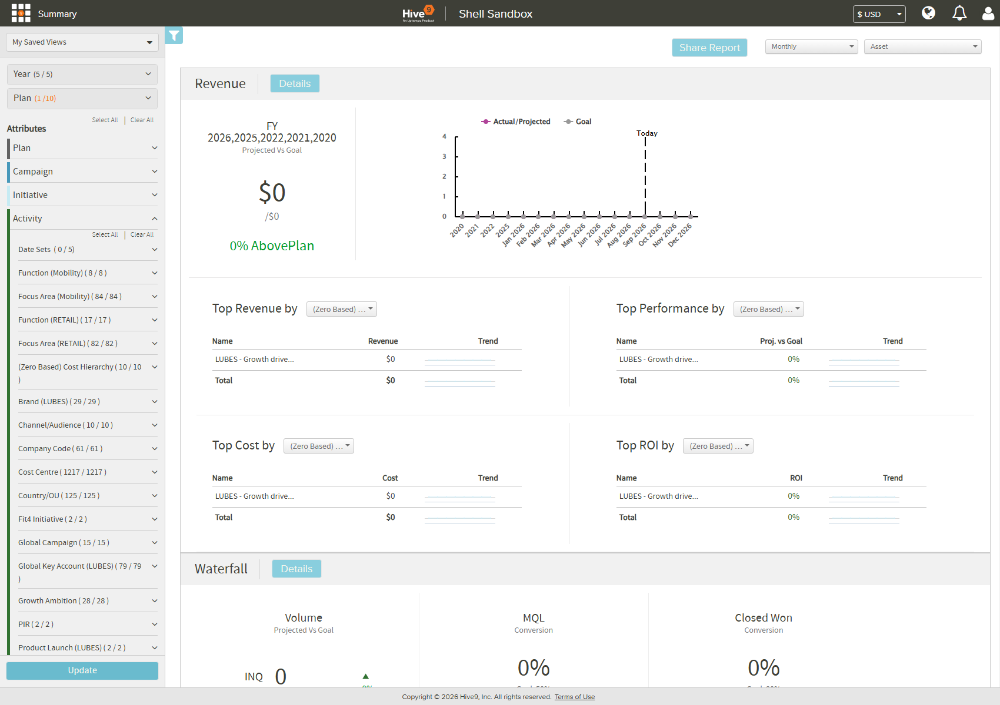

Figure 12 — Summary dashboard

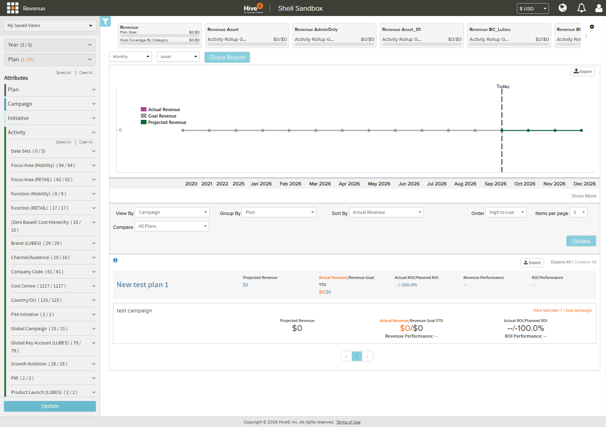

Figure 13 — Revenue dashboard, showing the goal-coverage HUD and the Actual/Projected/Goal trend

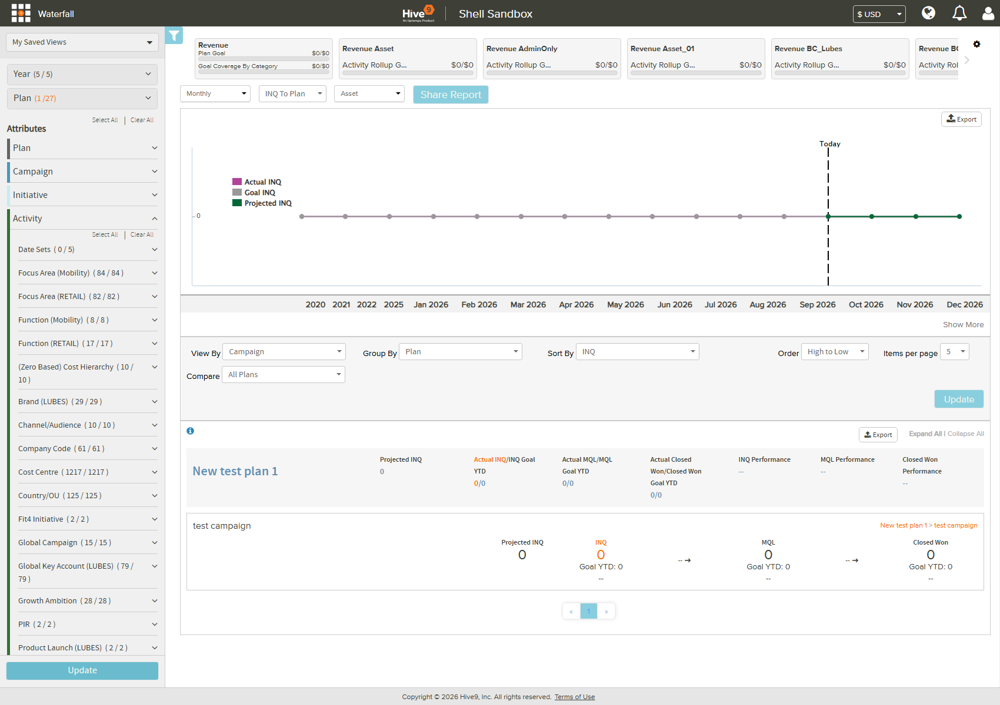

Figure 14 — Waterfall dashboard with the stage selector

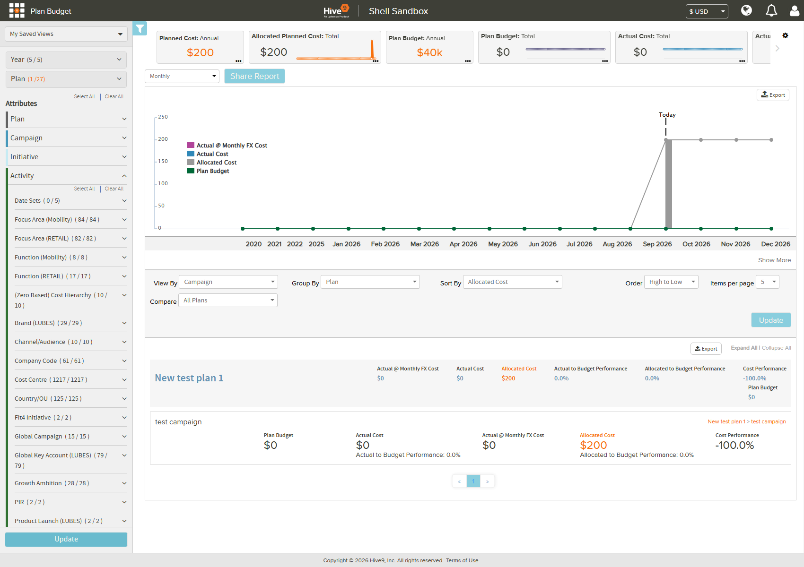

Figure 15 — Plan Budget dashboard with the four money series

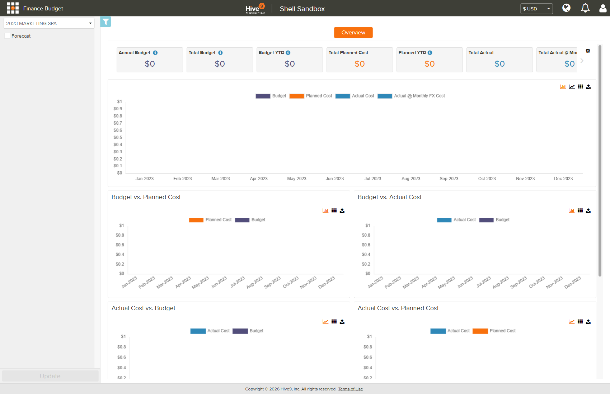

Figure 16 — Finance Budget dashboard: budget selector, Forecast toggle, Overview HUD and the four comparison charts

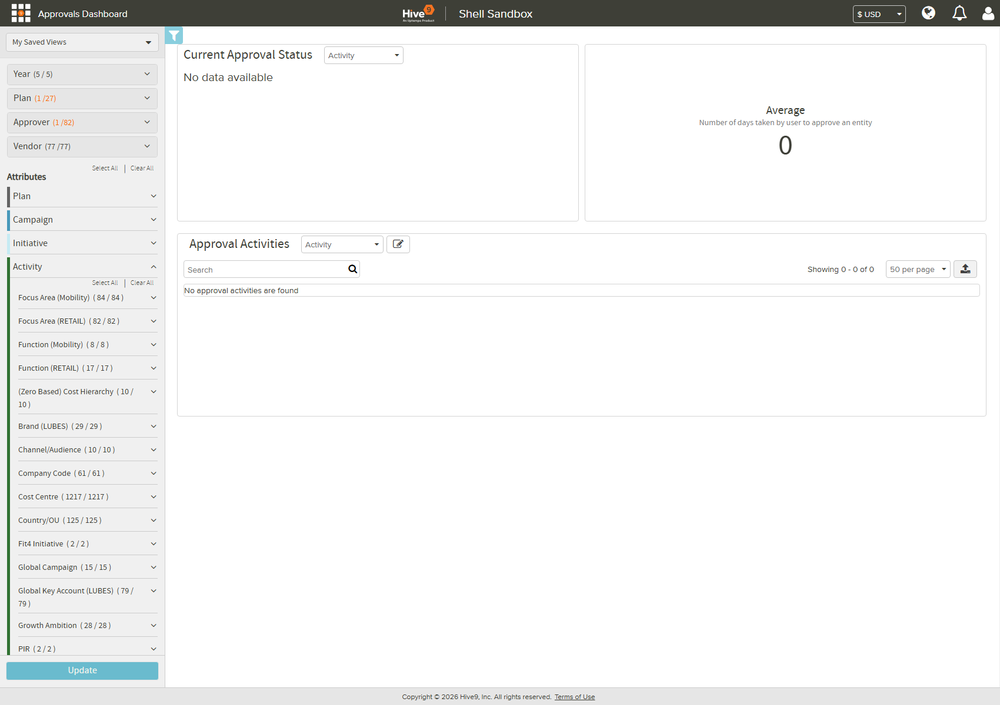

Figure 17 — Approvals Dashboard: status chart, average approval days and the activity grid

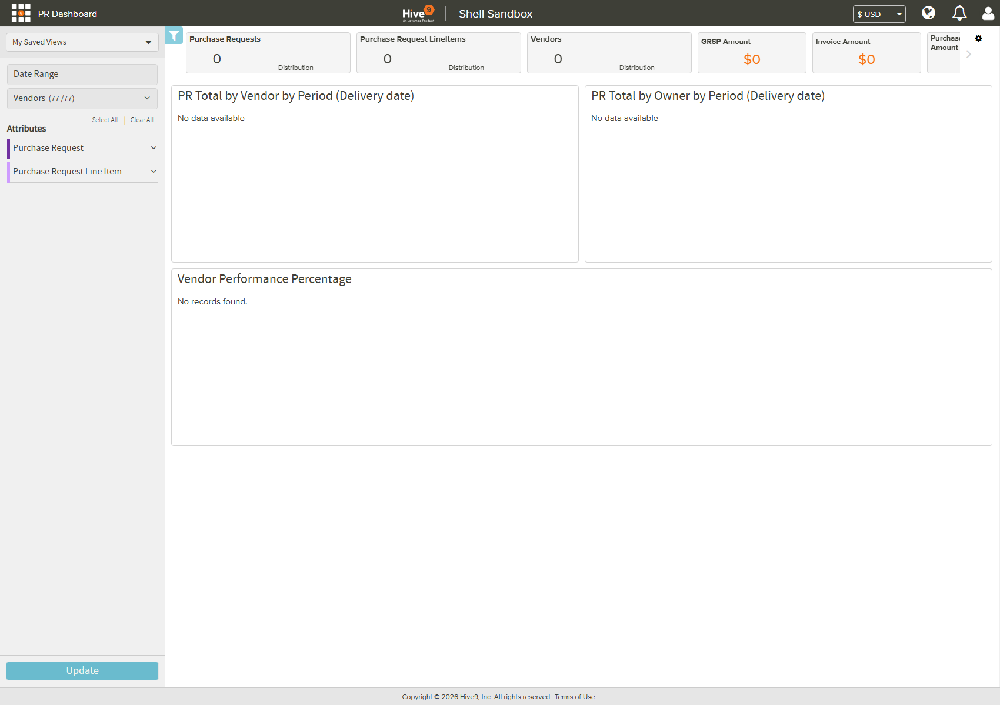

Figure 18 — PR Dashboard: commitment HUD and the three vendor/owner charts

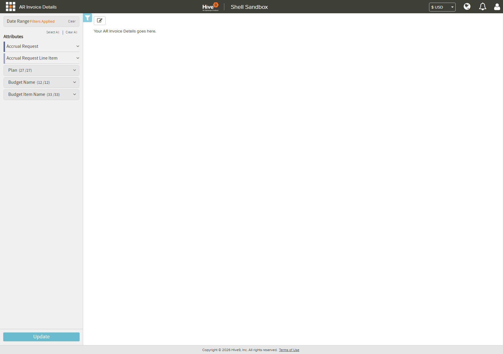

Figure 19 — AR Invoice Details grid

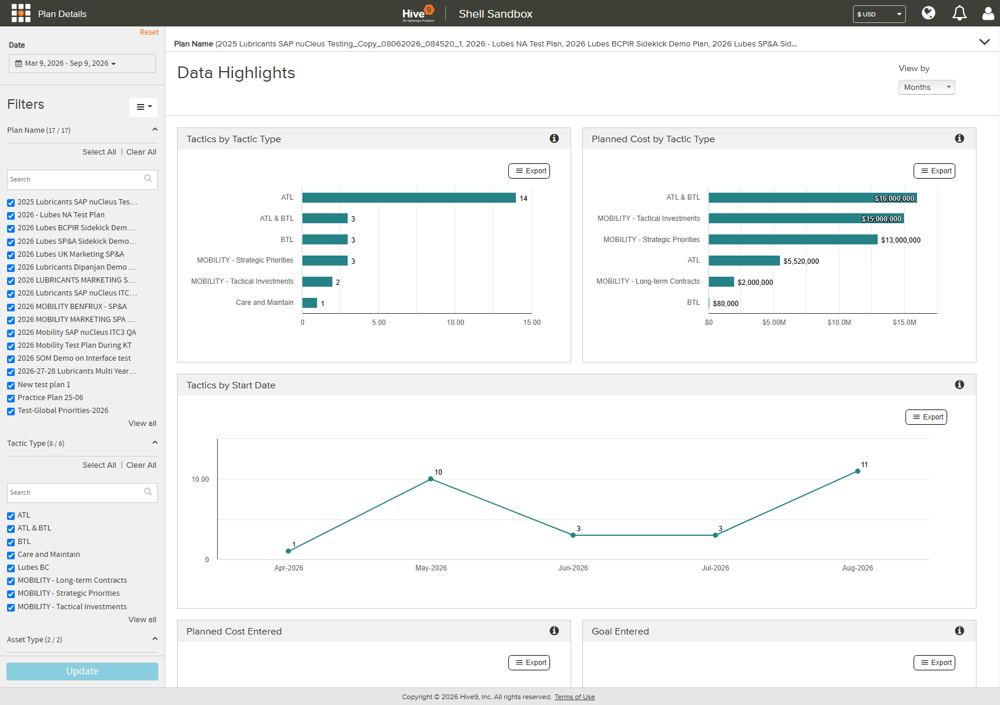

Figure 20 — Plan Details: self-configuring segmentation and completeness charts

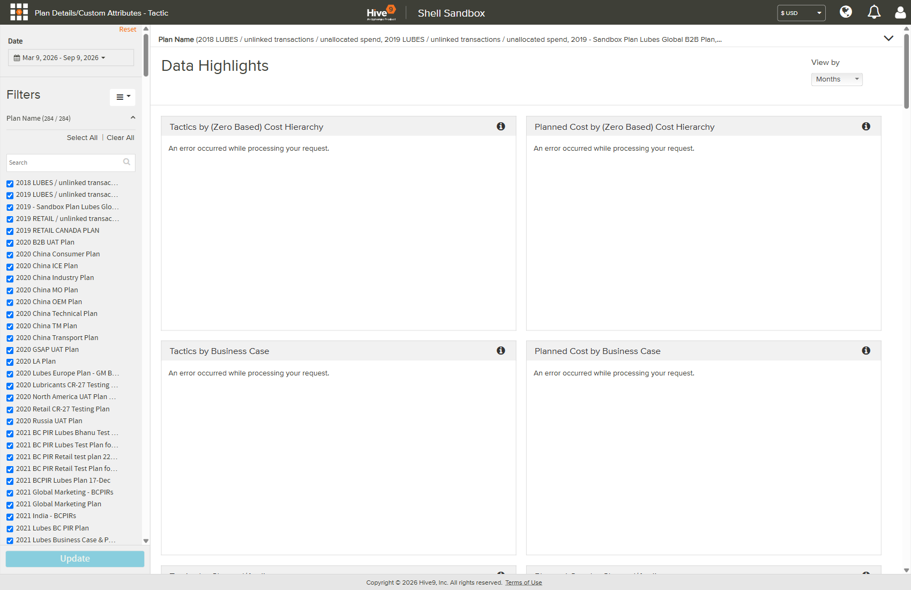

Figure 21 — Custom Attributes – Tactic: paired count and cost charts per attribute

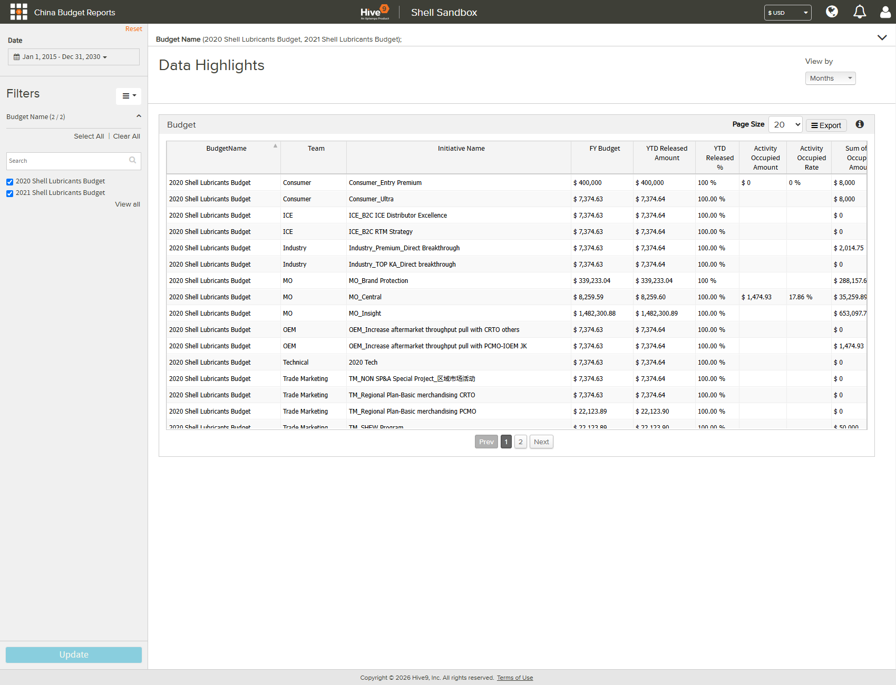

Figure 22 — China Budget Reports: budget release and occupancy table

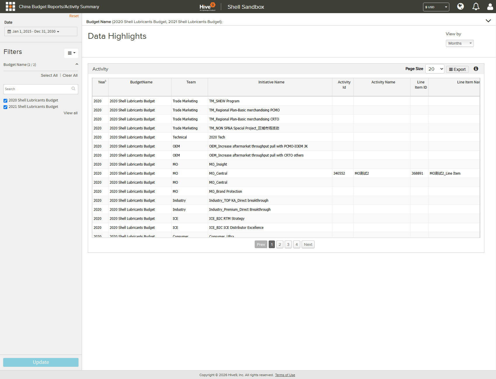

Figure 23 — Activity Summary: budget consumption to activity and line-item level

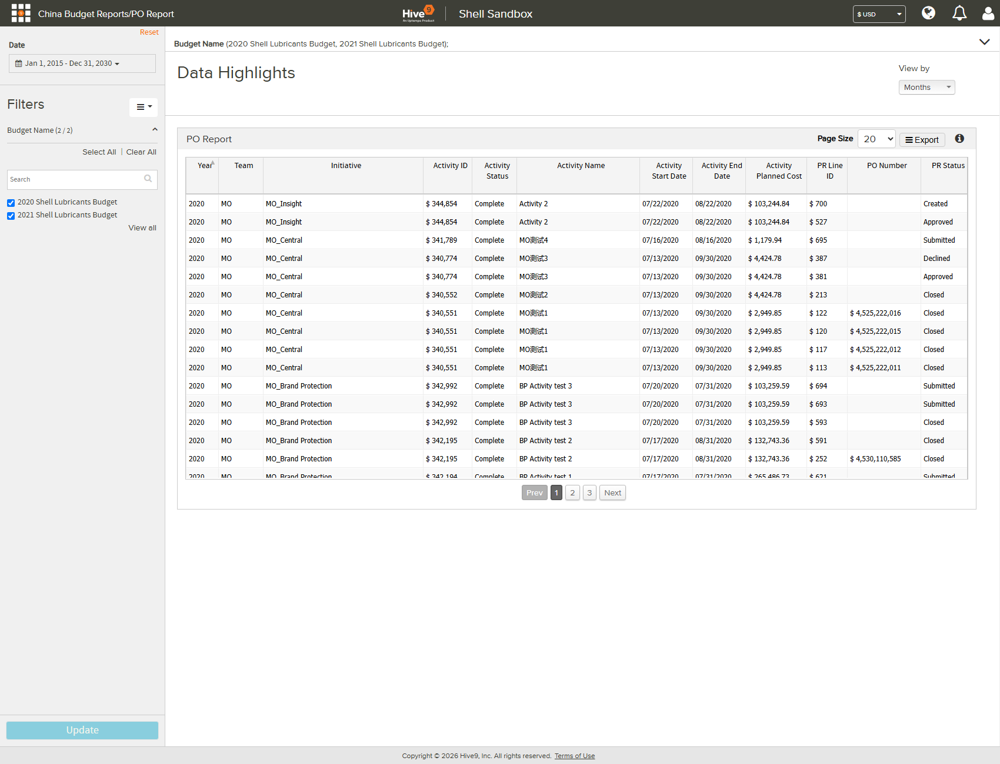

Figure 24 — PO Report: the 30-column PR/PO/receipt ledger

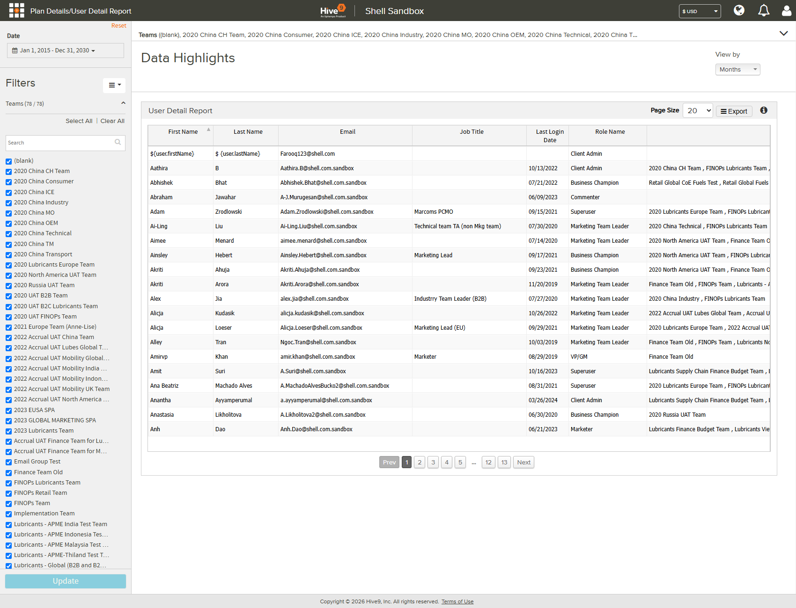

Figure 25 — User Detail Report: role and team access audit

# F. Administration and configuration

The configuration layer every other module is generated from. Users, Roles, Teams, Currency, Theme and Approval Workflows were read live from Settings, without editing (F4–F6). Organizational Setup, Integrations, Models and custom attributes are not in the sandbox role's menu; for those this part relies on the guide and on what the tenant's behaviour reveals. Models, custom attributes, permissions and integrations are also covered in sections E7.5.1, E4.5, E6 and E7.4.

## F1. What is configured, and what depends on it

| Area | What it controls | Modules that depend on it |
|---|---|---|
| Users (Live) | Create, edit, delete, import; default currency; role; teams | All |
| Impersonation (Live) | Admins can log in as a user who has allowed it (24 hours or always) | Support |
| Roles (Live) | One role per user; 20 roles. Client Admin sees everything and cannot be edited. Tabs: Plan, Measure, Notifications. Per-level create / edit / delete, content-visibility switches, module and admin rights, custom-dashboard rights — see F4. | All |
| Teams (Live) | Grant access to plans and budgets; per member Can Edit Team Content? and Can Approve? | Plan, Finance, Approvals |
| Custom attributes | Text, single- or multi-select; required-to-submit; dependencies; formulas; roll-up; multi-select cost and performance splits | Plan, Measure, Approvals |
| Integrations | CRM, marketing automation, web analytics connectors; push and pull mappings; folders | Plan (Activities), Measure |
| Currencies (Live) | Conversion table; monthly rates for actuals and for PRs | Plan, Finance, Measure |
| Theme (Live) | Activity-type colours; calendar quick-view attributes | Plan (Calendar) |
| Approval workflows (Live list) | Basic and advanced workflows; custom object workflows; life cycle | Plan, Finance, Measure |
| Tactic Type Categories | Groupings used by the dashboards | Measure |
| Models | Stages, conversion rates, velocity, average deal size, allowed target stages, integrations, External Name, Tactic Library (allowed Activity Types and defaults) | Plan, Measure |

## F2. Organizational Setup switches

| Setting | Effect | State in this tenant |
|---|---|---|
| Budget Configuration | Turn Plan Budget on or off | On (Live) |
| User Category options | Classify users; records inherit the owner's category | Not enabled — no field in My Account (Live) |
| Use Planned Cost as Actual Cost | Use planned cost for ROI when there is no finance feed | Unknown |
| Custom Goals | Define goal code, name, type, description | None seen on the Apple plans |
| Shrink date range to fit child activities | Campaign and Initiative dates follow their Activities | Off — dates are editable (Live) |
| User creation default team permission | New users become eligible approvers / editors by default | Unknown |
| Finance Budget link required on line item | Forces the Linked Budget Item | On (Live) |
| Allow unallocated amount in line item | Custom allocation may leave a remainder | Unknown |
| AOP / Strategic Plans | Shows the checkbox and the Plan View filter | On (Live) |
| Tactic Category Configuration | Default category for Summary, Revenue, Waterfall; Asset / Promotion captions | Default Asset (Live) |
| Finance Budget Levels | Names of the budget levels | Configured (Live) |
| Hierarchy naming (system admin only) | Singular and plural names per level | Initiative / Activity (Live) |
| Application Timeout | 10–120 minutes, default 60 | Unknown |
| Default Search Attribute for Grids | Default grid search criterion | Name (Live) |
| Calendar Export | ICS feed from saved filters | Unknown |
| Purchase Request Configuration | Purchase Support; lines on approved PRs | On; value 1 (Live) |
| Relate Plans | Related Plans grid on the plan | On (Live) |

## F3. Who administers today, and what the replacement needs

- System-level lists — GL codes, spend types, dropdown values, hierarchy naming, custom dashboards — are maintained by the Hive9 vendor; Shell raises a request (Workshop; custom dashboards per section E6.3).
- Shell asked for a Shell-side administrator persona in the replacement, able to maintain these lists itself (Workshop).
- Build the configuration layer first: almost every screen in Parts B, C and E is generated from it.

## F4. Roles — who can do what

Read live from Settings › Roles: twenty roles, each opened and its Plan, Measure and Notifications tabs read (nothing was edited). The Notifications tab only sets each role's default notification rules and is the same for every role. The sandbox account's role is Business Champion.

| Role | Users | What it can do |
|---|---|---|
| Client Admin | 40 | Everything. Cannot be edited or deleted (Guide). |
| System Admin | 1 | Everything; the Hive9 representative's role (Guide). |
| Business Champion | 36 | Create and edit plans (not delete) and full rights below; administers users, roles, teams and approval workflows. The sandbox account's role. |
| Superuser | 20 | Full rights from Campaign down; no plan-level rights. |
| Marketing Team Leader | 51 | Edit plans (not create or delete); full rights below. |
| Marketer | 44 | Create and edit campaigns; full rights on initiatives, activities, line items, PRs and accruals. |
| Mkg. Admin support | 2 | Full rights on initiatives, activities, line items and PRs. |
| IT Admin | 0 | Full rights on initiatives, activities and line items. |
| VP/GM | 4 | Create and edit plans; full rights on campaigns; nothing below. |
| SOM Admin | 3 | SOM with admin privileges — Plan-level rights only. |
| SOM Role | 1 | Created to perform User Management Activities ( i.e Create and update) — No plan rights; user-management role. |
| Local Finance Manager | 6 | No plan rights; can edit actuals. |
| Local Finance Marketing Advisor / BA | 5 | No plan rights; can edit actuals. |
| Global FINOPS | 3 | No plan rights. |
| Exchange Manager | 2 | No plan rights. |
| TA | 6 | Created to PR Requisitioner , who will be involved in Purchase Request creation at GSAP — No create or edit rights; views the plan and the Purchase Request Grid. The requisitioner of Part D. |
| Contract Holder | 7 | Users who are Contract Holders but not Marketers — No plan rights. |
| GM View | 2 | No plan rights. |
| Commenter | 14 | View and comment only on team content — View and comment only. |
| Read Only | 0 | This role cannot create, edit or delete — Cannot create, edit or delete. |

### F4.1 Plan content

C = create, E = edit, D = delete, — = none. Actuals = may edit actuals. The last two columns are the content-visibility switches.

| Role | Plan | Camp. | Init. | Activ. | Line item | PR | Accrual | Actuals | Own-team content only | Own-team financials only |
|---|---|---|---|---|---|---|---|---|---|---|
| Client Admin | CED | CED | CED | CED | CED | CED | CED | Y | — | — |
| System Admin | CED | CED | CED | CED | CED | CED | CED | Y | — | — |
| Business Champion | CE | CED | CED | CED | CED | CED | CED | Y | Y | — |
| Superuser | — | CED | CED | CED | CED | CED | CED | Y | Y | — |
| Marketing Team Leader | E | CED | CED | CED | CED | CED | CED | Y | Y | — |
| Marketer | — | CE | CED | CED | CED | CED | CED | — | Y | — |
| Mkg. Admin support | — | — | CED | CED | CED | CED | — | — | Y | — |
| IT Admin | — | — | CED | CED | CED | — | — | Y | Y | — |
| VP/GM | CE | CED | — | — | — | — | — | — | Y | — |
| SOM Admin | CED | — | — | — | — | — | — | Y | — | — |
| SOM Role | — | — | — | — | — | — | — | — | Y | — |
| Local Finance Manager | — | — | — | — | — | — | — | Y | Y | — |
| Local Finance Marketing Advisor / BA | — | — | — | — | — | — | — | Y | Y | — |
| Global FINOPS | — | — | — | — | — | — | — | — | Y | — |
| Exchange Manager | — | — | — | — | — | — | — | — | Y | — |
| TA | — | — | — | — | — | — | — | — | Y | — |
| Contract Holder | — | — | — | — | — | — | — | — | Y | — |
| GM View | — | — | — | — | — | — | — | — | — | — |
| Commenter | — | — | — | — | — | — | — | — | Y | — |
| Read Only | — | — | — | — | — | — | — | — | Y | — |

### F4.2 Finance and records

V = can view the screen, — = restricted; C/E/D as above; Y = allowed.

| Role | Fin. budget | Budgets | Budget rows | Trans-actions | Link trans. | Upload trans. | PR grid | Accrual grid | Currency | Edit FX rates |
|---|---|---|---|---|---|---|---|---|---|---|
| Client Admin | V | CED | CED | V | Y | Y | V | V | V | Y |
| System Admin | V | CED | CED | V | Y | Y | V | V | V | Y |
| Business Champion | V | CED | CED | V | Y | — | V | V | V | — |
| Superuser | V | — | — | V | Y | — | — | V | V | — |
| Marketing Team Leader | V | — | — | V | Y | — | — | V | V | — |
| Marketer | V | — | — | V | Y | — | — | V | V | — |
| Mkg. Admin support | V | E | E | V | Y | — | — | — | V | — |
| IT Admin | V | — | — | V | — | — | — | — | V | — |
| VP/GM | V | — | — | V | — | — | — | — | V | — |
| SOM Admin | V | CED | CED | V | — | — | V | V | V | — |
| SOM Role | — | — | — | — | — | — | — | — | — | — |
| Local Finance Manager | V | CED | CED | V | Y | — | — | — | V | — |
| Local Finance Marketing Advisor / BA | V | — | — | V | Y | — | — | — | V | — |
| Global FINOPS | V | CED | CED | V | Y | — | — | — | V | Y |
| Exchange Manager | — | — | — | — | — | — | — | — | V | Y |
| TA | — | — | — | — | — | — | V | — | — | — |
| Contract Holder | — | — | — | — | — | — | — | — | — | — |
| GM View | V | — | — | V | — | — | V | V | V | — |
| Commenter | — | — | — | — | — | — | — | — | — | — |
| Read Only | — | — | — | — | — | — | — | — | — | — |

### F4.3 Administration and record management

| Role | Users | Roles | Teams | Approval work-flows | Integr-ations | Models | Override model | Org setup | Plan audit log | Recycle bin | Create templates |
|---|---|---|---|---|---|---|---|---|---|---|---|
| Client Admin | Y | Y | Y | Y | Y | Y | Y | Y | V | V | Y |
| System Admin | Y | Y | Y | Y | Y | Y | Y | Y | V | V | Y |
| Business Champion | Y | Y | Y | Y | — | — | — | — | — | — | Y |
| Superuser | — | — | — | Y | — | — | — | — | — | — | Y |
| Marketing Team Leader | — | — | Y | — | — | — | — | — | — | — | Y |
| Marketer | — | — | — | — | — | — | — | — | — | — | Y |
| Mkg. Admin support | — | — | — | — | — | — | — | — | — | — | Y |
| IT Admin | — | — | — | — | Y | — | — | — | — | — | Y |
| VP/GM | — | — | — | — | — | — | — | — | — | — | Y |
| SOM Admin | Y | Y | Y | Y | Y | — | — | — | V | V | Y |
| SOM Role | Y | — | Y | — | — | — | — | — | — | — | Y |
| Local Finance Manager | — | — | — | — | — | — | — | — | — | — | Y |
| Local Finance Marketing Advisor / BA | — | — | — | — | — | — | — | — | — | — | Y |
| Global FINOPS | — | — | — | — | — | — | — | — | — | — | Y |
| Exchange Manager | — | — | — | — | — | — | — | — | — | — | Y |
| TA | — | — | — | — | — | — | — | — | — | — | Y |
| Contract Holder | — | — | — | — | — | — | — | — | — | — | Y |
| GM View | — | — | — | — | — | — | — | — | V | V | — |
| Commenter | — | — | — | — | — | — | — | — | — | — | Y |
| Read Only | — | — | — | — | — | — | — | — | — | — | Y |

### F4.4 Measure

| Role | Std reports | Schedule | Approval rpt | PR rpt | Compli-ance | Export custom | League | Custom dashboards it can view |
|---|---|---|---|---|---|---|---|---|
| Client Admin | Y | Y | Y | Y | Y | Y | Y | Plan Details, Monthly FX, PR Track Invoices, Transactions, SWBS Not Received, Pending PR, China Budget, Accrual Finance, Overlapping Actuals, SP&A Lubes, SP&A Mobility |
| System Admin | Y | Y | Y | Y | Y | Y | Y | Plan Details, Monthly FX, PR Track Invoices, Transactions, SWBS Not Received, Pending PR, China Budget, Accrual Finance, Overlapping Actuals, SP&A Lubes, SP&A Mobility |
| Business Champion | Y | — | Y | Y | — | — | — | Plan Details, China Budget |
| Superuser | — | — | — | — | — | — | — | SWBS Not Received |
| Marketing Team Leader | Y | — | — | — | Y | — | — | Pending PR, Accrual Finance |
| Marketer | — | — | — | — | — | — | — | China Budget, Accrual Finance |
| Mkg. Admin support | — | — | — | — | — | — | — | — |
| IT Admin | — | — | — | — | — | — | — | — |
| VP/GM | — | — | — | Y | — | — | — | — |
| SOM Admin | Y | Y | Y | Y | Y | Y | Y | Plan Details, Monthly FX, PR Track Invoices, Transactions, SWBS Not Received, Pending PR, China Budget, Accrual Finance, Overlapping Actuals, SP&A Lubes, SP&A Mobility |
| SOM Role | — | — | — | — | — | — | — | — |
| Local Finance Manager | — | — | — | — | — | — | — | — |
| Local Finance Marketing Advisor / BA | — | — | — | — | — | — | — | — |
| Global FINOPS | — | — | — | — | — | — | — | — |
| Exchange Manager | — | — | — | — | — | — | — | — |
| TA | — | — | — | — | — | — | — | — |
| Contract Holder | Y | — | — | — | — | — | — | — |
| GM View | Y | — | Y | Y | Y | — | — | Plan Details, Monthly FX, PR Track Invoices, Transactions, SWBS Not Received, Pending PR, China Budget |
| Commenter | — | — | — | — | — | — | — | — |
| Read Only | Y | — | — | — | — | — | — | — |

> Custom dashboards: The tenant defines eleven custom dashboards: Plan Details, Actuals @ Hive9 Monthly FX, PR Track Invoices, Transactions Report, SWBS Not Received, Pending PR, China Budget Reports, Accrual Finance Report, Overlapping Actuals, SP & A Lubes - New and SP & A Mobility - New, each with separate View and Export rights. Only two are visible to the sandbox role. Three look like monitoring for the GSAP link — SWBS Not Received, Pending PR and PR Track Invoices (Inferred from their names).

> For the rebuild: Rights are granted per level, not per module: Marketer cannot touch Plans but can create Campaigns; Marketing Team Leader can edit Plans but not create them; VP/GM works only at Plan and Campaign level; the finance roles have no planning rights but can edit Actuals. A replacement needs a permission model at this granularity — per role, per level, per create/edit/delete — plus the two content-visibility switches.

## F5. My Account and personal settings

Settings opens My Account for every user (Live). Its tabs:

| Tab | Contents |
|---|---|
| Account | Photo, first and last name, e-mail, phone, job title, organisation, date format, role (read-only), Activate Delegated Approver, Allow Admins to access my account (24 hours or Always), and team memberships with Can Edit Team Content? and Can Approve? per team. No User Category field — the feature is not enabled. |
| Notifications | Notification Rules (standard events, In App and Email, each Off / ASAP / Daily / Weekly), a Notification List, and Custom Notifications (see below) |
| Alerts | Performance alerts on campaigns, initiatives, activities or line items, built with a wizard and shareable; columns Alert Type, Entity Name, Description, Start Sending, Frequency, Enabled |
| Templates | The user's saved templates (Name, Entity Type) |
| Report Sharing | Scheduled report e-mails (Title, Report, Frequency, Day/Date, Last Sent, Recipients); sent at 12:00 am Central Time |
| Shared Filters | Filter views the user has shared (Filter View Name, Parent Hierarchy, Recipients) |
| Change Password | — |

Custom notifications (Guide): on a Plan, Campaign, Initiative, Activity, Line Item, Purchase Request or Accrual Request the user owns, triggered a number of days before or after a date attribute (Start and End Date for all but Plan), optionally repeating; or when a picklist or checkbox attribute takes a chosen value.

## F6. Other Settings screens (Live)

| Screen | What was seen |
|---|---|
| Users | About 250 users, 20 per page; columns First Name, Last Name, Role, Team(s); Import Users and New User |
| Teams | 85 teams (name, description, number of users); Create New Team |
| Currency | 29 currencies against a USD base: annual planned exchange rate per year, a Use Monthly Actual Rates switch, a Use Monthly Rates for Purchase Requests switch, and twelve monthly rates. Without monthly rates, the annual planned rate is applied to actuals. |
| Theme | Activity Type Colors for the calendar — 167 active Activity Types in the tenant |
| Approval Workflows | More than 100 workflows over six pages (name, status) — e.g. Accrual Request Workflow, Activity Approval - Sanjay Bhagat, 2LEVEL-ALL-SIGN-OFF-600KUSDLIMIT; Create New Approval Workflow |

Organizational Setup, Integrations, Models, custom attributes and Tactic Type Categories are not in this role's Settings menu, so F1–F2 describe them from the guide.

# G. Cross-module dependencies with the Plan

The Plan is the hub. Configuration flows into it; every other module reads from it, and several write results back onto its records. This part maps those dependencies in four views: by module, by Plan level, by field written back, and by failure.

## G1. Upstream, hub, downstream

| Upstream — the Plan needs these | The Plan | Downstream — these need the Plan |
|---|---|---|
| Administration: models, attributes and dependencies, teams, roles, workflows, currencies, org switches
Fiscal calendar
Finance Budget rows (for the line-item link) | Plan → Campaign → Initiative → Activity → Line Item
Budgets, goals, owners, statuses | Finance Budget · Transactions · Purchase Support · Accruals · Approvals · GSAP · performance connectors · marketing automation · Measure · Audit Log · notifications and alerts · calendar feed |

## G2. By module

| Module | Direction | Plan objects | What flows | Key | When it breaks |
|---|---|---|---|---|---|
| Administration | Into Plan | All | Lists, rules, stages, rates, workflows, switches | — | Forms render empty; a required field can be unfillable (B10) |
| Finance Budget | Both ways | Plan (default budget), Line Item | Line-item amounts into budget rows; remaining budget and hard limits back | Budget item ID | Line item cannot be saved; budget views disagree |
| Transactions | Into Plan | Line Item (rolls up) | Imported cost, split across line items | SWBS, cost centre, cost element | Actual Cost stays zero |
| Purchase Support | Both ways | Activity (gate), Line Item | PRs out; PR, PO, invoice and GRSP amounts back | Line-item ID; HX | No PR without a line item; not submittable until the Activity is approved |
| Accruals | From Plan | Line Item, budget row | Planned − actual in period | Line item / budget ID | No accrual candidates |
| Approvals | Both ways | Campaign, Initiative (attribute groups), Activity, PR, AR | Submit out; status and tracking back | Object ID | Activity never approved → no SWBS, PR submission, performance or External Name |
| GSAP | Both ways, via Line Item only | Line Item | SWBS request out; SWBS, PR, PO, invoice, actuals back | Line-item ID; HX; company code | Frozen during Nucleus |
| Performance connectors | Into Measure, keyed on Plan | Activity | Responses, leads, opportunities, revenue | Activity ID, media code, integration id, External Name | Is Integrated: No; revenue and waterfall zero |
| Marketing automation push | From Plan | Activity | Activity created in Eloqua / Marketo folders | External Name, integration id | — |
| Measure | From Plan (read-only) | All | Everything, joined on the Activity | Activity is the conforming dimension | Empty dashboards (E5.6) |
| Audit Log | From Plan and Finance | Budget rows; plan objects (Plan Log) | Change history | Object IDs | — |
| Notifications / alerts | From Plan | Date and picklist attributes; performance | Messages on rules | — | — |
| Calendar feed | From Plan | Activities in a saved filter | Nightly ICS | Saved filter | — |
| Currency / FX | Into Plan | Line Item, actuals | Rates | Currency code | Actual vs Actual @ Monthly FX differ |

## G3. By Plan level

| Module | Plan | Campaign | Initiative | Activity | Line Item |
|---|---|---|---|---|---|
| Administration | R | R | R | R | R |
| Finance Budget | R (default) | — | — | — | R / W |
| Transactions | roll-up | roll-up | roll-up | roll-up | W |
| Purchase Support | — | — | — | gate | R / W |
| Accruals | — | — | — | — | R |
| Approvals | Publish | W (group) | W (group) | W | — |
| GSAP | — | — | — | gate | R / W |
| Performance connectors | — | — | — | W (facts) | — |
| Measure | R | R | R | R | R |

R = reads the level; W = writes back to it; gate = the level's status controls whether the module can act; roll-up = receives the total from below.

## G4. Fields written back onto Plan records

| Field | On | Written by | When |
|---|---|---|---|
| SWBS Code | Line Item | GSAP (FSSI 1523 response) | 24–48 h after the Activity is approved |
| Total Purchase Request Amount | Line Item, rolled to Activity | Purchase Support | On PR creation |
| PR / PO number, PO copy, invoice rows | Line Item PR block, PR grid | GSAP (PGSI 941) | Daily |
| Total Invoiced Amount | Line Item, rolled to Activity | GSAP (PGSI 941) | Daily |
| Total Actuals, % of Actual Cost, Actuals @ Monthly FX | Line Item, rolled up | Transactions / GSAP | On import and link |
| Planned Cost (parents) | Initiative, Campaign, Plan | Roll-up | On save below |
| Remaining Plan / Campaign Budget | Campaign, Initiative | Calculation | On save |
| MQL, Revenue | Plan, Activity | Model calculation | On goal entry |
| Status, Approval Tracking | All approvable objects | Approvals | On each action |
| External Name | Activity | Model integration setting | When approved |
| Performance | Activity (via Measure) | Connectors | Connector schedule |

## G5. Gates — preconditions across modules

| To do this… | …you first need | Evidence |
|---|---|---|
| Create an Activity | An Initiative in the plan | Guide |
| Use an Activity Type | It is allowed by the plan's Model | Guide |
| Choose a Custom Goal on an Activity | The goal added to the plan | Guide |
| Save a line item | A Linked Budget Item | Live |
| Get an SWBS code | An approved Activity and Create SWBS Code ticked | Workshop |
| Submit a PR | An approved Activity | Guide |
| Create a GSAP PR | An SWBS code and the approved PR form | Workshop |
| See PR, PO and invoice in Hive9 | The HX key typed into GSAP | Workshop |
| See performance on an Activity | Approval, and an integration | Live; Guide |
| Link a multi-year Activity | A plan with a compatible Model and an Initiative in each year | Guide |
| Fill a dependent attribute | Its parent attribute filled | Live |

## G6. Failure propagation

| If this is missing or wrong in the Plan… | …this breaks, and where |
|---|---|
| No goal on the plan or Activity | Goal lines empty on Summary, Revenue, Waterfall; Plan Details shows Goal Entered: No |
| Activity not approved | No SWBS request, no PR submission, no performance, no External Name, Is Integrated: No |
| Create SWBS Code unticked | No SWBS → the requisitioner cannot build a GSAP PR → no PO |
| HX key not entered in GSAP | PR number, PO and invoices never reach Hive9; Total Invoiced and Actuals stay zero; Measure Actual Cost stays zero |
| Wrong Company Code on the Activity | GSAP rejects the PO (cross-company charging) |
| Line item not linked to a budget | Blocked in this tenant; elsewhere the Plan Budget and Finance Budget views disagree |
| Transactions not imported or linked | Actual Cost zero in the grid, the Finance Budget and Measure |
| Activity Type changed after costing | Planned Cost resets to the Model default; roll-ups and Measure change |
| Model rates changed | Every projected number and ROI restates, with no version stamp |
| Multi-year Activity not linked in every year | Data maps to the wrong year |
| Parent attribute of a dependency empty | Child options disappear; a required child blocks saving |

## G7. Plan to Measure field lineage

| Measure field | Comes from | Entered how |
|---|---|---|
| Goal Revenue / Goal <stage> | Plan and Activity goals | Typed, or calculated by the Model |
| Projected Revenue / <stage> | Model rates, velocity, average deal size | Calculated |
| Actual Revenue / <stage> | Connector facts matched to the Activity | Integration |
| Planned Cost | Activity Planned Cost | Typed (Model default) |
| Allocated Cost | Line-item allocation | Typed and allocated |
| Plan Budget | Plan budget fields | Typed |
| Actual Cost / @ Monthly FX | Transactions linked to line items | Integration; calculated |
| PR commitment, GRSP, Invoice | PRs and GSAP data on line items | Typed + integration |
| Planned − Actual (accruals) | Accrual lines | Calculated |
| Segments and groupings | Custom attributes at every level | Typed or formula |
| Approval cycle time | Workflow timestamps | System |
| Is Integrated / Goal Entered | Activity integration and goals | Derived |

## G8. What this means for the replacement

1. Build order: configuration layer → Plan hierarchy with roll-ups and budget containment → line item with allocation and Finance Budget link → approvals → Purchase Support → GSAP adapter → transactions and actuals → Measure.
2. Only the GSAP rows depend on something outside Shell's control during the freeze. Everything else in the Plan can be built and tested now.
3. Put GSAP behind one adapter with two implementations: the file interfaces (FSSI 1523, PGSI 941) and a manual or file-upload route for the freeze (SWBS codes; PR, PO and invoice extracts matched on the HX key).
4. Keep the HX key, but generate it for the user and validate it on return, rather than relying on a hand-typed string with no check.
5. Keep the Activity as the conforming dimension for Measure and the line item as the only finance bridge.
6. Model attribute dependencies explicitly — they decide which fields exist on a record, including those GSAP needs.

## G9. System events that cross modules

The standard notification rules (Live, Settings › Notifications) are the product's own list of events worth telling a user about. Several are cross-module signals — a replacement needs the same events, whether or not it notifies on them.

| Event | Modules involved |
|---|---|
| My activities are edited, deleted or restored (plans, campaigns, initiatives, activities, line items, PRs) | Plan |
| My campaigns, initiatives, activities, PRs or accrual requests are approved or declined | Approvals |
| New activities are assigned to me | Plan |
| Plans are shared with me (a destination for multi-year activities) | Plan |
| New comments on my activities; activities shared with me | Plan |
| Sys_Gen_Balance is non-zero | Plan ↔ Finance |
| My line item is unlinked | Plan ↔ Finance Budget |
| Due-date warning, threshold in days | Plan |
| SWBS updates | Plan ↔ GSAP |
| Purchase request transactions are pulled | Purchase Support ↔ GSAP |
| My budget items are edited or deleted (all edits, or only above an amount) | Finance Budget |
| New budget items are assigned to me | Finance Budget |
| Line items have been linked to Finance Budget rows (all rows I can edit, or only rows I own) | Plan → Finance Budget |
| Finance Budget rows have caused a budget overage | Plan → Finance Budget |
| New transactions are added (all, or only unlinked) | Transactions → Plan |
| Filtered views are shared with me | Filters |

# H. Gaps, open questions and what we need from Shell

## H1. Not verified, and why

| Area | Status | Reason |
|---|---|---|
| Creating a plan from scratch | Blocked | Business Unit has no options for this account (B10) |
| Saving a line item | Not done | Requires a Finance Budget mapping we were not willing to guess in a shared tenant |
| Line-item finance attributes on the form | Not seen | Hidden on the Mobility plan (B7) |
| GSAP round trip | Not observable | Test system C94 unavailable; no SWBS, PR or PO returns to the sandbox |
| Organizational Setup, Integrations, Models, custom attributes | Not available | Not in the Business Champion role's menu (guide-based in Part F) |
| Role-based behaviour | Partly verified | The permission settings of all 20 roles were read live (F4); behaviour under each role was not exercised |
| Calendar, Honeycomb actions, templates, snapshots, recycle bin | Not exercised | Documented from the guide and the live menu labels |
| Export file contents | Not inspected | Controls confirmed, files not opened |
| Production parity | Unknown | Sandbox only; custom dashboards and attributes are tenant-specific |

## H2. Open questions

For Shell business users

- What fills Business Unit's options (ShellAllPlans is disabled for our role), and which attributes each Business Unit unlocks?
- What are the intended budget containment rules (Initiative within Campaign)?
- Is Use Planned Cost as Actual Cost on in production?
- Which custom dashboards exist in production, and who changes them?

For the GSAP team

- File layouts, field mapping, naming and schedules for FSSI 1523 and PGSI 941.
- Error handling and reprocessing for rejected or unmatched records.
- Impact of Nucleus / S/4HANA on both interfaces.
- Threshold variations by geography or class of business.

For Uptempo

- The projection algorithm behind Projected Revenue and stage volumes.
- Refresh cadence of each performance connector.
- Whether any Hive9 REST APIs exist for data extraction.

## H3. What we need from Shell

- Business Unit options for our account (our role may already create plans), and a Finance Budget row we may link a line item to — or a guided session that does both with us.
- View access to the SWBS Not Received, Pending PR and PR Track Invoices dashboards.
- A way to see the GSAP round trip: test access, a recorded walkthrough, or production screenshots with sample files.
- The integration technical document with sample CSVs and the data-mapping sheet.
- A session with the GSAP technical team.
- Module-by-module sessions with the people who use each module, and role-by-role walkthroughs — F4 gives the permission settings of all 20 roles, but not how each is used day to day.
- The full list of vendor-maintained configuration and its current values.

# Appendix 1. Method and confidence

1. Playwright (Python) drove a real Chromium browser against the sandbox, signing in through the tenant's OpenID Connect provider.
2. All sixteen Measure pages were captured — screenshots, DOM inventories, request and response bodies — and empty screens were replayed with widened filters.
3. The Plan, Finance and approval screens were captured the same way. Two plans were then built by copying an existing plan, and every Inspection Window was captured on the saved records.
4. The Settings screens (My Account, Users, Roles, Teams, Currency, Theme, Approval Workflows) and all 20 role profiles were read without editing.
5. The Hive9 User & Admin Guide was extracted and cross-referenced throughout; independent reviewers checked the Measure part and a field inventory against the evidence.
6. The integration workshop transcript was read in full and reconciled with the live fields.

| Area | Confidence | Basis |
|---|---|---|
| Plan forms and fields, all five levels | High | Live, on saved records |
| Create routes, menus, workspace controls | High | Live |
| Finance, PR, accrual, transaction grids | High (columns) · Medium (behaviour) | Live grids; guide |
| Measure screens, fields, APIs | High | Live |
| GSAP process, actors, rules | High | Workshop, consistent with live fields |
| GSAP file layouts | Low | Technical document not received |
| Projection and attribution logic | Medium | Guide and on-screen help only |
| Users, roles, teams, currency, theme, workflows | High | Live, read-only |
| Role permission matrix (20 roles) | High | Live, read-only |
| Organizational Setup, Integrations, Models, attributes | Low–Medium | Guide only |
| Behaviour under each role | Low | One account used |
| Production parity | Low | Sandbox only |

# Appendix 2. Records created in the sandbox

| Record | ID | Detail |
|---|---|---|
| Plan | 9180 | Apple FY2026 Global Marketing — copied from 9179 with children, renamed; Draft |
| Campaign | 131344 | iPhone 18 launch — Created |
| Initiative | 342813 | Digital & Social — Created |
| Activity | 1065831 | iPhone 18 launch film — Created |
| Line item | 1248388 | Sys_Gen_Balance, $340,000 (system row) |
| Plan | 9181 | Apple FY2026 India Launch Plan — copied from 9179 with children, renamed; Draft |

Nothing was approved, published, submitted, deleted or shared. The display currency was changed to INR by a stray click and restored to USD. Plans 9180 and 9181 are disposable and can be deleted from the Plan grid.

# Appendix 3. Source documents

| Document | Role |
|---|---|
| Hive9 - User & Admin Guide - EN (1).pdf | Vendor guide — source for everything marked Guide |
| Workshop_ Understanding GSAP-Hive9 Integrations.docx | Workshop transcript — source for everything marked Workshop |
| Hive9_Measure_Module_Analysis.docx, Hive9_Plan_Module_Guide.docx, Hive9_Apple_Worked_Example.docx | Earlier working documents, fully merged into this one |

End of document
