# Hive9 Plan Module – As-Is Process for Plan Creation (Shell, 28 Sep 2026)

Project: Hive9 Replacement

Date: 28 Sept 2026

Plan Module: As-Is Process for Plan Creation

Plan → Campaign (Program) → Initiative → Activity → Line Item

Step 1: Create a Marketing Plan

Pre-requisite 1 - To create a new Plan, User should be added to team, or else Plan created will not be shown

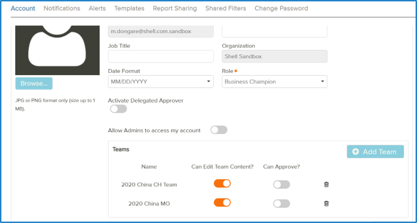

Pre-requisite 2 - Atleast one Campaign and Initiaive in Plan needed before generating template for Import

Pre-requisite 3 – Select a 'Plan' and 'Year' through Workspace Filter to create a Plan

Select + icon to create a New Plan

|  |  |  | Mandatory field | Feature of Dropdown | Pre-Calculated fields | Text / Decimal field | Option of Multi-Selection |
|---|---|---|---|---|---|---|---|
| Attribute | Name |  | Y |  |  | T |  |
| Attribute | Model |  | Y | Dropdown |  | NA | N |
| Attribute | Year |  | Y | Dropdown |  | NA | N |
| Attribute | Team |  | Y | Dropdown |  | NA | Y |
| Attribute | Owner |  | Y | Dropdown |  | NA | N |
| Attribute | Set Plan as Strategic/AOP |  | N | Checkbox |  | NA |  |
| Attribute | Description |  | N |  |  | T+D |  |
| Attribute | Budget | Plan budget |  |  |  | D |  |
| Attribute |  | Default Finance Budget | N | Drop down |  | NA | N |
| Attribute |  | Default Line-Item Allocation | N | Drop down |  | NA | N |
| Attribute | Custom Attributes | Shell All Plans | N | Drop down (greyed) |  |  |  |
| Attribute |  | BCIPR Plan | N | Checkbox |  | NA | NA |
| Attribute |  | Business Mobility Unit | Y | Drop down |  |  | Y |
| Goals | Waterfall Goal |  | Y | Drop down |  | NA | N |
| Goals | Goal Amount |  | N |  |  | D |  |
| Goals | Add Custom Goal |  | N |  |  | T | Y (multiple custom goal can be added) |
| Goals |  | Custom Goal | N | Drop down |  | NA | N |
| Goals |  | Goal Amount | N |  |  | D | N |
| Related Plans |  | Actions |  | greyed (enabled once Line item is created) |  |  |  |

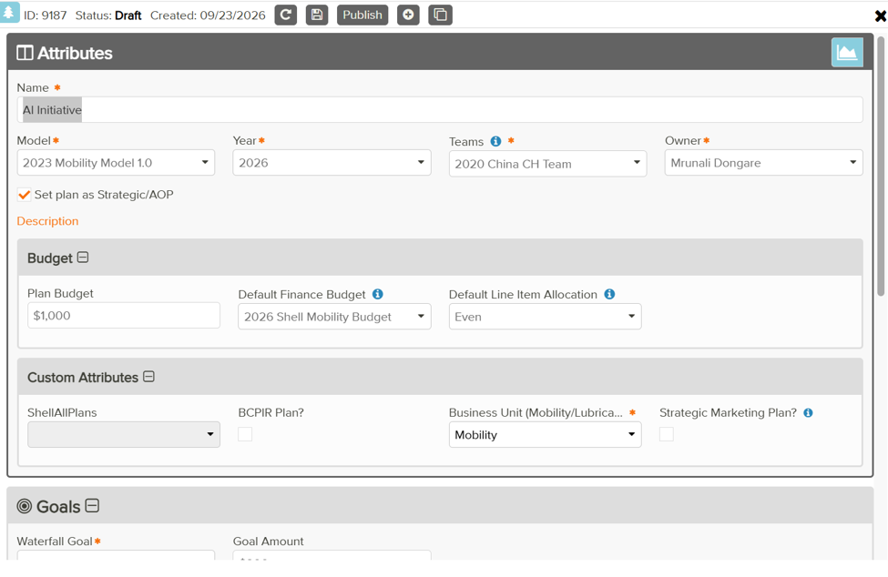

Step 2: Add New Campaign

|  |  |  | Mandatory field | Feature of Dropdown | Pre-Calculated fields | Text / Decimal field | Option of Multi-Selection |
|---|---|---|---|---|---|---|---|
| Attribute | Name |  | Y |  |  | T |  |
| Attribute | Owner |  | Y | Drop down |  | NA | N |
| Attribute | Start date |  | Y |  |  | D |  |
| Attribute | End date |  | Y |  |  | D |  |
| Attribute | Planned Cost | (GREYED) |  |  |  |  |  |
| Attribute | Description |  |  |  |  | T |  |
| Attribute | Budget | Campaign Budget | N |  |  | D | N |
| Attribute |  | Remaning Plan Budget | N |  | Y (GREYED) | D | N |
| Custom Attributes |  | Cluster | Y | Drop down |  | NA | Y |
| Custom Attributes |  | Region | Y (auto generated based on cluster) |  | Y |  |  |

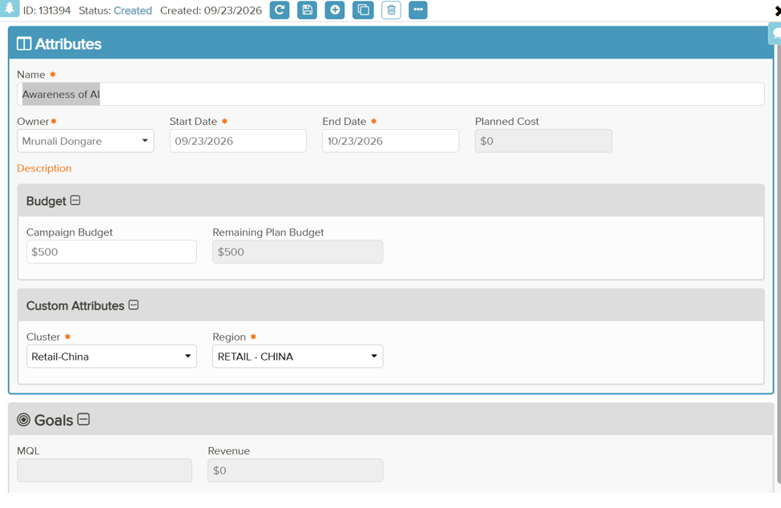

Step 3: Add Initiative under Campaign

|  |  |  | Mandatory field | Feature of Dropdown | Pre-Calculated fields | Text / Decimal field | Option of Multi-Selection |
|---|---|---|---|---|---|---|---|
| Attribute | Name |  | Y |  |  | T+ D |  |
| Attribute | Parent Campaign |  | Y (auto from parent) |  |  |  |  |
| Attribute | Owner |  | Y | Dropdpwn |  | T |  |
| Attribute | Start date |  | Y |  |  | D |  |
| Attribute | End date |  | Y |  |  | D |  |
| Attribute | Planned Cost |  | Y |  |  | D (greyed) |  |
| Attribute | Description |  | N |  |  | T+ D |  |
| Attribute | Budget |  |  |  |  |  |  |
| Attribute |  | Initiative Budget | N |  |  | D |  |
| Attribute |  | Remaining Campaign Budget | Y |  | Y (takes negative value too) | D |  |

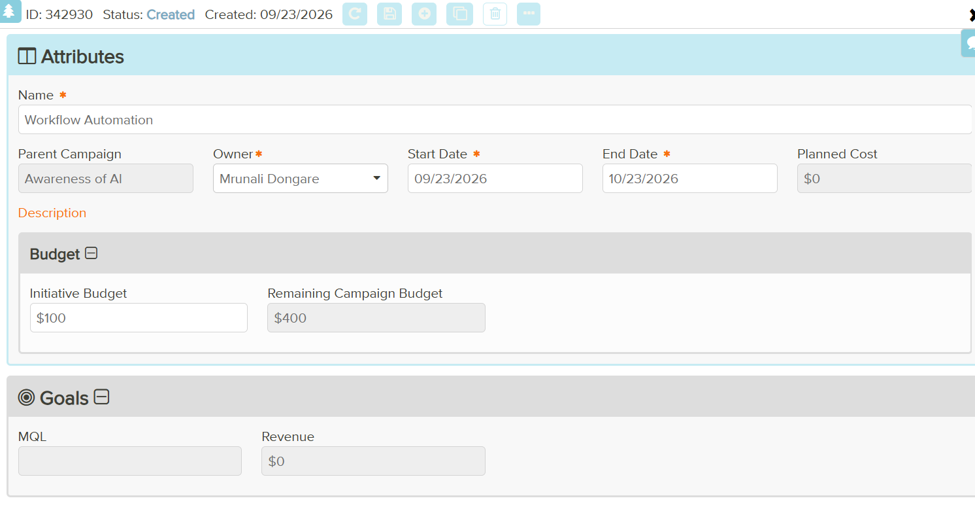

Step 4: Creating Activities

|  |  |  | Mandatory field | Feature of Dropdown | Pre-Calculated fields | Text / Decimal field | Option of Multi-Selection |
|---|---|---|---|---|---|---|---|
| Attribute | Name |  | Y |  |  | T + D |  |
| Attribute | Edit External Name |  | N | checkbox |  | T + D |  |
| Attribute | Parent Campaign |  | Y | drop down |  |  | N |
| Attribute | Parent Initiative |  | Y | drop down |  |  | N |
| Attribute | Activity Type |  | Y | drop down |  |  | N |
| Attribute | Owner |  | Y | drop down |  |  | N |
| Attribute | Start Date |  | Y | selection from calendar + EDIT DATES |  | T+D |  |
| Attribute | End Date |  | Y | selection from calendar + EDIT DATES |  | T+D |  |
| Attribute | Planned Cost |  | Y |  |  | D |  |
| Attribute | Approval Workflow |  | Y | drop down |  |  | N |
| Attribute | Description |  |  |  |  | T |  |
| Attribute | Ongoing Activity/Evergreen |  |  | tick box |  |  |  |
| Activity Custom Attributes | ( Zero based) Cost Hierarchy |  | N | drop down |  | NA | Y |
| Activity Custom Attributes | Activity - Total Actuals |  | N (greyed) |  |  |  |  |
| Activity Custom Attributes | Channel/Audience |  | Y | drop down |  | NA | Y |
| Activity Custom Attributes | Country/OU |  | Y | drop down (ratio between countries is editable) |  | D | Y |
| Activity Custom Attributes | Company Code |  | Y | drop down |  | NA | N |
| Activity Custom Attributes | Cost Centre |  | Y | drop down |  | NA | N |
| Activity Custom Attributes | Fit4 Initiative |  | Y | drop down |  | NA | N |
| Activity Custom Attributes | Fit4 ID |  | Y |  |  | T+D | N |
| Activity Custom Attributes | Global Campaign |  | Y | drop down |  | NA | Y |
| Activity Custom Attributes | Growth Ambition |  | Y | drop down |  | NA | Y |
| Activity Custom Attributes | Brands (LUBES) |  | Y | drop down (ratio between 'others' is editable) |  | D | Y |
| Activity Custom Attributes | Global Key Accounts (LUBES) |  | Y | drop down |  | NA | Y |
| Activity Custom Attributes | Sector (LUBES) |  | Y | drop down |  | NA | Y |
| Activity Custom Attributes | Sub-Sector (LUBES) |  | Y | drop down |  | NA | Y |
| Activity Custom Attributes | PIR |  | Y | drop down |  | NA | N |
| Activity Custom Attributes | Product Launch (LUBES) |  | Y | drop down |  | NA | N |
| Activity Custom Attributes | Total Invoiced Amount |  | N (greyed) |  |  |  |  |
| Activity Custom Attributes | Total Purchase Request Amount |  | N (greyed) |  |  |  |  |
| Goals | INQ |  | N |  |  | D (whole number) |  |
| Goals | Override Model |  | N | tick box |  |  |  |
| Goals | MQL |  | N (greyed) |  |  |  |  |
| Goals | Revenue |  | N (greyed) |  |  |  |  |
| Integrations |  |  |  |  |  |  |  |
| Performance |  |  |  |  |  |  |  |

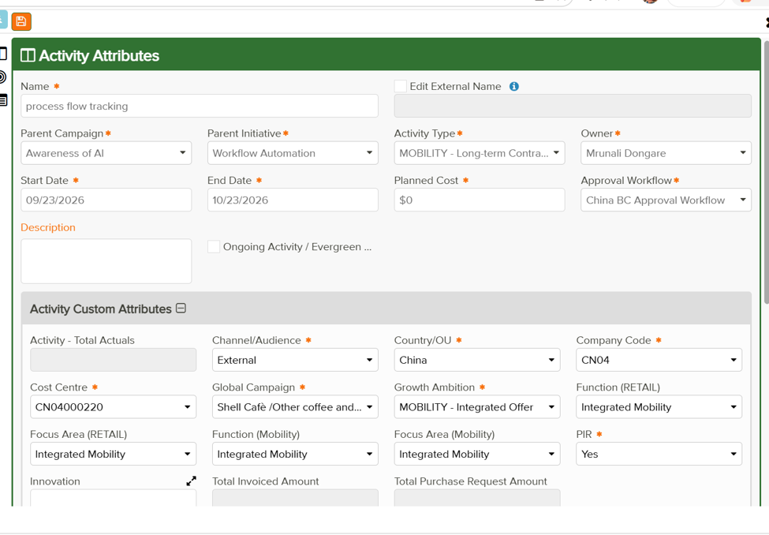

Once Activity was saved, Line item was enabled

Step 5: Line Item

Pre-requisite - Link to finance Budget - Budget Year, Link Budget Item (Required)

|  |  |  | Mandatory field | Feature of Dropdown | Pre-Calculated fields | Text / Decimal field | Option of Multi-Selection |
|---|---|---|---|---|---|---|---|
| Attribute | Name |  | Y |  |  | T+ D |  |
| Attribute | Local Currency |  | N | Drop down |  |  | N |
| Attribute | Planned Cost in Local Currency |  | N |  |  | T+ D |  |
| Attribute | Planned Cost inPreferred Currency |  | Y (greyed) |  |  | D |  |
| Attribute | Owner |  | Y | Drop down |  | T | N |
| Attribute | Description |  |  |  |  |  |  |
| Attribute | Line Item Custom Attributes | Total Actuals | N (greyed) |  |  |  |  |
| Attribute |  | % of actual cost | N (greyed) |  |  |  |  |
| Attribute |  | Actuals @Hive9 Monthly FX (Create SWBS Code - Purpose) | N (greyed) |  |  |  |  |
| Attribute |  | Contracted Amount | N |  |  | D |  |
| Attribute |  | Contracted Spend | N | Drop down |  | T | N |
| Attribute |  | Create SWBS Code | N | Tick box |  | NA |  |
| Attribute |  | Spend Category |  | Drop down |  | T | N |
| Attribute |  | Spend Type | Y | Drop down |  |  |  |
| Attribute |  | SWBS Code | N (greyed) |  |  |  |  |
| Attribute |  | Total Invoiced Amount | N (greyed) |  |  |  |  |
| Attribute |  | Total Purchase Request Amount | N (greyed) |  |  |  |  |
| Link to Finance Budget |  | Budget Year | Y | Drop down |  | D | N |
| Link to Finance Budget |  | Linked Budget Item | Y | Drop down |  | T+ D | N |
| PR& PO |  | Create New Purchase Request | N |  |  |  |  |
| Relate Primary Activities |  | Relate New Primary Activity | N |  |  |  |  |

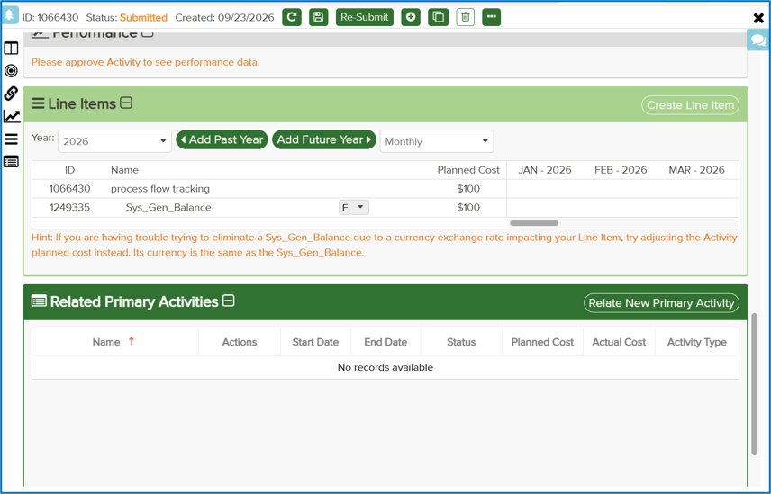

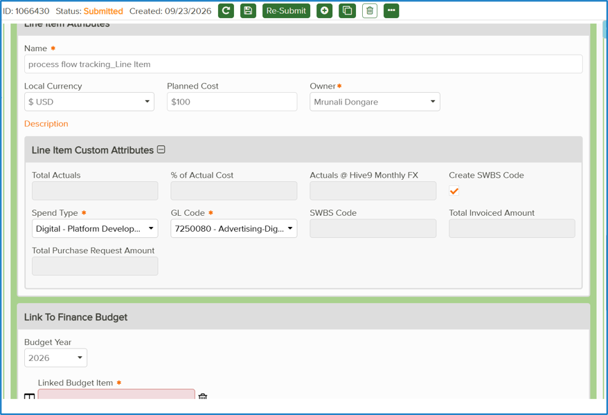

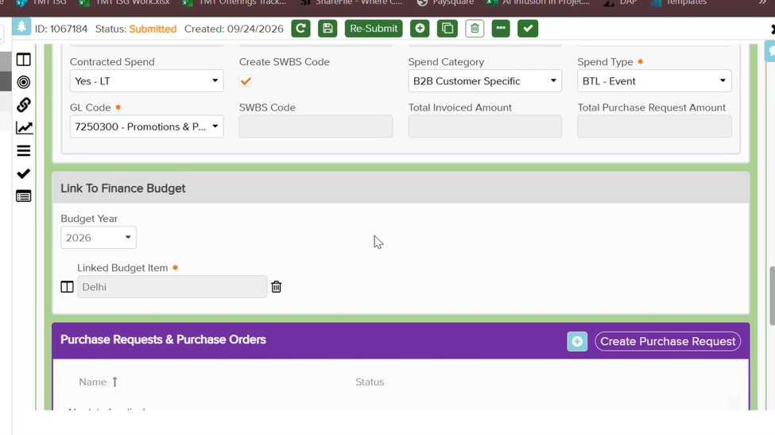

Step 6 - Purchase Request & Purchase Order

|  |  |  | Mandatory field | Feature of Dropdown | Pre-Calculated fields | Text / Decimal field | Option of Multi-Selection |
|---|---|---|---|---|---|---|---|
| Attribute | Name |  | Y |  |  | T + D |  |
| Attribute | Approval Workflow |  | Y | drop down |  | NA | N |
| Attribute | Approval Workflow for modification |  | Y | drop down |  | NA | N |
| Attribute | Owner |  | Y | drop down |  |  | N |
| Attribute | Description |  |  |  |  | T |  |
| Purchase Request Custom Attributes | Material or Service |  | Y | drop down |  | NA | Y |
| Purchase Request Custom Attributes | PR Type |  | Y | drop down |  | NA | Y |
| Purchase Request Custom Attributes | Short Text |  | Y |  |  | T+D |  |
| Purchase Request Custom Attributes | Requestor User ID |  | N |  |  | T+D |  |
| Purchase Request Custom Attributes | Behalf of Requestor |  | N |  |  | T+D |  |
| Purchase Request Custom Attributes | MoA/Approver Email |  | Y |  |  | T+D |  |
| Purchase Request Custom Attributes | MoA/AApproverID/Alias |  | Y |  |  | T+D |  |
| Purchase Request Custom Attributes | Invoice Approver Name in |  | Y |  |  | T+D |  |
| Purchase Request Custom Attributes | Vendor |  | Y |  |  | T+D |  |
| Purchase Request Custom Attributes | Vendor Contact Name |  | N |  |  | T+D |  |
| Purchase Request Custom Attributes | Vendor Email Address |  | N |  |  | T+D |  |
| Purchase Request Custom Attributes | Vendor Address |  | N |  |  | T+D |  |
| Purchase Request Custom Attributes | Vendor Code |  | N |  |  | T+D |  |
| Purchase Request Custom Attributes | Contact Holder |  | N |  |  | T+D |  |
| Purchase Request Custom Attributes | Outline Agreement |  | N |  |  | T+D |  |
| Purchase Request Custom Attributes | CP Lead |  | N |  |  | T+D |  |
| Purchase Request Custom Attributes | GSAP PR Number |  | N (greyed) |  |  |  |  |
| Purchase Request Custom Attributes | GSAP PR Date |  | N (greyed) |  |  |  |  |
| Purchase Request Custom Attributes | Supporting Documents |  | N (greyed) |  |  |  |  |
| Purchase Request Custom Attributes | Total Purchase Request Amount |  | N (greyed) |  |  |  |  |
| Purchase Request Custom Attributes | Total Inoviced Amount |  | N (greyed) |  |  |  |  |
| Purchase Request Custom Attributes | OA Vendor (China specific) |  | Y | drop down |  | NA | Y |
| Purchase Request Custom Attributes | Sub Category (Chine specific) |  | Y | drop down |  | NA | Y |
| Purchase Request Custom Attributes | Cost Center |  | N (greyed) |  |  |  |  |
| Purchase Request Lines | Line Item |  | N (greyed) |  | Y |  |  |
| Purchase Request Lines | Purchase Request Line Item ID |  | N (greyed) |  | Y |  |  |
| Purchase Request Lines | Local Currency |  | Y | drop down |  | NA | N |
| Purchase Request Lines | PR Line Amount |  | Y |  |  | D | N |
| Purchase Request Lines | Delivery Date |  | Y | selection from calendar/ type date |  |  |  |
| Purchase Request Lines | PO Number |  | N (greyed) |  |  |  |  |
| Purchase Request Lines | PO Line Number |  | N (greyed) |  |  |  |  |
| Purchase Request Lines | PO Line Status |  | N (greyed) |  |  |  |  |
| Purchase Request Lines | Sent Date |  | N (greyed) |  |  |  |  |
| Purchase Request Lines | Description |  | N |  |  | T+D |  |
| Purchase Request Line Custom Attributes | PO Date |  | N (greyed) |  |  |  |  |
| Purchase Request Line Custom Attributes | Material Group |  | N |  |  | T+D |  |
| Purchase Request Line Custom Attributes | Overall Limit in Local Currency |  | Y |  |  | D |  |
| Purchase Request Line Custom Attributes | Total Item Value |  | N (greyed) |  |  |  |  |
| Purchase Request Line Custom Attributes | Remarks/Comments |  | N |  |  | T+D |  |
| Purchase Request Line Custom Attributes | Material/Service Code |  | N |  |  | T+D |  |
| Purchase Request Line Custom Attributes | Total Invoiced Amount |  | N (greyed) |  |  |  |  |
| Purchase Request Line Custom Attributes | Actuals |  | N (greyed) |  |  |  |  |
| Purchase Request Line Custom Attributes | SWBS Code |  | Y (greyed) |  |  |  |  |

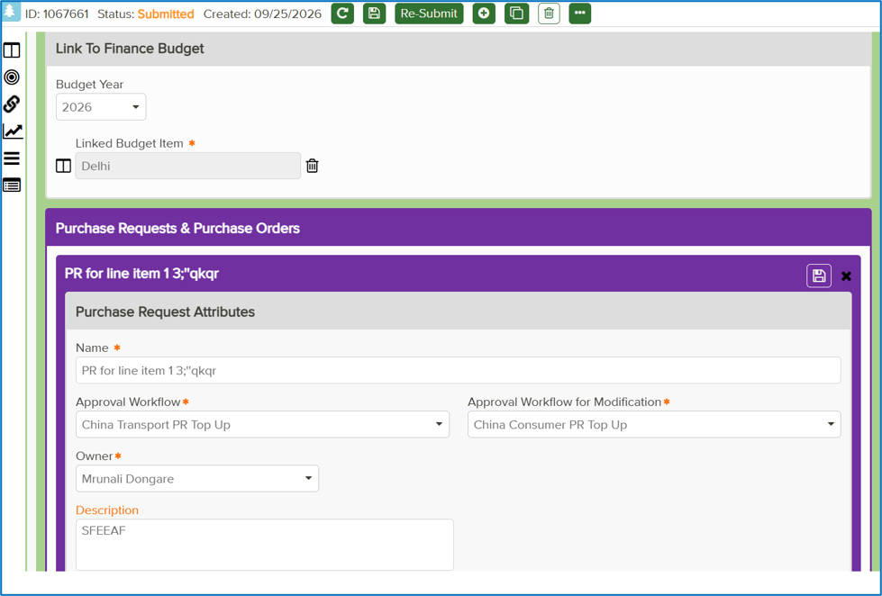

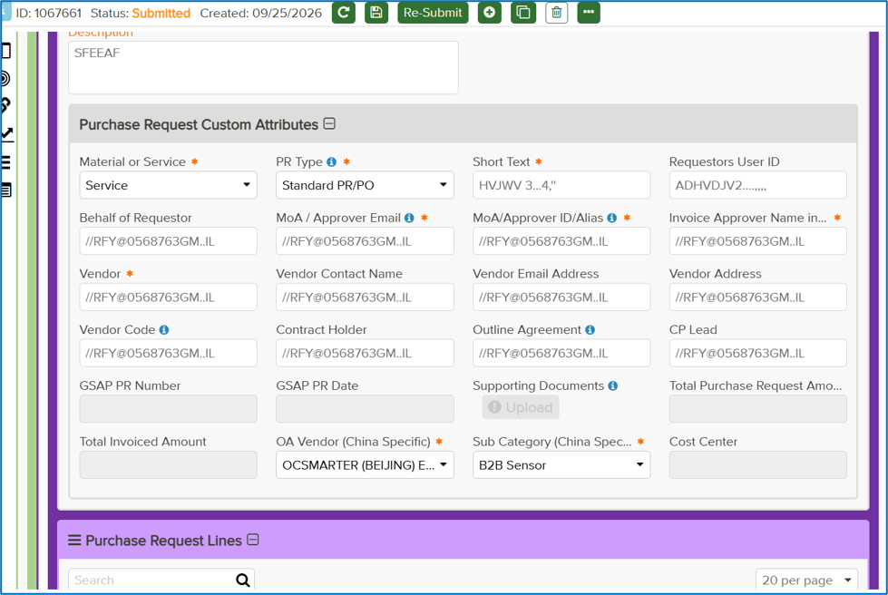

Pre-requisite - Select one of the line items

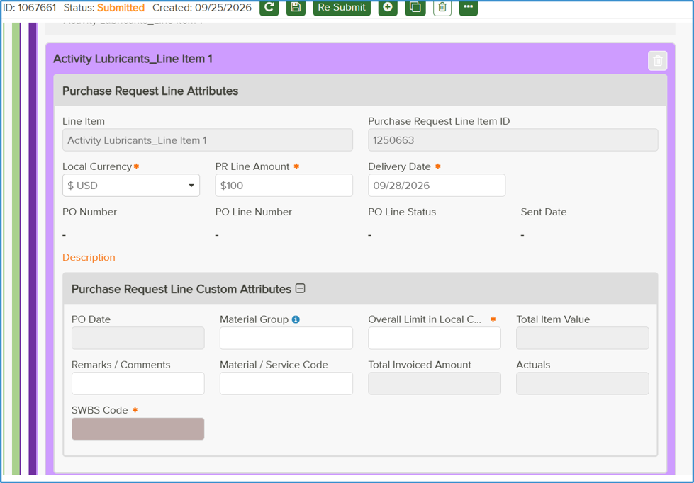
