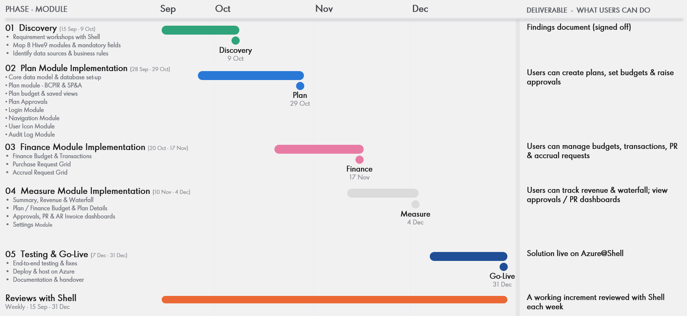

Hive9 Replacement Project Plan

Project Objective and Scope

Project Objective:

Shell uses Hive9 (Uptempo) platform for marketing planning, budgeting, approvals, procurement requests, reporting and analytics. Shell intends to replace it with a new purpose-built platform that needs to be built and delivered as a project.

Target Users/Personas:

> Role
> Marketer
> Business Champion
> Marketing Team Leader
> SOM Role
> Commenter
> Client Admin
> Local Finance Manager
> Provisioning Team
> Local Finance Marketing Advisor / BA
> Mkg. Admin support
> Superuser
> VP/GM
> SOM Admin
> GM View
> Contract Holder (non MKT)
> VP/GM 2
> System Admin
> Global FINOPS
> TA

In-scope Features:

Login Page

- Username
- Password

Workspace Controls

- Recycle Bin
- Filter Panel
- Control Panel
- Search
- Import
- Export
- Honeycomb (bulk action)
- View - Grid, calendar, budget
- Alerts and Notifications
- Heads-up Display configuration

Plan

- Plan View, BCPRI Plan, Business Unit, Strategic Marketing Plan, Owner
- Campaign - Cluster, Insight Session Completed, Region, Workshop Completed, Global GM Signoff Completed, Owner
- Initiative (same as programs) - Growth Ambition, Function, Focus Area, FIT4 Initiative, Owner
- Activity - Date Sets, Owner, Activity Type, Status
- Line Item - Contracted Spend, GL Code, Spend Category, Spend Type, Owner
- Show Hierarchies

Finance

- Finance Budget - Standalone window with filters to create personalized dashboard
- Transactions - Standalone window with filters to create personalized dashboard
- Purchase Request (PR) Grid
- Purchase Request - PR Type, Email Group, PR Recipients, OA Vendor, Sub-Category, Outline Agreement, Contract Holder, Owner, Status
- Purchase Request Line Item
- Accrual Request (AR) Grid
- Accrual Request - Country, Recipient, Mobility/Lubes, Owner, Status
- Accrual Request Line Item

Measure

- Summary - Same as Attributes of Plan
- Revenue - Same as Attributes of Plan
- Waterfall - Same as Attributes of Plan
- Plan Budget - Same as Attributes of Plan
- Finance Budget - Standalone
- Approvals Dashboard - Same as Attributes of Plan
- PR Dashboard - Same as Purchase Request Grid
- AR Invoice Details - Same as Accrual Request Grid
- Plan Details - Standalone window with filters to create personalized dashboard
- User Details
- Custom Attributes Tactic
- Custom Attributes Program
- User Detail Report
- China Budget Reports - Standalone window with filters to create personalized dashboard
- Activity Summary
- PO Report

Audit Log

- Finance Log - Standalone window with filters to create personalized dashboard

User Settings

- Notifications
- Alerts
- Templates
- Report Sharing
- Shared Filters
- Change Password

My Account Settings

- Users
- Roles
- Teams
- Currency
- Theme
- Approval Workflows
- Approvals - Standalone window with filters to create personalized dashboard

User Icon

- Release Notes
- Support
- Guide
- Sign Out

Out-of-scope Items:

<To be updated by BAs based on findings from user sessions>

Key Assumptions:

- Data linkages across Hive9 modules are based on inputs provided by Shell and may change based on insights gathered during discovery-phase user sessions.
- An actual production data dump from Hive9 must be extracted and made available to ensure that the new Hive9 build replicates the functionality and behavior of the existing system. Failure to provide the required production data may result in gaps between the new solution and client expectations.
- Integration and linkage with external systems, such as GSAP and any other applicable systems, will be implemented solely based on the information and understanding provided by Shell.
- Features identified as unused during discovery-phase user sessions will not be prioritized for development
- Workflow simplifications to enhance usability will be incorporated into development.
- Hive9 has 19 existing user roles. Roles with similar or overlapping permissions may be consolidated.

Requirements & Backlog

Requirements from Shell:

<Link(s) of artifacts to be updated by BAs once we get requirements from Shell>

Epics, Features, and Product Backlog Items:

Hive9 - Epic, Features & PBIs.xlsx

Delivery Roadmap

Delivery Schedule - Phases, Modules, Milestones, and Tentative Dates:

Sprint/Release Cadence:

<To be updated by PM, BAs, and Developers>

Delivery Team

Business Analyst: Elicits, documents, and prioritizes Shell's requirements into epics, features, and backlog items, and ensures delivered functionality meets the agreed acceptance criteria.

Project Manager: Owns end-to-end delivery of the project scope, schedule, budget, risks, and stakeholder communication, ensuring milestones are met and escalations are resolved on time.

System Architect: Defines the solution architecture, technology stack, integrations, and non-functional standards (security, scalability, performance) and ensures the build adheres to them with a proper review mechanism.

Full-Stack Developers: Design, build, unit-test, and maintain the front-end, back-end, and API components of the platform in line with the approved architecture and backlog priorities.

DevOps/Cloud: Provisions and manages cloud environments, CI/CD pipelines, monitoring, and release automation to enable reliable, secure deployments from Dev through Production.

Business SMEs/Stakeholders: Provide domain expertise on marketing planning, budgeting, and procurement processes, validate requirements, make timely decisions, and sign off on UAT and go-live.

Stakeholder Matrix

<To be updated by Zensar and Shell PMs>

Architecture & Technology

HLD, Architecture, Technology Stack, Integrations/APIs, Environments, Data Considerations:

<Link(s) of artifacts to be updated by System Architect and Developers>

Development and QA

Development Approach, Branching/Versioning, Code Reviews:

<To be updated by System Architect and Developers>

Multi-Tenancy, Authentication/Authorization, RBAC, Scalability, Availability, Monitoring, Logging, Backup/Recovery:

<To be updated by System Architect and Developers>

Test Strategy (Test Plan, Test Scripts from Requirements) and Test Execution for Functional and Non-Functional (Security and Performance) Testing, Defect Management, Automation:

<To be updated by System Architect and Developers>

Deployment and Release Readiness

Dev to QA to UAT to Production Flow, CI/CD, Release Criteria, Rollback Plan, Production Go-Live Readiness Checklist:

<To be updated by System Architect and Developers>

Change Management, User Migrations and Education, Data Migration:

<To be updated by System Architect and Developers>

Stakeholder Governance

| Forum | Frequency | Participants | Purpose |
|---|---|---|---|
| Zensar Sync Up | Daily | Zensar | Progress, Status Updates, Blockers, Risks, Issues, Dependencies |
| Zensar-Shell Sync Up | Daily | Zensar, Shell | Progress, Status Updates, Blockers, Risks, Issues, Dependencies |
| Weekly Status | Every Friday | Zensar, Shell | Progress, Status Updates, Blockers, Risks, Issues, Dependencies |
| Weekly Status Report to be shared with Shell Stakeholders |  |  |  |

Risks, Dependencies, and Issues

| Risk/Dependency/Issue | Description | Mitigation Action(s), Owner(s) & Updates | Raised on Date | Aging (Days) | ETA | Impact | Impact on Timelines |
|---|---|---|---|---|---|---|---|
| This will be tracked as a part of Weekly Status Report to be shared with Shell Stakeholders |  |  |  |  |  |  |  |
